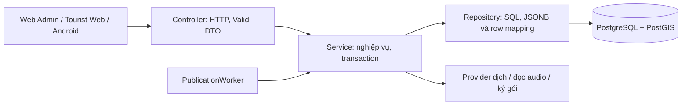
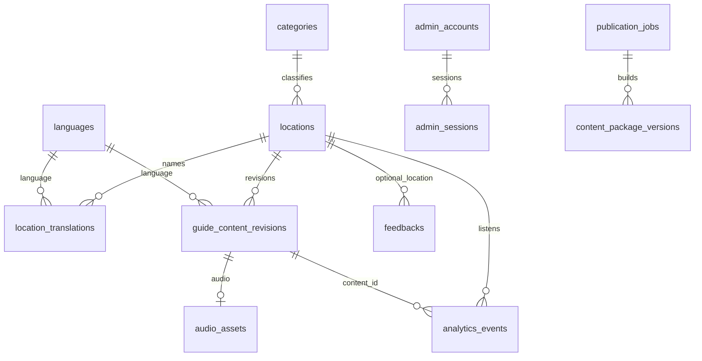

# Backend — kiến trúc và vận hành

Cập nhật 25/10/2026. Yêu cầu: [PRD EN](../en/PRD_Report.md), [PRD VI](../vi/PRD_Report_vi.md), quyết định EDITOR/REVIEWER tại UC-06. Hợp đồng HTTP chỉ định nghĩa tại [API_list.md](API_list.md).

## Kiến trúc



Giữ JDBC để kiểm soát truy vấn PostGIS, snapshot, JSONB và khóa PostgreSQL rõ ràng. Không có JPA/Hibernate; không dựng Service Interface/Impl. Ngoại lệ có chủ đích là TranslationProvider để thay nhà cung cấp. Controller nhận/validate cú pháp rồi trả DTO; Service kiểm nghiệp vụ và điều phối; SQL và ánh xạ hàng nằm trong Repository. Map tên/ngôn ngữ và map asset có kiểu giá trị cụ thể, không phải response Map<String,Object>.

## Package và class quan trọng

| Nhóm/class | Trách nhiệm và phương thức chính |
|---|---|
| [LocationController.java](../../backend/multi-audio-guide/src/main/java/com/application/controller/LocationController.java) | search/detail/categories chuyển vào LocationDiscoveryService; không truy vấn SQL. |
| [LocationDiscoveryService.java](../../backend/multi-audio-guide/src/main/java/com/application/service/LocationDiscoveryService.java) | search kiểm keyword/category/page/size, lấy count và trang; detail chỉ trả địa điểm công khai. |
| [LocationRepository.java](../../backend/multi-audio-guide/src/main/java/com/application/repository/LocationRepository.java) | search/count/findPublicById; truy vấn PostGIS, tên đa ngôn ngữ batch trong câu SELECT. |
| [CategoryRepository.java](../../backend/multi-audio-guide/src/main/java/com/application/repository/CategoryRepository.java), [DiscoveryMapper.java](../../backend/multi-audio-guide/src/main/java/com/application/mapper/DiscoveryMapper.java) | Danh mục đang hoạt động và đổi model sang DTO công khai, gồm names. |
| [GuideController.java](../../backend/multi-audio-guide/src/main/java/com/application/controller/GuideController.java), [PlaybackService.java](../../backend/multi-audio-guide/src/main/java/com/application/service/PlaybackService.java) | guide giữ FULL/SHORT khi fallback Selected → EN → VI; record chống đếm trùng eventId; analytics tổng hợp theo kỳ. |
| [GuideRepository.java](../../backend/multi-audio-guide/src/main/java/com/application/repository/GuideRepository.java) | find chọn is_current + revision mới nhất; findPublicById vẫn nhận revision APPROVED cũ để đồng bộ lượt nghe offline. |
| [PlaybackRepository.java](../../backend/multi-audio-guide/src/main/java/com/application/repository/PlaybackRepository.java) | INSERT analytics_events ON CONFLICT; thống kê theo locationId và language. content_id là định danh revision đã phát. |
| [AdminContentService.java](../../backend/multi-audio-guide/src/main/java/com/application/service/AdminContentService.java) | config/list/detail/save/upload/audio: nháp thiếu được, gửi duyệt kiểm trường bắt buộc, kiểm asset/audio, optimistic concurrency. |
| [AdminContentRepository.java](../../backend/multi-audio-guide/src/main/java/com/application/repository/AdminContentRepository.java) | Workspace JSONB và audio BYTEA; list không N+1: 2 SELECT cho danh sách không rỗng, 1 SELECT nếu rỗng. |
| [ReviewService.java](../../backend/multi-audio-guide/src/main/java/com/application/service/ReviewService.java) | queue/approve/reject/jobs/retry; quyết định yêu cầu đúng editVersion và PENDING_REVIEW. Duyệt yêu cầu ít nhất một kịch bản; từ chối phải có nhận xét. |
| [PublicationService.java](../../backend/multi-audio-guide/src/main/java/com/application/service/PublicationService.java) | publish: khóa toàn cục theo transaction, promote dữ liệu, build cả hai scope, xác minh checksum/chữ ký, đánh READY và PUBLISHED cùng commit. |
| [PublicationRepository.java](../../backend/multi-audio-guide/src/main/java/com/application/repository/PublicationRepository.java) | Durable jobs, promote POI/names/revisions/audio; đọc manifest và bytes đã lưu, lưu lỗi và thử lại. |
| [PublicationWorker.java](../../backend/multi-audio-guide/src/main/java/com/application/component/PublicationWorker.java) | Mỗi 3 giây đọc tối đa 10 BUILDING jobs; gọi service có transaction. Sau rollback mới ghi FAILED bên ngoài transaction lỗi. |
| [PackageBootstrap.java](../../backend/multi-audio-guide/src/main/java/com/application/config/PackageBootstrap.java) | Lần chạy demo đầu enqueue snapshot có sẵn nếu chưa có manifest và chưa có job; GET manifest không tự dựng gói. |
| [ContentPackageService.java](../../backend/multi-audio-guide/src/main/java/com/application/service/ContentPackageService.java), [ContentPackageRepository.java](../../backend/multi-audio-guide/src/main/java/com/application/repository/ContentPackageRepository.java) | build từ public APPROVED/is_current; manifests/download đọc version lưu DB. Package chia BASE/OPTIONAL theo category demo cố định trong repository. |
| [PackageSigner.java](../../backend/multi-audio-guide/src/main/java/com/application/component/PackageSigner.java), [SigningKeyRepository.java](../../backend/multi-audio-guide/src/main/java/com/application/repository/SigningKeyRepository.java) | SHA-256, RSA SHA256withRSA; khóa được tạo một lần rồi lưu DB để dùng qua restart. Khóa demo chưa tích hợp KMS. |
| [AudioFileReader.java](../../backend/multi-audio-guide/src/main/java/com/application/component/AudioFileReader.java) | Chỉ đọc audio classpath allowlist hoặc admin upload trong DB; không tải URL tùy ý. |
| [TranslationService.java](../../backend/multi-audio-guide/src/main/java/com/application/service/TranslationService.java) | translate kiểm ngôn ngữ đang hoạt động, trả kết quả mà không ghi đè workspace. Lỗi provider → 502; không tự chuyển sang provider giả lập. |
| [TranslationProvider.java](../../backend/multi-audio-guide/src/main/java/com/application/component/TranslationProvider.java), [DemoTranslationProvider.java](../../backend/multi-audio-guide/src/main/java/com/application/component/DemoTranslationProvider.java), [LibreTranslationProvider.java](../../backend/multi-audio-guide/src/main/java/com/application/component/LibreTranslationProvider.java) | Demo gắn tiền tố [DEMO ngôn-ngữ], không phải dịch thật. LibreTranslate gọi server được cấu hình; connect timeout 3s, mỗi request 5s; không tạo audio. |
| [AdminAuthService.java](../../backend/multi-audio-guide/src/main/java/com/application/service/AdminAuthService.java), [AdminAuthRepository.java](../../backend/multi-audio-guide/src/main/java/com/application/repository/AdminAuthRepository.java) | BCrypt; login phát token ngẫu nhiên 32 byte, DB chỉ lưu SHA-256 token; phiên 8 giờ; logout thu hồi. |
| [DemoAdminFilter.java](../../backend/multi-audio-guide/src/main/java/com/application/config/DemoAdminFilter.java), [AdminAuthController.java](../../backend/multi-audio-guide/src/main/java/com/application/controller/AdminAuthController.java) | Mọi API admin trừ POST login yêu cầu bearer; kiểm vai trò từ DB trên từng request. Tên filter là tên kế thừa, không còn kiểm Basic Auth. |
| [FeedbackService.java](../../backend/multi-audio-guide/src/main/java/com/application/service/FeedbackService.java), [FeedbackRepository.java](../../backend/multi-audio-guide/src/main/java/com/application/repository/FeedbackRepository.java) | search/export/detail/advance; lọc kỳ/category/status, phân trang, chuyển NEW → IN_REVIEW → RESOLVED, không mở lại. |
| [ApiExceptionHandler.java](../../backend/multi-audio-guide/src/main/java/com/application/controller/ApiExceptionHandler.java) | ProblemDetail cho lỗi validation, kiểu dữ liệu, nghiệp vụ và database; không trả SQL hoặc secret cho client. |

## Luồng chính

| Luồng | Controller → Service → Repository |
|---|---|
| Tìm kiếm/chi tiết POI | LocationController → LocationDiscoveryService → LocationRepository, CategoryRepository |
| Lấy thuyết minh | GuideController → PlaybackService → GuideRepository |
| Ghi lượt nghe/thống kê | DemoPlaybackController → PlaybackService → GuideRepository, PlaybackRepository |
| Biên tập/upload | AdminContentController → AdminContentService → AdminContentRepository |
| Duyệt/từ chối | ReviewController → ReviewService → PublicationRepository, AdminContentService |
| Xuất bản/tạo gói | PublicationWorker → PublicationService → PublicationRepository; ContentPackageService → ContentPackageRepository; PackageSigner/AudioFileReader |
| Dịch | TranslationController → TranslationService → TranslationProvider; AdminContentRepository kiểm ngôn ngữ |
| Polling/tải | ContentPackageController → ContentPackageService → PublicationRepository |
| Phản hồi | FeedbackController → FeedbackService → FeedbackRepository |

Ví dụ: EDITOR lưu một POI mới chỉ tạo workspace. REVIEWER chấp thuận tăng editVersion và enqueue snapshot bất biến với APPROVED. Worker promote snapshot trong transaction, tạo revision UUID mới, giữ locationId, chọn is_current mới, ký và tự kiểm gói. Chỉ sau commit public API mới thấy POI và manifest mới. Nếu lỗi audio, toàn bộ promote/READY rollback; job và placeholder chuyển FAILED, gói READY cũ không đổi. Sau restart job BUILDING được đọc lại; khóa advisory tự giải phóng khi connection chết. Không cần Kafka/Redis.

Workspace DRAFT → PENDING_REVIEW → APPROVED/REJECTED; REJECTED sửa/gửi lại; APPROVED → PUBLISHED sau gói READY. Public tables và wire payload vẫn dùng APPROVED để tương thích client cũ. EDITOR không được sửa workspace APPROVED đang chờ tác vụ; có thể sửa PUBLISHED thành nháp kế tiếp. Payload JSONB lưu fieldOrigins, names và assets; API không để EDITOR tự gán nhận xét reviewer.

Version gói là scope + SHA-256 bytes. Bytes/manifest của version đã lưu được giữ để tải lại; GET không đọc lại audio/dựng lại gói. Manifest dùng ETag chứa các version mới nhất; 304 không có body. Mỗi gói có names theo ngôn ngữ, guides, danh sách audio và geofencing nếu đủ dữ liệu khảo sát. Audio tải riêng được checksum trước cài đặt.

## Mô hình dữ liệu thực tế



admin_content_drafts.location_id chưa là FK vì cho tạo POI trước khi public locations tồn tại. publication_jobs lưu payload snapshot, location_id và edit_version; package_signing_keys là singleton. content_package_versions lưu trạng thái, checksum, signature, size_bytes, manifest JSONB, payload BYTEA, ready_at/error_log. Hai bảng content_packages/content_package_items cũ vẫn tồn tại nhưng luồng phiên bản mới dùng content_package_versions. admin_audio_uploads giữ bytes upload; audio_assets trỏ tới URL nội bộ và revision. Giữ revision cũ giúp lượt nghe liên kết locationId + content_id/revision_no dù đổi tên/dịch lại.

## Xác thực và cấu hình

| Biến | Ý nghĩa |
|---|---|
| SPRING_PROFILES_ACTIVE=demo | Bật các chức năng admin, gói và playback hiện còn nằm trong profile demo; đồng thời nạp fixture demo. Không dùng profile này trên DB production. |
| SPRING_DATASOURCE_URL/USERNAME/PASSWORD | JDBC PostgreSQL/PostGIS; Compose truyền POSTGRES_PASSWORD vào datasource. |
| DEMO_EDITOR_PASSWORD / DEMO_REVIEWER_PASSWORD | Mật khẩu seed lần đầu. Mặc định demo: editor / EditorDemo!2026 và reviewer / ReviewerDemo!2026. ON CONFLICT không reset mật khẩu có sẵn. |
| TRANSLATION_PROVIDER | demo (mặc định) hoặc libretranslate. Không cấu hình bằng tên khác. |
| TRANSLATION_URL / TRANSLATION_API_KEY | Endpoint /translate của LibreTranslate do người vận hành chọn và API key tùy server; không commit key. |
| publication.poll-ms | Property Spring, mặc định 3000ms cho worker. Không phải chu kỳ polling client. |
| TEST_DATABASE_URL/USERNAME/PASSWORD | DB riêng cho integration test; không trỏ DB đang demo. |

EDITOR được đọc nội dung/cấu hình/audio preview, ghi biên tập/upload/dịch; REVIEWER được đọc nội dung và duyệt/jobs/retry, không ghi biên tập. Cả hai đọc thống kê và quản lý phản hồi. Client du khách chỉ truy cập public API. Session trong browser chỉ ở bộ nhớ tab; reload phải đăng nhập lại. Các biến DEMO_ADMIN_USERNAME/PASSWORD cũ không còn cấp quyền Basic.

## Migration, chạy và test

[db/migration](../../backend/multi-audio-guide/src/main/resources/db/migration) chứa schema chung, gồm V5 tên POI/phản hồi. [db/demo](../../backend/multi-audio-guide/src/main/resources/db/demo) chứa fixture/workspace, V6 tài khoản/jobs/versions/khóa ký, V7 is_current. Profile demo nạp cả hai đường dẫn và bật out-of-order vì lịch sử version chung/fixture; không sửa migration đã áp dụng trên môi trường dùng chung. Flyway chạy khi khởi động; không sửa tay DB.

```powershell
# Từ gốc repo, Docker Desktop phải chạy Linux engine
.\scripts\start-live-demo.ps1
# Backend local: đặt datasource vào biến môi trường của terminal trước
cd backend/multi-audio-guide
$env:SPRING_PROFILES_ACTIVE='demo'
.\mvnw.cmd spring-boot:run
# Trong terminal kiểm thử riêng, đặt TEST_DATABASE_* trỏ DB disposable
.\mvnw.cmd clean verify
```

[PublicationIntegrationTest.java](../../backend/multi-audio-guide/src/test/java/com/application/PublicationIntegrationTest.java) kiểm chuỗi nháp/dịch/duyệt/manifest/tải/xác minh và rollback khi audio lỗi. Service tests dùng repository mock. Các kiểm thử DB tự skip nếu thiếu TEST_DATABASE_URL; phải báo số skip thay vì nhận tất cả đã kiểm. Trên máy Windows đã gặp lỗi Unix-domain pipe: có thể đặt JVM property jdk.net.unixdomain.tmpdir tới một thư mục không tồn tại để JVM dùng TCP pipe dự phòng; không tạo thư mục đó. Mockito tự attach bị treo thì dùng javaagent Mockito cùng phiên bản dependency; đường dẫn có khoảng trắng phải quote đúng.

## Ảnh POI và TTS trong Admin

Migration V8__location_images.sql thêm location_image_uploads và locations.image_url. LocationImageController → LocationImageService → LocationImageRepository xử lý upload/preview/public, chỉ nhận JPEG/PNG với giới hạn byte/dimensions, re-encode PNG loại metadata. AdminContentService xác nhận ảnh thuộc location; PublicationRepository.promote công bố image_url cùng transaction dữ liệu/gói. Ảnh nháp chỉ preview có auth, ảnh công khai phải đang được locations APPROVED tham chiếu. Payload gói có imageUrl nhưng chưa đóng byte ảnh để dùng offline. Không có pipeline sinh MP3: TTS vẫn chạy tại client; upload audio là tùy chọn.
