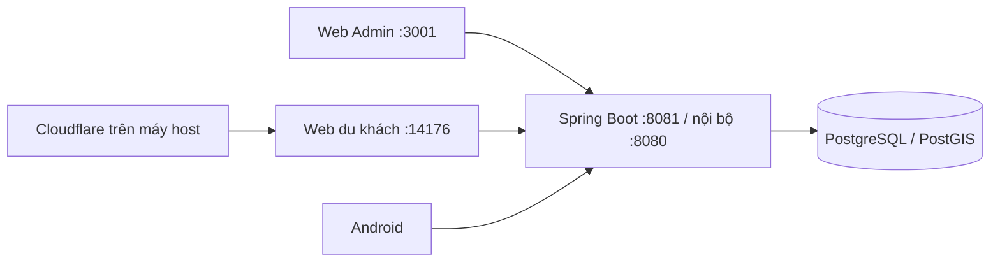

# Chạy toàn bộ hệ thống bằng Docker Compose

[compose.yaml](../../compose.yaml) là cấu hình local/demo chung. Một project `hvp-live-demo` gồm bốn container, khởi động bằng một lệnh. Android chạy trên điện thoại/emulator và gọi backend này; APK được phân phối từ Web du khách.



## Khởi động

Mở Docker Desktop ở chế độ Linux containers. Từ gốc repo:

```powershell
.\scripts\start-live-demo.ps1
```

Script tạo `.env.demo.local` với mật khẩu ngẫu nhiên nếu chưa có; nếu đã có thì giữ nguyên. Khi muốn cung cấp APK qua QR, chạy [prepare-android-download.ps1](../../scripts/prepare-android-download.ps1) trước khi build Web; yêu cầu Java/Android SDK. Không tự build Android trong mỗi lần khởi động Docker.

Lệnh Compose tương đương khi đã có `.env.demo.local`:

```powershell
docker compose --env-file .env.demo.local up -d --build --wait
docker compose --env-file .env.demo.local ps
```

| Thành phần | Địa chỉ mặc định | Biến đổi cổng |
|---|---|---|
| Web Admin | http://localhost:3001 | `WEB_PORT` |
| Backend | http://localhost:8081 | `BACKEND_PORT` |
| Web du khách | http://127.0.0.1:14176 | `TOURIST_WEB_PORT` |
| PostgreSQL | Chỉ trong mạng Compose, `postgres:5432` | Không mở cổng host |

Mọi service khởi động mặc định, không cần profile `tourist-web`. Backend và Admin bind localhost nếu không override; `start-live-demo.ps1 -Lan` mở hai cổng này trên LAN cho demo tin cậy. Script in cổng thực tế sau khi khởi động. Android emulator dùng `http://10.0.2.2:8081/`; điện thoại dùng IP LAN của PC hoặc URL HTTPS của Web du khách. Nginx Admin và gateway du khách cùng proxy về `backend:8080` trong mạng Compose.

## Cloudflare và QR

```powershell
.\scripts\share-docker-web.ps1
```

Tunnel chạy trên host, mặc định trỏ `127.0.0.1:14176`. Nếu tunnel cũ ở cổng này còn chạy thì không cần đổi URL. QR Android tự lấy origin của website; không hard-code tên miền Cloudflare. Khi đổi cổng, gọi `share-docker-web.ps1 -Port <cong-moi>`. Quick Tunnel có thể đổi URL khi khởi động lại; chỉ public gateway du khách.

## Dữ liệu và thao tác hằng ngày

Volume mặc định là `hvp-live-demo_postgres_data`, giữ nội dung, tài khoản, ảnh/audio upload, gói xuất bản và khóa ký trong PostgreSQL. Không đổi project bằng `-p` nếu muốn tiếp tục dùng dữ liệu demo hiện có. Biến mật khẩu PostgreSQL phải khớp DB đã khởi tạo; sửa env không tự đổi mật khẩu của DB cũ.

```powershell
# Xem log
docker compose --env-file .env.demo.local logs --tail 100 backend web-user
# Build lại hai web sau khi sửa UI hoặc chuẩn bị APK mới
docker compose --env-file .env.demo.local up -d --build web-admin web-user
# Dừng, giữ dữ liệu
docker compose --env-file .env.demo.local stop
# Khởi động lại bằng image sẵn có
.\scripts\start-live-demo.ps1 -NoBuild
```

`docker compose down` giữ named volume; **`down -v` xóa DB**. Không chạy lệnh đó để cập nhật giao diện. `.env.demo.local`, APK và backup chỉ lưu local, không commit.

## Cấu hình cũ

Admin phụ `3000`, backend phụ `8080` và container Web du khách `hvp-publication-web-user` không còn cần cho cấu hình này. Overlay `compose.admin-shared.yaml` đã được gỡ. Các volume legacy không bị xóa hay gộp dữ liệu tự động. Nếu còn container cũ chiếm cổng, dừng đúng container đó trước khi khởi động stack chung.

[compose.production.yaml](../../compose.production.yaml) vẫn là cấu hình VPS riêng với Caddy/TLS, không được tự động nạp khi chạy local và không gộp DB production vào demo. Các Dockerfile riêng cho backend và hai web vẫn giữ để build đúng runtime của từng service.
