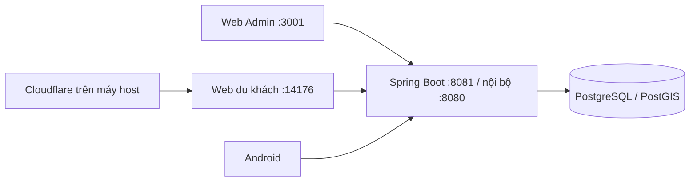

# Chạy toàn bộ hệ thống bằng Docker Compose

[compose.yaml](../../compose.yaml) là cấu hình local/demo chung. Một project `hvp-live-demo` gồm bốn container, khởi động bằng một lệnh. Android chạy trên điện thoại/emulator và gọi backend này; APK được phân phối từ Web du khách.



## Khởi động

Trên Windows, cài [Docker Desktop](https://docs.docker.com/desktop/setup/install/windows-install/) và dùng engine Linux/WSL 2. Chạy `docker version` và `docker compose version`; `docker version` phải có cả Client lẫn Server. Nếu gặp lỗi pipe `dockerDesktopLinuxEngine`, mở Docker Desktop và chờ engine sẵn sàng trước khi chạy Compose. Không đổi mật khẩu hoặc xóa volume để xử lý lỗi daemon chưa chạy.

Mở Docker Desktop ở chế độ Linux containers. Từ gốc repo:

```powershell
.\scripts\start-live-demo.ps1
```

Script tạo `.env.demo.local` với mật khẩu ngẫu nhiên nếu chưa có; nếu đã có thì giữ nguyên. Khi muốn cung cấp APK qua QR, chạy [prepare-android-download.ps1](../../scripts/prepare-android-download.ps1) trước khi build Web; yêu cầu Java/Android SDK. Không tự build Android trong mỗi lần khởi động Docker.

Lệnh Compose tương đương khi đã có `.env.demo.local`:

```powershell
docker compose --env-file .env.demo.local up -d --build --wait
docker compose --env-file .env.demo.local ps
```

| Thành phần | Địa chỉ mặc định | Biến đổi cổng |
|---|---|---|
| Web Admin | http://localhost:3001 | `WEB_PORT` |
| Backend | http://localhost:8081 | `BACKEND_PORT` |
| Web du khách | http://127.0.0.1:14176 | `TOURIST_WEB_PORT` |
| PostgreSQL | Chỉ trong mạng Compose, `postgres:5432` | Không mở cổng host |

Mọi service khởi động mặc định, không cần profile `tourist-web`. Backend và Admin bind localhost nếu không override; `start-live-demo.ps1 -Lan` mở hai cổng này trên LAN cho demo tin cậy. Script in cổng thực tế sau khi khởi động. Android emulator dùng `http://10.0.2.2:8081/`; điện thoại dùng IP LAN của PC hoặc URL HTTPS của Web du khách. Nginx Admin và gateway du khách cùng proxy về `backend:8080` trong mạng Compose.

## Cấu hình từng thành phần

| Service | Image/runtime và cổng | Kết nối/cấu hình chính | Health và lưu trữ |
|---|---|---|---|
| `postgres` | `postgis/postgis:17-3.6-alpine`, cổng nội bộ `5432` | DB `audio_guide`, user `audio_guide`; mật khẩu lấy từ `.env.demo.local`, không đưa lên host | `pg_isready`; volume `postgres_data` giữ dữ liệu |
| `backend` | Spring Boot, container `8080` → host `BACKEND_PORT` (mặc định `8081`) | Profile `demo`; JDBC `postgres:5432/audio_guide`; proxy dịch mặc định `host.docker.internal:5000/translate` | Chỉ khởi động sau khi DB healthy; healthcheck `/actuator/health` |
| `web-admin` | React build tĩnh + Nginx, container `80` → host `WEB_PORT` (mặc định `3001`) | Nginx proxy `/api` và `/demo-audio` tới `backend:8080`; Vite dev `5173` chạy riêng trên host | Healthcheck trang `/`; Admin/Backend bind theo `WEB_BIND_ADDRESS`/`BACKEND_BIND_ADDRESS` |
| `web-user` | React build + Node public gateway, container `4176` → host `TOURIST_WEB_PORT` (mặc định `14176`) | Compose đặt `API_PROXY_TARGET=http://backend:8080`; gateway chỉ chuyển tiếp các API public được cho phép | Phụ thuộc backend healthy; bind host cố định `127.0.0.1` |
| Android | Chạy trên emulator/điện thoại, không phải container | Emulator gọi host qua `10.0.2.2:<BACKEND_PORT>`; thiết bị thật cần IP LAN hoặc HTTPS public URL | Dùng chung API/backend; không kết nối thẳng PostgreSQL |

Với Vite chạy trên host, `.env.demo.local` là cấu hình chung: `API_PROXY_TARGET=http://127.0.0.1:8081`
được ưu tiên hơn `BACKEND_PORT`; nếu thiếu URL thì dùng `127.0.0.1:<BACKEND_PORT>`.
Có thể ghi đè bằng `API_PROXY_TARGET` trong `web-user/.env.local` hoặc `web-admin/.env.local`.
`localhost` trong container không phải host và không phải container backend; vì vậy các container
dùng DNS service `backend`, còn Vite trên host dùng `127.0.0.1`.

Mặc định `.env.demo.local` bind Backend/Admin vào `127.0.0.1`. Tùy chọn
`start-live-demo.ps1 -Lan` đổi hai giá trị này thành `0.0.0.0`, mở Backend/Admin ra các giao
diện mạng của máy; chỉ dùng trên mạng đáng tin cậy. Web du khách chỉ bind `127.0.0.1` trên host.

## Cloudflare và QR

```powershell
.\scripts\share-docker-web.ps1
```

Tunnel chạy trên host, mặc định trỏ `127.0.0.1:14176`. Nếu tunnel cũ ở cổng này còn chạy thì không cần đổi URL. QR Android tự lấy origin của website; không hard-code tên miền Cloudflare. Khi đổi cổng, gọi `share-docker-web.ps1 -Port <cong-moi>`. Quick Tunnel có thể đổi URL khi khởi động lại; chỉ public gateway du khách.

## Dữ liệu và thao tác hằng ngày

Mỗi thành viên có database local riêng; chia sẻ schema bằng migration trong Git. Tạo migration mới trong `backend/multi-audio-guide/src/main/resources/db/migration/` theo mẫu `V<version>__<description>.sql` (hai dấu gạch dưới). Thống nhất số phiên bản trước khi merge, không sửa migration đã áp dụng. Profile demo còn nạp `src/main/resources/db/demo/` và Java migration `src/main/java/db/demo/`; không xóa fixture/migration cũ để dọn dữ liệu vì Flyway vẫn đối chiếu lịch sử. Backup bằng `pg_dump` khác với migration và cần kiểm tra khả năng khôi phục.

Volume mặc định là `hvp-live-demo_postgres_data`, giữ nội dung, tài khoản, ảnh/audio upload, gói xuất bản và khóa ký trong PostgreSQL. Không đổi project bằng `-p` nếu muốn tiếp tục dùng dữ liệu demo hiện có. Biến mật khẩu PostgreSQL phải khớp DB đã khởi tạo; sửa env không tự đổi mật khẩu của DB cũ.

```powershell
# Xem log
docker compose --env-file .env.demo.local logs --tail 100 backend web-user
# Build lại hai web sau khi sửa UI hoặc chuẩn bị APK mới
docker compose --env-file .env.demo.local up -d --build web-admin web-user
# Dừng, giữ dữ liệu
docker compose --env-file .env.demo.local stop
# Khởi động lại bằng image sẵn có
.\scripts\start-live-demo.ps1 -NoBuild
```

`docker compose down` giữ named volume; **`down -v` xóa DB**. Không chạy lệnh đó để cập nhật giao diện. `.env.demo.local`, APK và backup chỉ lưu local, không commit.

Khi cần thử nhập nội dung từ đầu, sao lưu `audio_guide` bằng `pg_dump -Fc` trước, dừng backend trong lúc dọn các bảng nội dung/gói/thống kê và giữ tài khoản, danh mục, ngôn ngữ, khóa ký cùng Flyway history. Bản sao lưu của lần reset gần nhất được ghi ở `.local-tools/last-content-reset-backup.txt` (chỉ local; có dữ liệu nhạy cảm, không chia sẻ hoặc commit). Giữ Flyway history để dữ liệu mẫu không được seed lại khi khởi động. Gói `BASE`/`OPTIONAL` rỗng vẫn có checksum/chữ ký hợp lệ, cho phép thay gói cũ trên thiết bị và xuất bản khi mới có nội dung ở một nhóm.

Xóa dữ liệu server không tự xóa gói đã tải trong trình duyệt/Android. Để kiểm tra sạch, mở Web User trong cửa sổ riêng tư, hoặc cập nhật cả hai gói từ trang Ngoại tuyến; Android cũng cần cập nhật gói khi đang có mạng. Thêm địa điểm và upload ảnh ở Admin, chờ ảnh tải xong, lưu/gửi duyệt rồi duyệt và xuất bản; ảnh nháp không được public API phục vụ trước xuất bản.

## Cấu hình cũ

Admin phụ `3000`, backend phụ `8080` và container Web du khách `hvp-publication-web-user` không còn cần cho cấu hình này. Overlay `compose.admin-shared.yaml` đã được gỡ. Các volume legacy không bị xóa hay gộp dữ liệu tự động. Nếu còn container cũ chiếm cổng, dừng đúng container đó trước khi khởi động stack chung.

[compose.production.yaml](../../compose.production.yaml) vẫn là cấu hình VPS riêng với Caddy/TLS, không được tự động nạp khi chạy local và không gộp DB production vào demo. Các Dockerfile riêng cho backend và hai web vẫn giữ để build đúng runtime của từng service.
