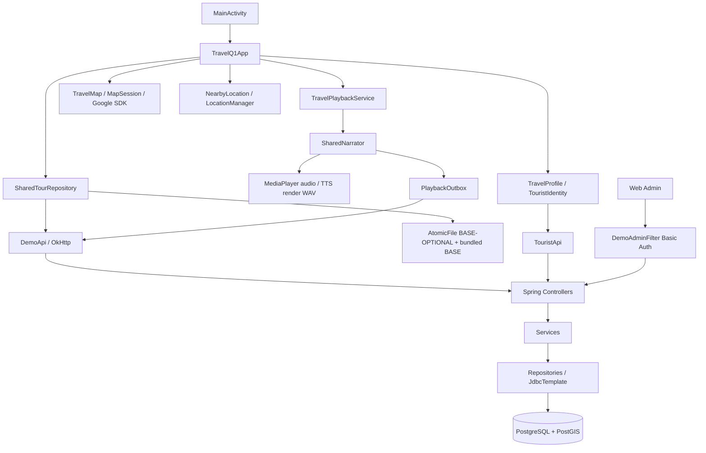
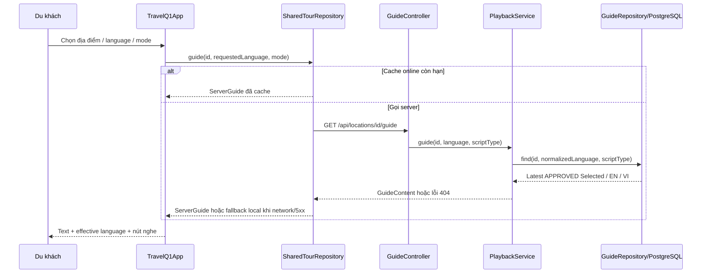
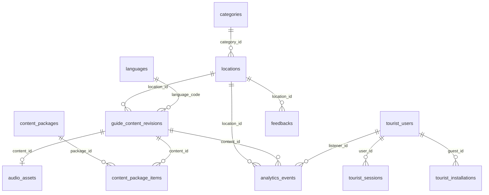

# Review code Backend và Android

Ngày review: **22/10/2026**. Source nền: commit `1ab5660`, nhánh `HVP-22-travelq1-ux-preview`.

Tài liệu này giải thích **code thực tế**, các file gọi nhau, hợp đồng HTTP và những vấn đề còn lại. Đối chiếu yêu cầu bằng [PRD EN](../en/PRD_Report.md) và [PRD VI](PRD_Report_vi.md). Không suy ra tính năng đã hoàn thành từ tên màn hình, seed APPROVED hoặc test prototype.

Phạm vi đọc gồm toàn bộ Java/Kotlin do dự án viết trong `backend/` và `android/`, SQL migration/fixture, cấu hình build/manifest/resources, script hỗ trợ và các test. Không review nghiệp vụ Web; chỉ nhắc Web Admin khi nó là bên gọi API backend. Thư mục build/cache, dependency và binary wrapper không phải source nghiệp vụ; các tài nguyên nhị phân được mô tả theo nơi sử dụng.

Theo yêu cầu trực tiếp của người dùng, báo cáo review được lưu thành **một Markdown trong repository**, thay cho quy ước cũ chỉ lưu review trên Jira. Lượt này không sửa nghiệp vụ, không cập nhật Jira, không commit/push.

## Mục lục

1. [Kết luận review và vấn đề ưu tiên](#findings)
2. [Bản đồ kiến trúc và điểm vào](#architecture)
3. [Danh sách toàn bộ API và bên gọi](#api)
4. [Các luồng xử lý từ Android tới database](#flows)
5. [Giải thích từng file backend](#backend)
6. [Database, migration, fixture và script](#database)
7. [Giải thích từng file Android](#android)
8. [Build, manifest, resources và dữ liệu đóng gói](#configuration)
9. [Test: mục đích từng file và giới hạn](#tests)
10. [Đối chiếu PRD](#requirements)
11. [Kết quả kiểm chứng lượt này](#verification)
12. [Markdown đã dọn và tài liệu còn giữ](#cleanup)

Link source dùng đường dẫn tương đối để đọc được trong repository/GitHub; `#L<number>` chỉ dòng tại snapshot review. Khi code thay đổi, tìm thêm tên hàm ghi cạnh link. File được liệt kê không có nghĩa tất cả nhánh của file đã được thực thi.

<a id="findings"></a>

## 1. Kết luận review và vấn đề ưu tiên

**Luồng hiện tại:** Android `MainActivity → TravelQ1App → SharedTourRepository/DemoApi → Spring controller → service → JDBC → PostgreSQL/PostGIS`. Audio và TTS chạy trên Android; backend cung cấp script/audio, gói nội dung và lưu lượt nghe. Không có JPA Entity, Redis, JWT hoặc Task/Expense trong backend này.

Các điểm đã làm đúng trong source: SQL có bind parameter; tìm kiếm escape `%/_/!`; chỉ guide APPROVED được trả công khai; fallback giữ FULL/SHORT; `eventId` chống gửi trùng; nháp Admin tách khỏi published; upload kiểm tra loại/header; session tourist lưu hash ở server và mã hóa trên Android; gói nội dung được kiểm checksum/chữ ký rồi mới ghi nguyên tử.

Không phát hiện P0 từ việc đọc source. Báo cáo có **6 finding P1 và 6 finding P2**. Các mục dưới là **finding tĩnh**, chưa có kiểm thử tái hiện trên thiết bị/database trong lượt này, trừ khi mục kiểm chứng ghi rõ. P1 cần ưu tiên vì làm sai luồng chính hoặc khả năng phục hồi; P2 là giới hạn, hiệu năng hoặc khả năng bảo trì cần xử lý có kế hoạch. Chưa sửa các finding vì yêu cầu hiện tại là review và viết tài liệu.

### P1-01 — Sự kiện lỗi chặn toàn bộ outbox, có thể chặn luôn đăng xuất

- Vị trí: [PlaybackOutbox.kt:38](../../android/app/src/main/java/vn/hvp/travelvoice/data/remote/PlaybackOutbox.kt#L38), [TouristIdentity.kt:47](../../android/app/src/main/java/vn/hvp/travelvoice/data/remote/TouristIdentity.kt#L47), [TravelProfile.kt:57](../../android/app/src/main/java/vn/hvp/travelvoice/ui/screens/TravelProfile.kt#L57), [PlaybackService.java:58](../../backend/multi-audio-guide/src/main/java/com/application/service/PlaybackService.java#L58).
- Điều kiện: sự kiện đầu có token hết hạn/đã revoke (401), content đã ARCHIVED (404), hoặc eventId xung đột (409). `flushLocked()` không bắt lỗi riêng từng sự kiện; vòng lặp thoát trước khi gửi các sự kiện sau. Logout gọi flush trước revoke nên cũng không đi tiếp.
- Tác động: một sự kiện không thể tự phục hồi làm tồn đọng cả những lượt nghe mới hợp lệ. Token hết hạn bị xóa khỏi local session; đăng nhập lại cùng tài khoản mới có thể thay token trong snapshot cũ. Đây không phải cơ chế retry tự hồi phục cho mọi lỗi.
- Hướng sửa: phân loại retryable/network/5xx và lỗi cần người dùng; lưu trạng thái lỗi theo sự kiện, cho tiếp tục sự kiện độc lập và có cách xử lý pending khi logout mà vẫn bảo toàn danh tính. Không âm thầm gán sự kiện của A cho B.
- Cách xác minh: xếp 3 sự kiện, cho sự kiện đầu trả 401/404/409, kiểm tra sự kiện 2–3 và logout; thêm tình huống login lại đúng/sai tài khoản.

### P1-02 — Lượt nghe offline bị ghi thành online và sai ngày xảy ra

- Vị trí: [PlaybackRequest.java:5](../../backend/multi-audio-guide/src/main/java/com/application/dto/PlaybackRequest.java#L5), [PlaybackRepository.java:33](../../backend/multi-audio-guide/src/main/java/com/application/repository/PlaybackRepository.java#L33), [V1__demo.sql:87](../../backend/multi-audio-guide/src/main/resources/db/migration/V1__demo.sql#L87), [PlaybackOutbox.kt:21](../../android/app/src/main/java/vn/hvp/travelvoice/data/remote/PlaybackOutbox.kt#L21).
- Điều kiện: nghe từ gói offline vào ngày A, gửi lại có mạng vào ngày B. Payload chỉ có `eventId/contentId`; INSERT cố định `is_offline=FALSE`, `occurred_at` dùng thời gian server nhận.
- Tác động: online/offline ratio và báo cáo theo ngày phản ánh sai hoạt động offline. Endpoint hiện có không đủ thông tin để tính đúng metric đó.
- Hướng sửa: version hóa/bổ sung thông tin thời điểm xảy ra và nguồn online/offline với validation, giữ thời điểm nhận riêng; bảo toàn hợp đồng client cũ và idempotency.
- Cách xác minh: tạo lượt offline hôm trước, đồng bộ hôm sau, xem cả hai kỳ báo cáo và `is_offline`.

### P1-03 — Gói đã cài hỏng chặn fallback về BASE đi kèm APK

- Vị trí: [SharedTourRepository.kt:62](../../android/app/src/main/java/vn/hvp/travelvoice/data/remote/SharedTourRepository.kt#L62).
- Điều kiện: `BASE.json` đọc/parse được nhưng sai checksum/chữ ký, hoặc `OPTIONAL.json` sai chữ ký. `runCatching` chỉ bao đọc JSON; `verify(record)` ở ngoài và ném lỗi cho toàn bộ `readRecords()`.
- Tác động: BASE bundled còn nguyên vẫn không được dùng; một OPTIONAL hỏng cũng có thể làm toàn bộ danh sách offline không đọc được. AtomicFile giúp chống ghi dở, không thay cho xử lý dữ liệu đã hỏng.
- Hướng sửa: xác minh trong nhánh phục hồi theo từng scope; BASE lỗi thì dùng bản bundled, OPTIONAL lỗi thì cách ly và báo lỗi riêng. Không cung cấp nội dung chưa xác minh.
- Cách xác minh: sửa một byte raw trong envelope đã cài, ngắt mạng, mở app; lặp lại riêng cho BASE và OPTIONAL.

### P1-04 — Cài/xóa gói không chờ phiên nghe và không làm mới dữ liệu màn chính

- Vị trí: [SharedTourScreen.kt:227](../../android/app/src/main/java/vn/hvp/travelvoice/ui/screens/SharedTourScreen.kt#L227), [SharedTourRepository.kt:183](../../android/app/src/main/java/vn/hvp/travelvoice/data/remote/SharedTourRepository.kt#L183), [TravelQ1App.kt:127](../../android/app/src/main/java/vn/hvp/travelvoice/ui/navigation/TravelQ1App.kt#L127).
- `download()` xác minh rồi ghi đè scope ngay, `deleteOptional()` xóa ngay; không kiểm tra `TravelPlayback`. Đây là thiếu điều kiện chờ playback theo UC-04. Dữ liệu player đang giữ thường vẫn phát được, nhưng không đồng nghĩa đã thực hiện gate nghiệp vụ.
- Sau cài/xóa, UI chỉ tải lại danh sách `installed`; không invalidate guide cache hoặc tăng `revision` của shell. Khi offline, danh sách/guide trên màn chính có thể vẫn là bản cũ đến khi có lần tải lại hoặc mở lại app.
- Hướng sửa: staging → chờ điều kiện cài → commit; phát thay đổi repository cho shell reload và invalidate cache phù hợp; áp dụng gate cả khi xóa gói đang dùng.
- Cách xác minh: đang nghe bản A, tải B, quan sát thời điểm active version đổi; quay về bản đồ khi offline và kiểm tra nội dung mới/đã xóa.

### P1-05 — Device tests đang trỏ tới giao diện và fixture cũ

- Vị trí: [DemoFlowTest.kt:18](../../android/app/src/androidTest/java/vn/hvp/travelvoice/DemoFlowTest.kt#L18), [SharedTourFlowTest.kt:23](../../android/app/src/androidTest/java/vn/hvp/travelvoice/SharedTourFlowTest.kt#L23), [MapFlowTest.kt:24](../../android/app/src/androidTest/java/vn/hvp/travelvoice/MapFlowTest.kt#L24), [LivePlaybackTest.kt:33](../../android/app/src/androidTest/java/vn/hvp/travelvoice/LivePlaybackTest.kt#L33).
- MainActivity mở TravelQ1App, nhưng test tìm tab Khám phá/Ngoại tuyến cũ, label SharedTourScreen và Bảo tàng Demo đã ARCHIVED; LivePlaybackTest còn hard-code analytics ở 8081. `MapFlowTest` đòi giới hạn camera thuộc cấu hình `districtOneOnly=true`, trong khi TravelMap hiện không truyền cờ này.
- Tác động: bộ device test cũ không chứng minh luồng release hiện tại. Không lấy kết quả ở snapshot cũ làm kết quả cho branch này.
- Hướng sửa: các test prototype phải tự setContent route prototype; device test release thao tác theo shell hiện tại, dùng dữ liệu test và base URL có cấu hình. Không nới assertion chỉ để test xanh.

### P1-06 — Audio prepare timeout không đi qua TTS fallback

- Vị trí: [SharedNarrator.kt:51](../../android/app/src/main/java/vn/hvp/travelvoice/platform/audio/SharedNarrator.kt#L51), [SharedNarrator.kt:86](../../android/app/src/main/java/vn/hvp/travelvoice/platform/audio/SharedNarrator.kt#L86).
- Điều kiện: URL pre-rendered audio không prepare xong trong 15 giây, nhưng chưa gọi OnError. Runnable timeout gọi thẳng `fail()` → stop; khác nhánh OnError/catch gọi `useTts()` khi fallback=true.
- Tác động: người dùng có script APPROVED và giọng TTS phù hợp vẫn chỉ gặp lỗi, không nhận đường fallback của UC-03 khi audio không dùng được.
- Hướng sửa: phân biệt timeout của nguồn audio với timeout TTS/render; chỉ timeout audio mới thử TTS một lần, cleanup source cũ và giữ đúng guide identity. Không tạo vòng lặp retry/fallback.
- Cách xác minh: nguồn HTTP treo response/audio preparation hơn 15 giây, thiết bị có voice tương ứng; xác nhận chuyển TTS và chỉ ghi một event khi phát thật.

### P2-01 — Endpoint audio công khai thiếu điều kiện danh mục/ngôn ngữ hoạt động

- Vị trí: [AdminContentService.java:144](../../backend/multi-audio-guide/src/main/java/com/application/service/AdminContentService.java#L144), so sánh [GuideRepository.java:23](../../backend/multi-audio-guide/src/main/java/com/application/repository/GuideRepository.java#L23).
- Nếu category hoặc language bị tắt nhưng location/guide vẫn APPROVED, guide/package API ẩn nội dung; URL upload audio đã biết vẫn trả bytes vì câu SQL audio chỉ kiểm tra hai status.
- Hướng sửa: dùng cùng predicate công khai cho guide/package/audio. Test trực tiếp URL sau khi tắt category/language. Static `/demo-audio/` là fixture riêng và không được bảo vệ bằng trạng thái DB.

### P2-02 — Không có trust key độc lập; gói phát hành chỉ là cơ chế demo

- Vị trí: [ContentPackageService.java:38](../../backend/multi-audio-guide/src/main/java/com/application/service/ContentPackageService.java#L38), [SharedTourRepository.kt:168](../../android/app/src/main/java/vn/hvp/travelvoice/data/remote/SharedTourRepository.kt#L168).
- Server sinh RSA key mỗi lần chạy, client tải key từ cùng origin rồi tin key trong envelope. Checksum/chữ ký phát hiện dữ liệu không khớp key đó; không chứng minh người phát hành đáng tin khi nguồn HTTP bị thay thế. Đây là giới hạn triển khai demo, không phải kết luận đang có tấn công.
- Muốn phát hành production cần HTTPS, trust anchor có quản lý rotation và lịch sử package bền vững. Không đổi migration cũ để làm việc này.

### P2-03 — Áp lực bộ nhớ khi tải gói và ghép TTS

- Vị trí: [SharedTourRepository.kt:154](../../android/app/src/main/java/vn/hvp/travelvoice/data/remote/SharedTourRepository.kt#L154), [SharedTourRepository.kt:174](../../android/app/src/main/java/vn/hvp/travelvoice/data/remote/SharedTourRepository.kt#L174), [PcmWave.kt:12](../../android/app/src/main/java/vn/hvp/travelvoice/platform/audio/PcmWave.kt#L12).
- HTTP body được đọc toàn bộ rồi mới kiểm tra giới hạn 150 MB; nhiều audio được base64 hóa trong một JSON. Dung lượng đĩa `required*2` không bao gồm đầy đủ bản cũ, base64 và các bản sao trong RAM. PcmWave cũng giữ PCM trong memory rồi tạo thêm buffer toàn bộ.
- Tác động xuất hiện với gói lớn, chưa đo bằng profiler ở lượt này. Hướng sửa: giới hạn stream từ đầu, ghi asset ra staging files, tính cả dung lượng staging/old, ghép WAV theo stream; kiểm thử trên thiết bị RAM thấp.

### P2-04 — Lượt nghe ngắn hơn một giây có thể không được ghi

- Vị trí: [SharedNarrator.kt:56](../../android/app/src/main/java/vn/hvp/travelvoice/platform/audio/SharedNarrator.kt#L56), [SharedNarrator.kt:169](../../android/app/src/main/java/vn/hvp/travelvoice/platform/audio/SharedNarrator.kt#L169).
- Chỉ callback `started()` khi position nguyên giây lớn hơn 0. Nghe rồi dừng trong giây đầu, hoặc file dưới một giây kết thúc trước tick hợp lệ, không tạo event. Không tương đương định nghĩa mọi phiên PLAYBACK_STARTED.
- Hướng sửa: phát hiện playback bắt đầu từ tiến trình mili giây/callback phù hợp; vẫn không đếm prepare hoặc resume. Cần chốt ngưỡng metric nếu muốn yêu cầu nghe tối thiểu.

### P2-05 — Scope IO của narrator không được cancel khi close

- Vị trí: [SharedNarrator.kt:50](../../android/app/src/main/java/vn/hvp/travelvoice/platform/audio/SharedNarrator.kt#L50), [SharedNarrator.kt:121](../../android/app/src/main/java/vn/hvp/travelvoice/platform/audio/SharedNarrator.kt#L121), [SharedNarrator.kt:171](../../android/app/src/main/java/vn/hvp/travelvoice/platform/audio/SharedNarrator.kt#L171).
- `close()` đóng TTS/player nhưng không cancel CoroutineScope `io`; ghép WAV đang chạy có thể tiếp tục sau khi đổi bài. Generation guard ngăn phát nhầm, nhưng không dừng công việc/file I/O cũ.
- Hướng sửa: quản lý job render và cleanup có thứ tự, cancel hợp tác; tránh xóa thư mục khi job đang đọc. Đo lại bằng đổi bài nhanh trong lúc render bài dài.

### P2-06 — File demo con và tên lớp làm khó xác định code đang dùng

- [demo/pom.xml](../../backend/multi-audio-guide/demo/pom.xml) trỏ parent là artifact có packaging `jar`; root không khai báo module này. [Main.java](../../backend/multi-audio-guide/demo/src/main/java/com/application/Main.java) chỉ in Hello world, không thuộc Spring runtime root.
- Android còn nhiều prototype trong main source; `DemoApp` trả về TravelQ1App ngay khi startDestination=tour, khiến nhánh `shared=true` phía dưới không đạt được theo đường đó. `DemoStatePicker` còn text rác.
- Hướng sửa sau review: thống nhất entry point, cô lập prototype/test fixtures và loại module skeleton nếu nhóm không dùng. Lượt này chỉ dọn Markdown theo yêu cầu.

<a id="architecture"></a>

## 2. Bản đồ kiến trúc và điểm vào



### 2.1 Backend

[MultiAudioGuideApplication.main](../../backend/multi-audio-guide/src/main/java/com/application/MultiAudioGuideApplication.java#L6) bật Spring component scan `com.application`, auto-config datasource/mail/Flyway/web/actuator. Controller nhận HTTP rồi gọi bean service qua constructor injection. Các controller **không gọi HTTP lẫn nhau**; chúng dùng service/repository chung.

Discovery có đủ controller → service → repository → mapper → DTO. Playback gộp truy vấn guide và analytics trong PlaybackService. AdminContentService/ContentPackageService dùng JdbcTemplate trực tiếp, nên chưa tách data access thành repository ở hai vùng đó. `model` đều là Java record, không có JPA annotation hoặc EntityManager.

| Nhóm | Profile default | Profile demo |
| --- | --- | --- |
| Catalog/categories/detail/guide | Có | Có |
| Tourist guest/OTP/logout | Có | Có |
| Playback POST và Admin analytics | Không đăng ký controller | Có |
| Admin workspace/upload/public uploaded audio | Không đăng ký | Có |
| Content package/key/download | Không đăng ký | Có |
| Flyway | `db/migration`: V1, V2, V3, V4 | Thêm `db/demo`: 2.1, 3.1–3.4, 4.1–4.2 |

Controller có `@Profile("demo")` mới được filter Basic Auth bảo vệ tương ứng. Không có Spring Security dependency trong POM. Tourist dùng opaque bearer token; token này không mở quyền Admin.

### 2.2 Android

[AndroidManifest](../../android/app/src/main/AndroidManifest.xml#L16) khai báo launcher MainActivity; [MainActivity:45](../../android/app/src/main/java/vn/hvp/travelvoice/MainActivity.kt#L45) trực tiếp gọi `TravelQ1App()`.

| Vùng app đang dùng | Owner và dữ liệu |
| --- | --- |
| Bản đồ, tìm tên, danh sách, chọn địa điểm | TravelQ1App giữ state bằng remember/rememberSaveable, catalog từ repository |
| Chi tiết/ngôn ngữ/FULL–SHORT | TravelPlaceDetails; guide theo selected/language/mode/revision |
| Mini-player, player, notification | TravelPlayback bridge + TravelPlaybackService giữ SharedNarrator |
| Cài đặt | TravelSettings; SharedPreferences `travelq1-settings` |
| Offline | SharedOfflineContent được gọi từ tab nội bộ offline của shell |
| Hồ sơ | TravelProfile → TouristIdentity/TouristApi |

Không có ViewModel/Room/WorkManager/Media3 trong dependency hiện tại. Điều hướng release là state và bottom sheets, không phải NavHost. NavHost trong DemoApp phục vụ prototype cũ. Không tự động tải lại package khi đổi ngôn ngữ; chỉ tải guide tương ứng hoặc đọc bản cục bộ.

<a id="api"></a>

## 3. Danh sách toàn bộ API và bên gọi

Base Android lấy từ `BuildConfig.API_BASE_URL`, mặc định `http://10.0.2.2:8080/`. `10.0.2.2` dùng cho Android Emulator truy cập máy host. Android không kết nối PostgreSQL và không chứa mật khẩu DB/Admin/Gmail.

### 3.1 API catalog và guide — luôn bật

| HTTP | Request/response và lỗi | Ai gọi → ai xử lý |
| --- | --- | --- |
| `GET /api/categories` | `CategoryResponse[]`: categoryId, name, locationCount. Chỉ category active, gồm category rỗng | Chưa có call riêng trong release Android → [LocationController.categories](../../backend/multi-audio-guide/src/main/java/com/application/controller/LocationController.java#L39) → service → CategoryRepository |
| `GET /api/locations` | Query keyword mặc định rỗng, categoryId UUID tùy chọn, page=0, size=20; size 1–50. Trả items/page/size/totalElements/totalPages/message/suggestedCategories. Sai query 400, category không hoạt động 404, DB lỗi 503 | [DemoApi.locations](../../android/app/src/main/java/vn/hvp/travelvoice/data/remote/DemoApi.kt#L31) gọi size=50 từng trang → [LocationController.search](../../backend/multi-audio-guide/src/main/java/com/application/controller/LocationController.java#L25) |
| `GET /api/locations/{locationId}` | DTO locationId/name/categoryId/categoryName/latitude/longitude/geofenceRadiusM. Không có script. Không công khai/không có 404 | Android release lấy metadata từ catalog, chưa gọi endpoint này riêng → [LocationController.detail](../../backend/multi-audio-guide/src/main/java/com/application/controller/LocationController.java#L34) |
| `GET /api/locations/{id}/guide` | Query language=VI, scriptType=FULL; lang trim+uppercase, FULL/SHORT phân biệt hoa/thường. Trả contentId/locationId/locationName/languageCode/scriptType/scriptText/audioUrl nullable | [DemoApi.guide](../../android/app/src/main/java/vn/hvp/travelvoice/data/remote/DemoApi.kt#L44) → [GuideController](../../backend/multi-audio-guide/src/main/java/com/application/controller/GuideController.java#L18) → PlaybackService.guide → GuideRepository |

Guide chọn Selected → EN → VI, giữ scriptType, revision_no cao nhất trong ngôn ngữ được chọn. Không khớp trả 404 với detail “Nội dung cho địa điểm này hiện đang được cập nhật.”, không trả text/audio cũ. Đọc guide không tạo lượt nghe.

Ví dụ response (UUID dùng ký hiệu trong đoạn này, request thật phải dùng UUID hợp lệ):

```json
{"contentId":"<revision UUID>","locationId":"<location UUID>","locationName":"Dinh Độc Lập","languageCode":"FR","scriptType":"SHORT","scriptText":"Văn bản APPROVED đúng biến thể","audioUrl":null}
```

### 3.2 Playback và analytics — demo

| HTTP | Request/response | Caller và xử lý |
| --- | --- | --- |
| `POST /api/playbacks` | Body `{eventId,contentId}`; tùy chọn `X-Installation-Key` và `Authorization: Bearer ...`. Trả `{eventId,created}`; thiếu ID 400, content không công khai 404, trùng ID khác content 409, bearer sai/hết hạn 401 | Narrator → [PlaybackOutbox](../../android/app/src/main/java/vn/hvp/travelvoice/data/remote/PlaybackOutbox.kt) → DemoApi.playback → [DemoPlaybackController.record](../../backend/multi-audio-guide/src/main/java/com/application/controller/DemoPlaybackController.java#L26) → TouristAuthService.listener → PlaybackService.record → PlaybackRepository |
| `GET /api/admin/analytics` | Basic Auth; from/to ISO date tùy chọn. Mặc định 30 ngày gồm hôm nay, tối đa 366 ngày inclusive. Trả from/to/timeZone/generatedAt/totalPlaybacks/onlinePlaybacks/offlinePlaybacks/topLocations/languages | Web Admin, Android không gọi → DemoAdminFilter → DemoPlaybackController.analytics → PlaybackService.analytics → PlaybackRepository |

Backend suy ra location/language từ contentId, không tin một trường listenerId do client gửi. Retry cùng event/content trả `created=false`. Không có endpoint export XLSX hoặc feedback thật trong controller backend hiện tại. Đây là count số phiên bắt đầu nghe, không phải số người nghe duy nhất hoặc số bài đã nghe hết.

### 3.3 Package — demo, không cần login

| HTTP | Hợp đồng | Caller → xử lý |
| --- | --- | --- |
| `GET /api/content-packages/key` | algorithm, keyId SHA256(SPKI), spki base64 RSA public key | SharedTourRepository.download → [ContentPackageController.key](../../backend/multi-audio-guide/src/main/java/com/application/controller/ContentPackageController.java#L23) → service.publicKey |
| `GET /api/content-packages` | Manifest array; scope không có nội dung bị bỏ qua | SharedOfflineContent → repository.available → controller.packages → service.available |
| `GET /api/content-packages/{scope}/{version}` | Raw JSON bytes; Content-Type application/json, no-store, X-Content-SHA256. scope BASE/OPTIONAL; version cũ 404, scope sai 400 | repository.download → controller.download → service.build |

Manifest: `schemaVersion`, `scope`, `version`, `status`, `isBase`, `sizeBytes`, `sha256`, `signature`, `keyId`, `downloadUrl`, `assets[{url,sizeBytes,sha256}]`. `sizeBytes` của manifest chỉ là JSON; tổng tải còn gồm assets. Version = `scope.lowercase + "-" + sha256(raw JSON)`.

Payload ký: `schemaVersion/status/scope/isBase/locations/guides/retiredLocationIds/languages/assets`. Ký SHA256withRSA trên bytes UTF-8 chính xác. Gói không lấy từ các bảng content_packages/content_package_items; service tạo snapshot động từ dữ liệu published. BASE phân theo category UUID cố định `...0101`; OPTIONAL là các category khác.

Với migration demo hiện tại, 6 địa điểm giả đã ARCHIVED nên có BASE 7 địa điểm/84 scripts và không có OPTIONAL từ 6 địa điểm đó. Không giữ mô tả cũ rằng server luôn trả hai gói.

### 3.4 Admin content — demo, Basic Auth

Tất cả `/api/admin/*` đi qua [DemoAdminFilter](../../backend/multi-audio-guide/src/main/java/com/application/config/DemoAdminFilter.java). Password chưa cấu hình → 503; thiếu/sai Basic → 401; response no-store. Tên/password lấy từ server, không từ APK.

| HTTP | Hợp đồng | Xử lý |
| --- | --- | --- |
| `GET /api/admin/content/config` | categories tên string[], languages `{code,label}[]`, code chữ thường | [AdminContentController.config](../../backend/multi-audio-guide/src/main/java/com/application/controller/AdminContentController.java#L22) → AdminContentService.config |
| `GET /api/admin/content/locations` | Union published IDs và draft IDs, trả detail từng ID | controller.list → service.list/detail |
| `GET /api/admin/content/locations/{id}` | Draft nếu có, ngược lại published; có `published` metadata khi đang APPROVED; không có 404 | controller.detail → service.detail/published |
| `PUT /api/admin/content/locations/{id}` | Full workspace: id/name/category/latitude/longitude/radius là string, status, editVersion số, assets object. Chỉ DRAFT/PENDING_REVIEW; 400 body/required sai, 409 stale editVersion | controller.save → service.save; transaction ghi admin_content_drafts |
| `POST /api/admin/content/audio` | multipart locationId/language/scriptType/file; MP3/WAV/OGG header hợp lệ; 12 bytes–20 MiB. Trả audioUrl/audioName/audioStatus | controller.upload → service.upload → admin_audio_uploads BYTEA |
| `GET /api/admin/content/audio/{id}.{format}` | Preview bytes, phải Basic Auth | controller.preview → service.audio(preview=true) |
| `GET /api/content-audio/{id}.{format}` | Public bytes khi được guide APPROVED + location APPROVED tham chiếu, còn lại 404; không cần Basic Auth | Android MediaPlayer hoặc tải package asset → controller.published → service.audio(preview=false) |

Assets của PUT theo khóa `vi:FULL`, `fr:SHORT`...; từng object phải khớp locationId/languageCode/scriptType, có text và audioUrl tùy chọn. Đây là **PUT toàn bộ assets**: muốn đổi một ngôn ngữ phải giữ/gửi lại biến thể khác; backend không tự merge asset bị bỏ khỏi body. `editVersion=0` tạo workspace mới, lần sau gửi version server trả. Tên người sửa là username Admin dùng chung trong cấu hình.

`save()` không ghi lại locations/guide_content_revisions/audio_assets published; không có approve/publish route. Muốn phát hành phải có dependency ngoài. Test có SQL mô phỏng publisher không phải API đã triển khai.

### 3.5 Tourist identity — luôn bật

| HTTP | Body/header | Kết quả và caller |
| --- | --- | --- |
| `POST /api/tourist/guest` | `X-Installation-Key` bắt buộc, body Android gửi `{}` | userId/kind=GUEST; TravelQ1App startup → TouristApi → [TouristAuthController.guest](../../backend/multi-audio-guide/src/main/java/com/application/controller/TouristAuthController.java#L17) |
| `POST /api/tourist/otp/request` | email + installation key | challengeId/expiresInSeconds=300/retryAfterSeconds=60; TravelProfile → service.request → repository + TouristMailSender |
| `POST /api/tourist/otp/verify` | challengeId/code + installation key | userId/email/accessToken/expiresAt; TravelProfile → service.verify; code sai/hết hạn/đã dùng 400 |
| `POST /api/tourist/logout` | Bearer tùy chọn | revoke token nếu hợp lệ về cú pháp; 204; profile gọi sau flush outbox |

Key thiết bị là 32 random bytes base64url không padding, 43 ký tự `[A-Za-z0-9_-]`. OTP có 6 chữ số, PBKDF2WithHmacSHA256 150.000 vòng với salt riêng, hết hạn 5 phút, tối đa 5 lần thử sai. Request bị throttle theo 60 giây/email và 1 giờ: email 5, installation 10, IP 30; dùng advisory transaction lock theo thứ tự ổn định.

Session token ngẫu nhiên 32 bytes, hạn 30 ngày; DB chỉ lưu SHA-256(token). Không có refresh token/JWT. Auth tùy chọn cho tourist; catalog/guide/package không yêu cầu tài khoản. Lỗi email chưa cấu hình/vận chuyển → 503, không trả hoặc log OTP trong code này. SMTP nằm trong transaction nên thất bại rollback challenge; việc giữ lock/connection trong lúc gửi mail là điểm cần cân nhắc khi tăng tải.

### 3.6 Hạ tầng và tài nguyên static

`GET /actuator/health` do Actuator cung cấp; Compose dùng kiểm tra readiness. `/demo-audio/{museum|gallery|heritage}.wav` do Spring static resource handler, không có controller tự viết; static handler được test Range. Uploaded audio dùng response byte[] riêng, không được suy ra có Range từ test static WAV.

<a id="flows"></a>

## 4. Các luồng xử lý từ Android tới database

### 4.1 Mở app, tải danh sách và chọn địa điểm

1. MainActivity lấy app-language, appearance; áp locale bằng AppCompat và tạo theme. onStart/onStop cập nhật `TravelPlayback.appVisible`.
2. TravelQ1App tạo một SharedTourRepository theo API base cố định của APK. Các state selected/query/tab/language/mode được saveable; dữ liệu lớn locations/guide chỉ remember và tải lại.
3. Effect startup gửi guest registration và flush pending theo hai `runCatching` riêng; lỗi không chặn đọc nội dung. Effect catalog đưa `localLocations()` ra ngay rồi thử `repository.locations()` online.
4. DemoApi lặp GET catalog size=50 tới totalPages, loại ID trùng. Backend strip keyword, validate page/size/category, count và select cùng predicate public, mapper chuyển record DB sang response. SQL xếp exact → prefix → substring; tie bằng tên/UUID.
5. Android release lấy toàn catalog rồi lọc tên cục bộ, không gửi keyword/category lên search API. `select(id)` đặt FULL và bật card tương ứng. Không fetch detail riêng.

Lưu ý: local startup nhanh không chứng minh server đã kết nối; UI source online/offline lấy từ kết quả catalog. `guide()` trả source boolean riêng nhưng TravelQ1App hiện bỏ qua giá trị đó, nên nhãn catalog không nhất thiết là nguồn của bài đang đọc.

### 4.2 Đổi ngôn ngữ/FULL–SHORT và fallback



Cache online key gồm location/language/mode, tối đa 32 mục, TTL 60 giây. 4xx xóa cache tương ứng và không fallback local để tránh làm nội dung bị ẩn công khai xuất hiện lại. Network/5xx mới tìm bản signed local Selected → EN → VI, không đổi FULL sang SHORT hoặc ngược lại. Retry ở shell clear guide cache và tăng revision.

`DemoApi.guide()` kiểm lại locationId/type/effectiveLanguage/text trước nhận response; audio relative resolve theo backend host/port. Khi request selection đổi, remember key reset guide và LaunchedEffect cũ bị cancel; các synchronous OkHttp call của DemoApi chạy IO và không có `Call.cancel()` trực tiếp như download package, nên request cũ có thể vẫn chiếm tài nguyên đến timeout.

### 4.3 Play, TTS, tua và điều khiển nền

1. Nút Play gọi `TravelPlayback.play()` gửi Intent đầy đủ guide identity/text/audio/base/rate cho TravelPlaybackService. Service không export, client ngoài không gọi trực tiếp.
2. Service acknowledge foreground start, tạo MediaSession và SharedNarrator mới nếu contentId đổi; close narrator cũ trước. Callback started enqueue event. Singleton bridge giúp mini-player và panel cùng đọc một narrator.
3. Narrator ưu tiên URL audio. MediaPlayer prepareAsync, set AudioAttributes/wake lock, xin audio focus trước start. Audio lỗi chuyển TTS; lỗi prepare timeout hiện gọi fail, không tự suy ra mọi lỗi đều fallback thành công.
4. TTS chọn voice cùng `languageCode`, ưu tiên offline voice. Đọc đúng scriptText, chia chunk theo giới hạn TTS, synthesizeToFile ở tốc độ 1×; PcmWave.join kiểm PCM format các chunk, nối WAV và rename tệp tạm. Cache key gồm contentId/language/type/text/voice. Không dịch/tóm tắt runtime.
5. WAV sau render được phát bằng MediaPlayer: duration/currentPosition thật; tốc độ 0.75/1/1.25/1.5× đổi qua PlaybackParams. Slider/±10 giây gọi seek; pause/resume không tạo phiên mới, play sau hoàn tất reset event. Service tick 300 ms cập nhật timeline/MediaSession.

Audio focus loss và ACTION_AUDIO_BECOMING_NOISY pause; không tự phát lại khi lấy focus. Khi app ra nền mà narrator active, service giữ media notification; về foreground gỡ notification. TTS voice yêu cầu mạng có thể không render khi offline; readable text vẫn còn. Chưa xác minh từng voice/hãng máy/phiên bản Android trong lượt review.

### 4.4 Lượt nghe → outbox → analytics

```mermaid
sequenceDiagram
    participant N as SharedNarrator
    participant O as PlaybackOutbox
    participant I as TouristIdentity
    participant B as DemoPlaybackController
    participant S as PlaybackService
    participant DB as PostgreSQL
    N->>O: started(event UUID, contentId)
    O->>I: Ghi encrypted snapshot identity + event
    O->>B: POST /api/playbacks + tourist headers
    B->>DB: Resolve listener từ installation/token
    B->>S: record(event, listener)
    S->>DB: Kiểm eventId / public revision / INSERT ON CONFLICT
    DB-->>O: Receipt created true hoặc false
    O->>I: Xóa đúng event đã acknowledge, commit
    Note over O,DB: Lỗi giữ pending; xem P1-01/P1-02
```

Outbox dùng Mutex process-wide tránh hai flush cùng ghi. Từng ACK được commit ngay nên response sau lỗi không làm mất event chưa gửi; response mất có thể retry cùng UUID. Không có WorkManager/connectivity worker; flush được gọi lúc launch, phiên nghe mới, trước logout. Bản release chưa có UI trạng thái hàng đợi/retry riêng như LiveDemoScreen cũ.

Analytics tính trong REPEATABLE_READ, khoảng `[00:00 from, 00:00 to+1)` tại Asia/Ho_Chi_Minh; đếm online/offline, group location và language. Tên địa điểm lấy tên DB hiện tại; khi đổi tên, báo cáo lịch sử hiển thị tên mới. Không dùng merged_into để tính unique listeners vì metric hiện không có unique user.

### 4.5 Guest → OTP → email session → logout

TravelProfile đọc session mã hóa từ Android Keystore AES-GCM, nhận user input và timer resend; đổi email xóa challenge hiện tại. TouristApi gửi HTTP trên Dispatchers.IO. Server request validate email/key, lock/rate-limit, ghi salted OTP rồi gửi mail. Verify khóa row `FOR UPDATE`, tăng attempts ngay cả code sai (trả Optional.empty để transaction không rollback attempts), consume code đúng, upsert email user, liên kết guest merged_into và cấp opaque token.

Android lưu Session trong key theo hash `BuildConfig.API_BASE_URL`, snapshot mỗi lượt giữ installation/userId/token lúc nghe. Flush chỉ thay token mới khi cùng userId. Logout flush pending → server revoke → local xóa session và installation; khách lần sau có secret mới. Đọc/nghe vẫn dùng được khi chưa login. Không có màn quản lý tài khoản hoặc xóa tài khoản trong source.

### 4.6 Kiểm tra, tải, cài và đọc offline

SharedOfflineContent → available manifests → người dùng xác nhận → download key và raw package → verify length/hash/keyId/RSA/schema/scope/version → tải từng asset và kiểm size/hash → thêm downloadedAssets → ensureActive → AtomicFile.startWrite/finishWrite. Lỗi write gọi failWrite; hủy/lỗi trước commit giữ bản cũ. BASE luôn có bản bundled; chỉ OPTIONAL được xóa qua API repository.

Mỗi scope lưu một envelope JSON trong `filesDir/shared-content-v1/`. Envelope gồm manifest/raw(base64)/key/installedAt/downloadedAssets. `readRecords()` xác minh lại, hợp nhất retired IDs từ các gói và bundled BASE rồi lọc locations/guides trên bản copy. Không sửa raw bytes đã ký. Local guide tìm asset theo URL rồi checksum, giải ra cacheDir để MediaPlayer dùng; tên cache hiện luôn `.wav` kể cả bytes MP3/OGG, cần kiểm thực tế decoder nếu mở rộng format, không coi là đã chứng minh giữ extension.

Không resume theo byte/range download; retry tải lại. Chưa lưu lịch sử phiên bản server; request version cũ build lại current snapshot rồi 404 khi hash đổi. BASE bundled đang có script, không có audio của 7 điểm; nghe offline cần voice offline hoặc WAV TTS đã cache. Gói content không chứa Google tiles.

### 4.7 Vị trí và bản đồ

Người dùng bấm Gần tôi/My location → kiểm quyền coarse, nếu thiếu mở explanation rồi launcher xin fine+coarse. NearbyLocation chọn GPS khi fine và provider bật, ngược lại network provider; timeout 15 giây, cancel khi ON_STOP/dispose. Kết quả dùng Location.distanceBetween ở client; nearby lọc ≤500 m, sort tăng dần và lấy 5.

TravelMap chuyển ServerLocation hợp lệ thành MapPoint → MapSession dựng Google MapView, sync lifecycle, markers tagged locationId, camera saveable, theme và padding vùng bị card che. Callback marker chọn đúng ID, không autoplay. Map timeout 20 giây có Retry/List. Đây là **one-shot position**, chưa đăng ký geofence/continuous monitoring/cooldown/location notification. Media notification của player không phải UC-05.

### 4.8 Biên tập Admin ảnh hưởng Android thế nào?

Admin GET working copy → sửa full workspace hoặc upload một asset → PUT DRAFT/PENDING_REVIEW → chỉ thay admin_content_drafts. Guide/package Android vẫn đọc các bảng APPROVED cũ. Có external publisher ghi revision APPROVED mới thì online guide có thể đổi sau cache/retry; package version hash đổi, người dùng kiểm tra/tải lại để offline nhận bản mới. **Không có đường Admin PUT → Android tự nhận nháp.**

<a id="backend"></a>

## 5. Giải thích từng file backend

### 5.1 Bootstrap, controller và filter

| File | Thành phần chính, gọi gì và dữ liệu đi đâu | Điểm review |
| --- | --- | --- |
| [MultiAudioGuideApplication.java](../../backend/multi-audio-guide/src/main/java/com/application/MultiAudioGuideApplication.java) | main → SpringApplication.run; scan toàn package | Entry runtime root |
| [DemoAdminFilter.java](../../backend/multi-audio-guide/src/main/java/com/application/config/DemoAdminFilter.java) | shouldNotFilter chọn `/api/admin/`; so Basic header bằng MessageDigest.isEqual | demo-only, thiếu password fail closed; không phải RBAC |
| [LocationController.java](../../backend/multi-audio-guide/src/main/java/com/application/controller/LocationController.java) | search/detail/categories → LocationDiscoveryService | UUID/query binding và defaults |
| [GuideController.java](../../backend/multi-audio-guide/src/main/java/com/application/controller/GuideController.java) | guide → PlaybackService.guide | Read API luôn bật, không count |
| [DemoPlaybackController.java](../../backend/multi-audio-guide/src/main/java/com/application/controller/DemoPlaybackController.java) | record resolve listener rồi service.record; analytics parse from/to | demo profile, analytics Basic filter |
| [ContentPackageController.java](../../backend/multi-audio-guide/src/main/java/com/application/controller/ContentPackageController.java) | key/packages/download → ContentPackageService | So version hiện tại, raw bytes/no-store |
| [AdminContentController.java](../../backend/multi-audio-guide/src/main/java/com/application/controller/AdminContentController.java) | config/list/detail/save/upload/preview/published → AdminContentService | Upload đọc toàn MultipartFile; public audio route ngoài filter |
| [TouristAuthController.java](../../backend/multi-audio-guide/src/main/java/com/application/controller/TouristAuthController.java) | Nested RequestCode/VerifyCode records; guest/request/verify/logout → TouristAuthService | Response no-store; không trả OTP |
| [ApiExceptionHandler.java](../../backend/multi-audio-guide/src/main/java/com/application/controller/ApiExceptionHandler.java) | ResponseStatusException→ProblemDetail; type mismatch→400; DataAccessException log server→503 | Không lộ SQL trong body; không có handler tự viết cho mọi loại lỗi |

### 5.2 Service

| File | Các method và cộng tác | Quy tắc cần giữ |
| --- | --- | --- |
| [LocationDiscoveryService.java](../../backend/multi-audio-guide/src/main/java/com/application/service/LocationDiscoveryService.java) | search validate → CategoryRepository.findActiveById → LocationRepository.count/search → DiscoveryMapper; categories/detail tương tự | Empty 200 với gợi ý; trang vượt phạm vi khác với không có kết quả; readOnly transaction chưa yêu cầu repeatable snapshot |
| [PlaybackService.java](../../backend/multi-audio-guide/src/main/java/com/application/service/PlaybackService.java) | guide normalize→GuideRepository.find; record validate/idempotency→findPublicById/insert; analytics dates→count/byLocation/byLanguage | Record transactional; cùng event khác revision 409; analytics repeatable-read |
| [ContentPackageService.java](../../backend/multi-audio-guide/src/main/java/com/application/service/ContentPackageService.java) | Constructor sinh RSA; publicKey; available loop BASE/OPTIONAL; build SQL snapshot→asset hashes→serialize/sign; nested Asset/Manifest/Bundle records | Latest published từng identity; active lang/category; nonblank; hard-coded BASE category; không persist package history |
| [AdminContentService.java](../../backend/multi-audio-guide/src/main/java/com/application/service/AdminContentService.java) | config SQL categories/languages; list union IDs→detail; published query metadata+assets; save validate full body→optimistic INSERT/UPDATE; upload header→BYTEA; audio predicate→bytes | DRAFT thiếu field được; PENDING bắt buộc name/category/coords/radius; text ≤100k, assets ≤100; expected version conflict 409; SQL trực tiếp trong service, list có nhiều query/detail |
| [TouristAuthService.java](../../backend/multi-audio-guide/src/main/java/com/application/service/TouristAuthService.java) | hash/otpHash/installation helpers; guest/request/verify/listener/logout → TouristRepository; request→mail.send | Advisory locks, OTP attempts commit, random token hash, guest merge reference; không JWT/refresh |
| [TouristMailSender.java](../../backend/multi-audio-guide/src/main/java/com/application/service/TouristMailSender.java) | ObjectProvider<JavaMailSender>; send simple mail dùng from property, map MailException→503 | Không có mailer/from thì khách vẫn dùng được; không phát sinh email khi test mock transport |

### 5.3 Repository

| File | SQL/trả về | Caller và lưu ý |
| --- | --- | --- |
| [CategoryRepository.java](../../backend/multi-audio-guide/src/main/java/com/application/repository/CategoryRepository.java) | LEFT JOIN public locations, count theo category active, optional by UUID | Discovery service; giữ category active nhưng rỗng |
| [LocationRepository.java](../../backend/multi-audio-guide/src/main/java/com/application/repository/LocationRepository.java) | SELECT ST_Y latitude/ST_X longitude, JOIN category active; search/count/findPublicById; bind named params | SQL geometry lấy lon trước/lat sau đúng PostGIS; offset long; LIKE escape; index GIST chưa được dùng cho nearby query vì không có endpoint GPS |
| [GuideRepository.java](../../backend/multi-audio-guide/src/main/java/com/application/repository/GuideRepository.java) | PUBLIC_GUIDE join location/category/language + LEFT JOIN audio đúng content ID; find fallback order/revision; findPublicById | PlaybackService; không mượn audio revision cũ; byId có thể nhận revision APPROVED cũ nếu chưa archive |
| [PlaybackRepository.java](../../backend/multi-audio-guide/src/main/java/com/application/repository/PlaybackRepository.java) | insert ON CONFLICT(id) DO NOTHING; contentForEvent; count(boolean offline), byLocation/byLanguage | Thời điểm mặc định DB, offline=false cố định; P1-02 |
| [TouristRepository.java](../../backend/multi-audio-guide/src/main/java/com/application/repository/TouristRepository.java) | guest upsert installation và dọn user thua race; challenge FOR UPDATE; advisory lock; rate limits; attempted; emailUser; merge; session/user/revoke | Các thao tác nhiều SQL dựa transaction ở service; merge chỉ lưu reference, không copy/rewrite analytics |

### 5.4 DTO, model và mapper

| File | Nội dung và quan hệ |
| --- | --- |
| [Category.java](../../backend/multi-audio-guide/src/main/java/com/application/model/Category.java) | Record id/name/locationCount từ CategoryRepository |
| [Location.java](../../backend/multi-audio-guide/src/main/java/com/application/model/Location.java) | Record metadata từ LocationRepository; nullable coords dùng Double/Integer |
| [GuideContent.java](../../backend/multi-audio-guide/src/main/java/com/application/model/GuideContent.java) | Record revision+location+effective language/type/text/audioUrl; trả trực tiếp qua guide API và dùng package |
| [DiscoveryMapper.java](../../backend/multi-audio-guide/src/main/java/com/application/mapper/DiscoveryMapper.java) | Chuyển Category/Location → response records thủ công; không MapStruct |
| [CategoryResponse.java](../../backend/multi-audio-guide/src/main/java/com/application/dto/CategoryResponse.java) | categoryId/name/locationCount cho catalog và suggestedCategories |
| [LocationResponse.java](../../backend/multi-audio-guide/src/main/java/com/application/dto/LocationResponse.java) | locationId/name/categoryId/categoryName/latitude/longitude/geofenceRadiusM |
| [LocationSearchResponse.java](../../backend/multi-audio-guide/src/main/java/com/application/dto/LocationSearchResponse.java) | Page envelope, message và suggestedCategories |
| [PlaybackRequest.java](../../backend/multi-audio-guide/src/main/java/com/application/dto/PlaybackRequest.java) | eventId/contentId; service validate null; không có thời điểm/nguồn |
| [PlaybackReceipt.java](../../backend/multi-audio-guide/src/main/java/com/application/dto/PlaybackReceipt.java) | eventId/created, cho retry nhận biết đã có |
| [AnalyticsResponse.java](../../backend/multi-audio-guide/src/main/java/com/application/dto/AnalyticsResponse.java) | Kỳ báo cáo/timeZone/generatedAt/tổng và CountItem(label,count) cho location/language |

<a id="database"></a>

## 6. Database, migration, fixture và script

### 6.1 Quan hệ dữ liệu đang được code sử dụng



`admin_content_drafts.location_id` và `admin_audio_uploads.location_id` cố ý không FK tới locations để chứa địa điểm mới chưa published; mapping do service validate. `tourist_otp` chứa installation_hash/email/ip_hash, không FK identity. `tourist_users.merged_into` là self-FK. Feedback có bảng nhưng chưa có controller/service/repository dùng. Sơ đồ trên là quan hệ vật lý, không phải tuyên bố mọi bảng đã có nghiệp vụ hoàn chỉnh.

### 6.2 Từng SQL file

| File | Tác dụng | Runtime/test dùng thế nào |
| --- | --- | --- |
| [V1__demo.sql](../../backend/multi-audio-guide/src/main/resources/db/migration/V1__demo.sql) | Bật PostGIS; 9 bảng catalog/content/audio/package/feedback/analytics; UUID/FK/unique/check và index | Mọi profile; không seed record; DRAFT fields nullable |
| [V2__location_discovery.sql](../../backend/multi-audio-guide/src/main/resources/db/migration/V2__location_discovery.sql) | Thêm status location, CHECK APPROVED đủ name/category/coords/radius, index status/category | Public catalog lọc status; dữ liệu cũ mặc định DRAFT |
| [V3__playback_content_reference.sql](../../backend/multi-audio-guide/src/main/resources/db/migration/V3__playback_content_reference.sql) | FK analytics.content_id và index | Gắn lượt nghe revision |
| [V4__tourist_identity.sql](../../backend/multi-audio-guide/src/main/resources/db/migration/V4__tourist_identity.sql) | tourist_users/installations/sessions/otp; listener_id FK analytics | Auth hoạt động cả default; không seed tài khoản |
| [V2_1__seed_discovery_demo.sql](../../backend/multi-audio-guide/src/main/resources/db/demo/V2_1__seed_discovery_demo.sql) | 4 category/6 địa điểm hư cấu, cả active/inactive/empty và nhiều status | demo; dữ liệu này về sau bị retire |
| [V3_1__seed_short_guides.sql](../../backend/multi-audio-guide/src/main/resources/db/demo/V3_1__seed_short_guides.sql) | 3 VI/SHORT script + metadata trỏ 3 WAV | demo; không seed analytics; hiện địa điểm gốc đã archive |
| [V3_2__seed_multilingual_guides.sql](../../backend/multi-audio-guide/src/main/resources/db/demo/V3_2__seed_multilingual_guides.sql) | Thêm EN và VI FULL/EN FULL/EN SHORT cho museum cũ | Fixture fallback/test, không có audio mới |
| [V3_3__seed_district_tour.sql](../../backend/multi-audio-guide/src/main/resources/db/demo/V3_3__seed_district_tour.sql) | 7 địa điểm + 6 ngôn ngữ × FULL/SHORT =84; text nguồn giữ nguyên, không audio | demo BASE; status APPROVED fixture không thay cho biên tập/kiểm chứng sự thật |
| [V3_4__admin_content_workspace.sql](../../backend/multi-audio-guide/src/main/resources/db/demo/V3_4__admin_content_workspace.sql) | admin_content_drafts JSONB/version/audit; admin_audio_uploads bytes/identity/format/audit | Chỉ demo; nháp không thay published |
| [V4_1__retire_fictional_locations.sql](../../backend/multi-audio-guide/src/main/resources/db/demo/V4_1__retire_fictional_locations.sql) | ARCHIVED 6 địa điểm cũ và revision, giữ FK lịch sử | Catalog/package/guide không còn hiển thị; signed tombstones đưa xuống Android |
| [V4_2__release_catalog_labels.sql](../../backend/multi-audio-guide/src/main/resources/db/demo/V4_2__release_catalog_labels.sql) | Đổi tên category tuyến, tắt category demo rỗng | Không đổi source text của 84 script |
| [restore-discovery-fixtures.sql](../../backend/multi-audio-guide/src/test/resources/restore-discovery-fixtures.sql) | Bật lại fixture/cũ trong transaction test | @Sql ở test discovery/guide/playback; rollback, không khôi phục fixture runtime |

Flyway sắp theo version toàn cục, không theo thư mục trước/sau: `1 → 2 → 2.1 → 3 → 3.1 → 3.2 → 3.3 → 3.4 → 4 → 4.1 → 4.2`. Không sửa nội dung migration đã chạy. DB demo đã có history demo cần tiếp tục dùng migration locations phù hợp; tắt profile demo trên volume đó không phải cách đưa về database production sạch.

### 6.3 Script, static audio và module con

| File | Nội dung và liên hệ |
| --- | --- |
| [generate-tour-fixture.mjs](../../backend/multi-audio-guide/scripts/generate-tour-fixture.mjs) | Đọc [multilingual_tour_content.md](../en/multilingual_tour_content.md), kiểm 7 phần/6 ngôn ngữ/2 loại, quote SQL, tọa độ minh họa, SHA source; `--check` so đúng V3_3; mặc định từ chối overwrite file đã có |
| [generate-demo-audio.ps1](../../backend/generate-demo-audio.ps1) | Đọc đúng 3 script V3_1 → text dưới target → Docker alpine/eSpeak → 3 WAV source; không chạy script này trong review vì sẽ ghi lại asset |
| [museum.wav](../../backend/multi-audio-guide/src/main/resources/static/demo-audio/museum.wav) | Audio tổng hợp VI của museum giả, được V3_1 tham chiếu; static route vẫn tồn tại sau archive DB |
| [gallery.wav](../../backend/multi-audio-guide/src/main/resources/static/demo-audio/gallery.wav) | Audio của không gian museum giả; cùng cơ chế |
| [heritage.wav](../../backend/multi-audio-guide/src/main/resources/static/demo-audio/heritage.wav) | Audio của di tích giả; cùng cơ chế |
| [demo/pom.xml](../../backend/multi-audio-guide/demo/pom.xml) | Skeleton Maven con không được root khai báo; Java17 trong khi runtime root Java21; không tham gia build chính |
| [demo/Main.java](../../backend/multi-audio-guide/demo/src/main/java/com/application/Main.java) | Hello world; không phải Spring launcher |

<a id="android"></a>

## 7. Giải thích từng file Android

### 7.1 Entry, data và model

| File | Vai trò/hàm chính | Ai gọi và quan hệ |
| --- | --- | --- |
| [MainActivity.kt](../../android/app/src/main/java/vn/hvp/travelvoice/MainActivity.kt) | onCreate locale/theme/content; onStart/onStop báo visibility | Launcher → TravelQ1App; SharedPreferences listener cho appearance |
| [TravelQ1App.kt](../../android/app/src/main/java/vn/hvp/travelvoice/ui/navigation/TravelQ1App.kt) | Shell state, effects catalog/guide/guest/outbox, location permission, select/home/retry/play, distanceMeters | Điều phối repository, map, panels, offline/settings/profile; state owner hiện lớn nhưng độ dài riêng không phải bug |
| [DemoApi.kt](../../android/app/src/main/java/vn/hvp/travelvoice/data/remote/DemoApi.kt) | ServerLocation/ServerGuide, GuideApiException; normalizeBaseUrl, locations, guide, playback, json | OkHttp synchronous execute trên IO; pagination đầy đủ; exception giữ HTTP status; ServerLocation bỏ geofenceRadiusM từ response nên chưa đủ UC-05 |
| [SharedTourRepository.kt](../../android/app/src/main/java/vn/hvp/travelvoice/data/remote/SharedTourRepository.kt) | Cache guide, verify/readRecords, installed/localLocations/locations/guide, get/available/download/deleteOptional | API + signed local store; download callback hỗ trợ Call.cancel; tất cả gói chung directory, chưa namespace theo backend origin như session |
| [PlaybackOutbox.kt](../../android/app/src/main/java/vn/hvp/travelvoice/data/remote/PlaybackOutbox.kt) | enqueueAndFlush/flush/flushLocked; Mutex; migrate legacy pref events | Narrator/startup/logout → TouristIdentity encrypted events → DemoApi.playback; mỗi event lưu base và identity riêng |
| [TouristIdentity.kt](../../android/app/src/main/java/vn/hvp/travelvoice/data/remote/TouristIdentity.kt) | key/read/write/installation/session/snapshot/signedIn/signedOut; TouristApi.post | AndroidKeyStore AES-GCM, commit; session theo BuildConfig base; token expiry dùng device time; lỗi giải mã có thể propagate, UI chỉ báo generic |
| [MapPoint.kt](../../android/app/src/main/java/vn/hvp/travelvoice/domain/model/MapPoint.kt) | MapPoint, MapCamera, isValidMapCoordinate | Dùng TravelMap/MapPreview/MapSession và test tọa độ; finite + lat/lng ranges |

### 7.2 Platform adapters

| File | Vai trò/hàm chính | Điểm review |
| --- | --- | --- |
| [TravelPlaybackService.kt](../../android/app/src/main/java/vn/hvp/travelvoice/platform/audio/TravelPlaybackService.kt) | TravelPlayback bridge; Service onCreate/onStartCommand/visibilityChanged/ticker/updateMediaState/notification/onDestroy | Owner narrator ngoài composition, MediaSession, noisy receiver, foreground lifecycle. START_NOT_STICKY; không khôi phục phiên sau process death |
| [SharedNarrator.kt](../../android/app/src/main/java/vn/hvp/travelvoice/platform/audio/SharedNarrator.kt) | play/prepare/useTts/chooseVoice/render/trimCache/pause/stop/seek/speed/tick/close | Một source active; measured WAV timing; generation guard; state là String tiếng Việt được UI switch; P1-06/P2-04/P2-05 |
| [PcmWave.kt](../../android/app/src/main/java/vn/hvp/travelvoice/platform/audio/PcmWave.kt) | join(parts,target), parse RIFF fmt/data, check format match/PCM/size, atomic rename | Chỉ WAV PCM; không phải parser cho MP3/OGG; 50 MiB audio cap, memory copies |
| [NearbyLocation.kt](../../android/app/src/main/java/vn/hvp/travelvoice/platform/location/NearbyLocation.kt) | request/cancel, sequence chống callback cũ, 15s timeout | User-triggered one-shot; không background geofence; shell hủy ON_STOP |
| [TravelMap.kt](../../android/app/src/main/java/vn/hvp/travelvoice/platform/maps/TravelMap.kt) | remember camera saver, MapSession lifetime, effects points/theme/padding/position, error timeout/retry | Native map trong AndroidView; danh sách là đường thay thế; cần runtime Maps auth riêng |
| [MapSession.kt](../../android/app/src/main/java/vn/hvp/travelvoice/platform/maps/MapSession.kt) | Own MapView; marker/camera callbacks, setPoints/theme/padding, user marker+accuracy circle, center/fit/zoom/close | Forward lifecycle và remove callbacks. districtOneOnly là khung chữ nhật tùy chọn, release TravelMap không bật; không phải ranh giới hành chính |
| [DemoNarrator.kt](../../android/app/src/main/java/vn/hvp/travelvoice/platform/audio/DemoNarrator.kt) | Legacy MediaPlayer foreground, observed ms start callback, pause on ON_STOP/noisy | Chỉ LiveDemoScreen; không TTS, không service playback nền; khác SharedNarrator hiện hành |

### 7.3 Màn/component đang được release gọi

| File | Thành phần và dữ liệu | Luồng đi tiếp |
| --- | --- | --- |
| [TravelPlacePanel.kt](../../android/app/src/main/java/vn/hvp/travelvoice/ui/screens/TravelPlacePanel.kt) | TravelPlaceCard loading/error/text/distance; TravelLanguages; TravelPlaceDetails LazyColumn text/language/mode/fallback | Callbacks về shell; chỉ render, không gọi API; inline player khi contentId đang nghe khớp |
| [TravelPlayerPanel.kt](../../android/app/src/main/java/vn/hvp/travelvoice/ui/screens/TravelPlayerPanel.kt) | TravelMiniPlayer, TravelPlayerPanel, clock; labels/sliders/±10s/speed/stop | Trực tiếp bridge narrator; seeking local tới onValueChangeFinished; source TTS hiện có hint |
| [TravelSettings.kt](../../android/app/src/main/java/vn/hvp/travelvoice/ui/screens/TravelSettings.kt) | TravelSpeeds, TravelSettings; UI locale VI/EN, appearance, narration language/rate, system settings/offline | Giao diện locale độc lập ngôn ngữ script; appearance listener ở Activity; không nút xóa TTS cache riêng |
| [TravelProfile.kt](../../android/app/src/main/java/vn/hvp/travelvoice/ui/screens/TravelProfile.kt) | Guest/email/code/resend timer/login/logout/error UI; suspend action wrapper | TouristApi + encrypted identity + outbox; IME padding/liveRegion; optional login |
| [SharedTourScreen.kt](../../android/app/src/main/java/vn/hvp/travelvoice/ui/screens/SharedTourScreen.kt) | Có cả SharedTourScreen/SharedNarration legacy và **SharedOfflineContent dùng thật** | Shell chỉ dùng SharedOfflineContent; không được xếp cả file là dead code. Offline confirm/cancel/delete và install list |
| [Theme.kt](../../android/app/src/main/java/vn/hvp/travelvoice/ui/theme/Theme.kt) | LightColors/DarkColors, typography/shapes, TravelVoiceTheme | Activity chọn dark/system, màn dùng MaterialTheme roles |

### 7.4 Prototype còn trong source, không phải entry point release

| File | Code làm gì | Giới hạn cần hiểu |
| --- | --- | --- |
| [DemoApp.kt](../../android/app/src/main/java/vn/hvp/travelvoice/ui/navigation/DemoApp.kt) | Default tour chuyển thẳng TravelQ1App; startDestination khác mới dựng NavHost explore/detail/player/live/offline | Host prototype test setContent(explore); không coi NavHost này là release navigation |
| [ExploreScreen.kt](../../android/app/src/main/java/vn/hvp/travelvoice/ui/screens/ExploreScreen.kt) | DemoData lọc keyword/category/distance, slider radius, simulated GPS/banner/cooldown | Tọa độ/khoảng cách/notification scenario giả; slider cũ 50–500 khác PRD 100–500, không áp dụng runtime release |
| [DetailScreen.kt](../../android/app/src/main/java/vn/hvp/travelvoice/ui/screens/DetailScreen.kt) | Mock FULL/SHORT/fallback, guideDemoText/languageLabel, feedback dialog | Không API; feedback chỉ UI, không có persistence. CTA feedback khi thiếu content là prototype lệch PRD cũ |
| [PlayerScreen.kt](../../android/app/src/main/java/vn/hvp/travelvoice/ui/screens/PlayerScreen.kt) | Timer tăng progress, controls/speed/TTS/focus-loss scenario | Không phát audio/TTS; duration 90/300 giây giả, không bằng chứng timing thật |
| [OfflineScreen.kt](../../android/app/src/main/java/vn/hvp/travelvoice/ui/screens/OfflineScreen.kt) | Fake version/progress/size/cancel/delete/errors | Không tải/ghi tệp; khác SharedOfflineContent hiện dùng |
| [LiveDemoScreen.kt](../../android/app/src/main/java/vn/hvp/travelvoice/ui/screens/LiveDemoScreen.kt) | Legacy API live VI/SHORT + DemoNarrator + outbox; base URL editable | Audio thật nếu revision có URL; không default release; help text 8081 và fixture museum đã cũ |
| [SharedTourScreen.kt](../../android/app/src/main/java/vn/hvp/travelvoice/ui/screens/SharedTourScreen.kt) | SharedTourScreen cũ server/bundled catalog, filters/map/detail; SharedNarration giữ narrator theo lifecycle | Đã bị shell mới thay; còn SharedOfflineContent tái sử dụng. Không xóa cả file khi dọn prototype |
| [DemoData.kt](../../android/app/src/main/java/vn/hvp/travelvoice/ui/mock/DemoData.kt) | 6 địa điểm Hà Nội minh họa, static guide/summary/distances, map coordinates và find | Không dùng cho catalog release; ID slug khác UUID backend |
| [Components.kt](../../android/app/src/main/java/vn/hvp/travelvoice/ui/components/Components.kt) | SectionTitle/StateMessage/DemoStatePicker/LocationCard/LocationArtwork vector Canvas | Prototype; DemoStatePicker còn text `jhdasdfdfdfdffd`; không asset ảnh thật |
| [MapPreview.kt](../../android/app/src/main/java/vn/hvp/travelvoice/ui/components/MapPreview.kt) | Legacy map có connectivity observer/inspection fallback/FlowRow accessible marker buttons, NativeMapSurface | Google SDK thật khi dùng runtime; release dùng TravelMap khác. Network callback dispose đúng; không dùng osm.json |

<a id="configuration"></a>

## 8. Build, manifest, resources và dữ liệu đóng gói

### 8.1 Backend và infrastructure liên quan

| File | Nội dung đang áp dụng |
| --- | --- |
| [pom.xml](../../backend/multi-audio-guide/pom.xml) | Spring Boot 4.1.1/Java21/JAR; JDBC, Flyway+PostgreSQL, mail, webmvc, actuator, webmvc-test/actuator-test/JUnit; không Security/JPA/Redis |
| [application.properties](../../backend/multi-audio-guide/src/main/resources/application.properties) | Migration mặc định; validate naming; SMTP timeouts 5s |
| [application-demo.properties](../../backend/multi-audio-guide/src/main/resources/application-demo.properties) | Thêm migrations demo; Admin credentials env; multipart 20/21MB |
| [Dockerfile](../../backend/multi-audio-guide/Dockerfile) | Temurin21 build Maven package skipTests, runtime JRE21 non-root; copy JAR root; health do Compose quản lý |
| [mvnw](../../backend/multi-audio-guide/mvnw), [mvnw.cmd](../../backend/multi-audio-guide/mvnw.cmd), [maven-wrapper.properties](../../backend/multi-audio-guide/.mvn/wrapper/maven-wrapper.properties) | Wrapper chuẩn, Maven3.9.9; shell Windows/Linux, không business logic; không chỉnh generated launcher |
| [compose.yaml](../../compose.yaml) | backend8080, Admin3000 mặc định loopback, PostGIS17-3.6-alpine private network, persistent volume, health dependency; profile mặc định default; Gmail SMTP env chỉ server |
| [start-live-demo.ps1](../../scripts/start-live-demo.ps1) | Legacy stack hvp-live-demo 8081/3001, random secrets trong env ignored, LAN tùy chọn; không chuyển API_BASE_URL của APK hiện tại |
| [ci.yml](../../.github/workflows/ci.yml) | Backend verify với PostGIS riêng + Admin lint/build; chưa có Android job trong YAML này; không kết luận GitHub run xanh từ cấu hình |

### 8.2 Android build và manifest

| File | Vai trò và điều kiện |
| --- | --- |
| [settings.gradle.kts](../../android/settings.gradle.kts) | Repositories google/mavenCentral/plugin portal; include app; tên root TravelVoiceDemo |
| [build.gradle.kts](../../android/build.gradle.kts) | AGP8.13.2/Kotlin2.2.21/Compose plugin2.2.21 |
| [app/build.gradle.kts](../../android/app/build.gradle.kts) | SDK36/min26, package vn.hvp.travelvoice, version1.0.0; debug suffix .debug; BuildConfig base; Maps key env/file; Compose BOM2025.10.01; OkHttp/GoogleMaps/AppCompat/NavCompose/Robolectric; release R8/resource shrink/signing validation |
| [gradle.properties](../../android/gradle.properties) | JVM2GiB, AndroidX, style official, workers2 |
| [gradle-wrapper.properties](../../android/gradle/wrapper/gradle-wrapper.properties) | Gradle8.13 URL + SHA256; launcher [gradlew](../../android/gradlew)/[gradlew.bat](../../android/gradlew.bat), [wrapper jar](../../android/gradle/wrapper/gradle-wrapper.jar) là hạ tầng build, không logic nghiệp vụ |
| [secrets.properties.example](../../android/secrets.properties.example) | Template MAPS_API_KEY rỗng; giá trị thật trong file ignored/env; signing properties/keystore cũng ignored, không đọc/chép vào báo cáo |
| [main/AndroidManifest.xml](../../android/app/src/main/AndroidManifest.xml) | Internet/network/location/notification/foreground media/wakelock; TTS query; Maps placeholder; unexported playback service; exported launcher Activity; backup false/locales |
| [debug/AndroidManifest.xml](../../android/app/src/debug/AndroidManifest.xml) | Cho HTTP debug |
| [release/AndroidManifest.xml](../../android/app/src/release/AndroidManifest.xml) | Gắn release network security config |
| [release_network_security.xml](../../android/app/src/release/res/xml/release_network_security.xml) | Base cấm cleartext, ngoại lệ localhost/127.0.0.1/10.0.2.2; Gradle require cờ allowLocalBackend cho release HTTP local. XML hiện giữ ngoại lệ cả khi build HTTPS |

Không có VIEW intent filter/deep-link/QR scanner trong manifest. Intent mở notification của player chỉ mở MainActivity, không chứa UC-05 location routing. Không thêm tính năng QR/geofence vào phạm vi đã xong chỉ vì PRD có mô tả.

### 8.3 Từng resource/asset

| File | Nội dung, bên dùng và giới hạn |
| --- | --- |
| [assets/content/base.json](../../android/app/src/main/assets/content/base.json) | Envelope JSON một dòng rất lớn: public key/manifest/raw base64 signed BASE; repository verify trước đọc. 7 địa điểm/84 guides/6 ngôn ngữ/6 retired IDs. Không chứa private key; không coi là file code để sửa tay |
| [assets/maps/osm.json](../../android/app/src/main/assets/maps/osm.json) | Style OSM raster cũ; source Maps hiện tại không đọc; không phải Google offline tiles |
| [values/strings.xml](../../android/app/src/main/res/values/strings.xml) | app_name/back và labels prototype |
| [values/travelq1.xml](../../android/app/src/main/res/values/travelq1.xml) | Chuỗi Việt release cho discovery/player/settings/profile/package, placeholders định dạng |
| [values-en/travelq1.xml](../../android/app/src/main/res/values-en/travelq1.xml) | Bản English cho UI và các string chung; ngôn ngữ UI này không giới hạn 6 ngôn ngữ script |
| [values/themes.xml](../../android/app/src/main/res/values/themes.xml) | Theme AppCompat DayNight NoActionBar cho Activity; Compose color roles ở Theme.kt |
| [xml/locales_config.xml](../../android/app/src/main/res/xml/locales_config.xml) | Khai báo UI locales vi/en với hệ điều hành |
| [xml/data_extraction_rules.xml](../../android/app/src/main/res/xml/data_extraction_rules.xml) | Loại tourist-secure-v1/playback-outbox khỏi cloud backup/device transfer; allowBackup=false ở application |
| [drawable/ic_launcher.xml](../../android/app/src/main/res/drawable/ic_launcher.xml) | Vector launcher icon, manifest dùng |
| [drawable/ic_stat_audio.xml](../../android/app/src/main/res/drawable/ic_stat_audio.xml) | Vector small icon của media notification |

`README`, `.gitignore`, `.dockerignore`, `.gitkeep` là chỉ dẫn/ignore/giữ thư mục, không có call flow. Inventory cuối tài liệu kiểm tra mọi file Java/Kotlin/SQL/config do dự án quản lý đều có liên kết giải thích; binary/cache/generated build không được coi đã code-review thuật toán bên trong.

<a id="tests"></a>

## 9. Test: mục đích từng file và giới hạn

### 9.1 Backend

| File | Kiểm gì | Giới hạn |
| --- | --- | --- |
| [controller/LocationControllerTest.java](../../backend/multi-audio-guide/src/test/java/com/application/controller/LocationControllerTest.java) | HTTP/service/mapper: trim search, suggestions, empty, malformed UUID/query, paging, DB error503 | Mock repositories, không chạy SQL |
| [controller/GuideControllerTest.java](../../backend/multi-audio-guide/src/test/java/com/application/controller/GuideControllerTest.java) | Default VI/FULL, normalize, invalid args,404 không có stale playable data,503 không lộ SQL, không count khi đọc | Mock repositories; không chứng minh fallback SQL |
| [LocationDiscoveryIntegrationTest.java](../../backend/multi-audio-guide/src/test/java/com/application/LocationDiscoveryIntegrationTest.java) | Flyway tới4.2/idempotent migrate, literal LIKE/SQL input, ranking/paging/categories/status/coords | Cần TEST_DATABASE_URL PostGIS, @Sql hồi phục fixtures trong transaction |
| [GuideIntegrationTest.java](../../backend/multi-audio-guide/src/test/java/com/application/GuideIntegrationTest.java) | 4 variants cũ, Selected→EN→VI, nonblank/latest/status/active checks, không đổi type/borrow audio/count | Không demo profile nhưng override flyway locations có fixture; không chứng minh default seed |
| [PlaybackIntegrationTest.java](../../backend/multi-audio-guide/src/test/java/com/application/PlaybackIntegrationTest.java) | Idempotency/conflict/public content, Basic Auth, Vietnam date boundaries/empty/bad period, static WAV+Range | Record chỉ online; không test offline timestamp; audio Range test là static fixture |
| [AdminContentIntegrationTest.java](../../backend/multi-audio-guide/src/test/java/com/application/AdminContentIntegrationTest.java) | Full 12-variant workspace, incomplete draft, submit, version conflict, identity validation, byte upload/private preview, bảo vệ published | Publication mô phỏng SQL trong rolled-back test; không có publisher implementation |
| [TourPackageIntegrationTest.java](../../backend/multi-audio-guide/src/test/java/com/application/TourPackageIntegrationTest.java) | 84 public variants, raw signature/hash/tamper/stable version, retired IDs không public, stale/invalid scope | Không benchmark memory, không trust anchor production |
| [TouristAuthIntegrationTest.java](../../backend/multi-audio-guide/src/test/java/com/application/TouristAuthIntegrationTest.java) | Stable guest/no Admin, OTP verify+revoke/count listener, attempts5/expiry/device/resend | Mock **mail transport**; không gửi Gmail thật; class @Transactional không phải chứng minh commit qua HTTP process độc lập |
| [restore-discovery-fixtures.sql](../../backend/multi-audio-guide/src/test/resources/restore-discovery-fixtures.sql) | Transaction-only restoration cho các integration test cũ | Không được chạy vào runtime để lấy lại demo giả |

Các integration class đều có điều kiện `TEST_DATABASE_URL` bắt đầu jdbc:postgresql; thiếu thì skipped, Maven xanh vẫn chưa chứng minh DB. Không trỏ test vào DB dùng chung: migration và fixture được cài, một số test DELETE/UPDATE dữ liệu trong transaction.

### 9.2 Android host tests

| File | Nội dung | Giới hạn |
| --- | --- | --- |
| [DemoApiUrlTest.kt](../../android/app/src/test/java/vn/hvp/travelvoice/DemoApiUrlTest.kt) | Chấp nhận origin local/HTTPS, từ chối credentials/query/non-http | Không gửi HTTP thật |
| [MapCoordinateTest.kt](../../android/app/src/test/java/vn/hvp/travelvoice/MapCoordinateTest.kt) | ID fixture gắn đúng tọa độ, finite/range boundaries | Không GPS/Google SDK runtime |
| [SharedContentTest.kt](../../android/app/src/test/java/vn/hvp/travelvoice/SharedContentTest.kt) | Verify bundled7×6×2/tombstones, tamper/isBase, deleteOptional bảo vệ BASE, signed revocation của gói cũ | Tự tạo test signing key; không independent publisher trust, chưa test corrupt installed fallback |
| [TravelQ1UxTest.kt](../../android/app/src/test/java/vn/hvp/travelvoice/TravelQ1UxTest.kt) | Shell hiện hành: xin quyền theo thao tác, Home reset, offline trong Settings, optional profile/app vs narration language | Inject map renderer; dùng bundled baseline, không chứng minh map tiles/audio/GPS/Gmail |
| [DemoUiTest.kt](../../android/app/src/test/java/vn/hvp/travelvoice/DemoUiTest.kt) | Prototype explore/detail/player/banner/offline/back; tự setContent DemoApp(explore), host capture PNG | Mock UI và renderer; không release e2e hoặc âm thanh thật |
| [PcmWaveTest.kt](../../android/app/src/test/java/vn/hvp/travelvoice/platform/audio/PcmWaveTest.kt) | Nối PCM đúng samples/duration từ header, reject sample-rate mismatch/truncated input, không publish partial file | Synthetic WAV; không kiểm voice TTS của thiết bị |

### 9.3 Android device/instrumentation tests

| File | Mục đích ban đầu | Tình trạng source hiện tại |
| --- | --- | --- |
| [DemoFlowTest.kt](../../android/app/src/androidTest/java/vn/hvp/travelvoice/DemoFlowTest.kt) | Prototype navigation, fallback/interruption simulation, mock offline/banner | @Before click Khám phá không có trong release shell; cần tự mở prototype |
| [LivePlaybackTest.kt](../../android/app/src/androidTest/java/vn/hvp/travelvoice/LivePlaybackTest.kt) | Native audio→backend count, resume không trùng, replay tăng; opt-in Admin arg | Còn museum fixture/8081/old UI; không chạy mặc định có nghĩa coverage release |
| [MapFlowTest.kt](../../android/app/src/androidTest/java/vn/hvp/travelvoice/MapFlowTest.kt) | Google map thật, region camera, marker→guide không autoplay | Assertion theo MapPreview cũ, không TravelMap hiện tại |
| [SharedTourFlowTest.kt](../../android/app/src/androidTest/java/vn/hvp/travelvoice/SharedTourFlowTest.kt) | Server six languages/FR SHORT/protected BASE | Text selectors/flow của SharedTourScreen cũ; xem P1-05 |

Không chạy connectedAndroidTest trong lượt này; code của các file này vẫn được đọc và chỉ ra mismatch. Build/lint/host test không thay cho kiểm chứng thiết bị, TalkBack, rotation/process death, native TTS/audio focus/background hoặc Maps authorization.

<a id="requirements"></a>

## 10. Đối chiếu PRD

| UC | Source hiện có | Phần còn thiếu/giới hạn trước khi xác nhận đầy đủ |
| --- | --- | --- |
| UC-01 Explore/select | Catalog/name filter/manual list/map; one-shot GPS ≤500m sort5; permission-denied path | Chưa category control trong release shell; backend chưa GPS search API; geofence radius chưa vào ServerLocation; vị trí không tự lấy ở entry, cần thống nhất với quyết định UX/PRD hiện hành |
| UC-02 Multilingual | APPROVED6 language×2 types, exact stored text, Selected→EN→VI, online/local verified | Tên location đơn ngữ; chưa location translations/schema theo PRD; stale/cache/source label giới hạn ghi ở trên |
| UC-03 Audio | Native MediaPlayer, TTS fallback cùng identity, measured WAV timing/seek/speed, focus/noisy/service | P1-06/P2-04; 7 điểm không có recorded audio; offline voice/runtime cần xác minh; chưa acceptance matrix các thiết bị/voice |
| UC-04 Offline | Bundled BASE/signature/hash, confirmation, cancel, AtomicFile, protected BASE/delete OPTIONAL | Thiếu gate chờ playback, resume download, corrupt fallback; dynamic packages không history/trust production; kích thước/UI scope metadata vẫn demo |
| UC-05 Location notification | Permission location one-shot; notification media playback | Chưa geofencing, cooldown, localized arrival banner/system notification, notification locationId routing; prototype không phải triển khai |
| UC-06 Content management | Server workspace CRUD qua GET/PUT và upload/preview; DRAFT/PENDING_REVIEW; optimistic conflict; published bảo vệ | Chưa localized names/reviewer comment/REJECTED workflow; external approval/publication chưa implement, không tự bổ sung approve trái PRD |
| UC-07 Analytics/feedback | Persist eventIdempotent, protected analytics,30day/period/location/language counts | P1-02 ratio/time sai với offline; feedback table chưa API/status transition/category/update timestamp; export XLSX backend chưa có, không suy ra từ Web export |

Mọi placeholder `[?]`, `[ ]` trong PRD vẫn là quyết định chưa chốt. Báo cáo không thay đổi yêu cầu hoặc tự chọn provider, production auth, retention, storage hay danh sách voice hỗ trợ.

<a id="verification"></a>

## 11. Kết quả kiểm chứng lượt này

Kết quả dưới đây được kiểm tra trực tiếp ngày 22/10/2026; không dùng report cũ có trong target/build làm kết quả mới. Source nghiệp vụ không thay đổi trong lượt review.

| Kiểm tra | Kết quả |
| --- | --- |
| Đọc source/backend+Android | Inventory 117 file Java/Kotlin/Gradle/SQL/properties/XML/JSON/script/Dockerfile: **117/117 có link giải thích**, không bỏ sót file trong tập này. Wrapper và tài nguyên binary liệt kê riêng |
| Backend Maven verify | **BUILD SUCCESS**: 71 test entries, **25 pass / 0 fail / 0 error / 46 skipped**. Thiếu TEST_DATABASE_URL nên DB integration bị skipped. Báo cáo mới tại `backend/multi-audio-guide/target/surefire-reports/` |
| Android assembleDebug/lintDebug | **BUILD SUCCESSFUL**; lint **0 errors / 45 warnings / 2 hints**. Xem `android/.verification-build/app/reports/lint-results-debug.html`; không coi warning đã được sửa trong review tài liệu |
| Android testDebugUnitTest | Lần đầu UP-TO-DATE nên chạy lại riêng task với `--rerun`: **19 pass / 0 fail / 0 error / 0 skipped**, 6 class. XML mới tại `android/.verification-build/app/test-results/testDebugUnitTest/` |
| Fixture generator | `node scripts/generate-tour-fixture.mjs --check`: **PASS 7 locations / 84 exact source scripts**, không ghi migration |
| Bundled BASE kiểm độc lập | Node crypto xác minh RSA signature/SHA256/size: **PASS**; 7 locations/84 guides/6 languages/6 retired IDs/0 audio assets |
| PostGIS runtime | Docker CLI hiện báo không có pipe dockerDesktopLinuxEngine; không khởi động/migrate DB dùng chung |
| Device/Maps/GPS/audio/TTS/Gmail thật | Không kiểm chứng runtime trong lượt này |
| Git diff/link/inventory | **PASS 230 liên kết local / 142 đích**, gồm anchor và dòng source; 117/117 file được phủ trong báo cáo. Diff production backend/Android/Web **không có file ngoài Markdown**; `git diff --check` **PASS**; file báo cáo mới cũng đã kiểm trailing whitespace/code fences |

Các lệnh kiểm tra chính (chạy từ module tương ứng, JDK21):

```powershell
# backend/multi-audio-guide
$env:JAVA_HOME = 'C:\Program Files\Java\jdk-21.0.11'
.\mvnw.cmd -B -ntp verify
# Chỉ để chạy DB integration: cung cấp TEST_DATABASE_URL/USERNAME/PASSWORD
# cho database PostGIS kiểm thử riêng trước lệnh verify.
```

```powershell
# android
$env:JAVA_HOME = 'C:\Program Files\Java\jdk-21.0.11'
$env:GRADLE_USER_HOME = "$PWD\.gradle-user-home"
$env:JAVA_TOOL_OPTIONS = '-Djdk.net.unixdomain.tmpdir=E:/Project/CongNghePhanMem_2026-2027/android/.java-tmp'
.\gradlew.bat :app:assembleDebug :app:lintDebug :app:testDebugUnitTest '-PbuildOutputDir=.verification-build' '-Pkotlin.incremental=false' '-Pkotlin.compiler.execution.strategy=in-process' --no-daemon --no-configuration-cache
# Nếu task test báo UP-TO-DATE mà cần kết quả thực chạy mới:
.\gradlew.bat :app:testDebugUnitTest --rerun '-PbuildOutputDir=.verification-build' '-Pkotlin.incremental=false' '-Pkotlin.compiler.execution.strategy=in-process' --no-daemon --no-configuration-cache
```

Lần chạy Maven ban đầu trong sandbox dừng sau khởi tạo test; lần Android đầu không kết nối daemon. Chạy lại ngoài sandbox đã hoàn tất hai nhóm kiểm tra nêu trên. Docker engine không hoạt động nên không chạy lại DB integration hoặc e2e API với PostgreSQL. Không có kết quả device/Gmail/Maps live mới để xác nhận các finding bằng runtime.

<a id="cleanup"></a>

## 12. Markdown đã dọn và tài liệu còn giữ

### 12.1 Những file dư thừa được xóa/gộp

| Đường dẫn cũ | Xử lý/lý do |
| --- | --- |
| `GUILD.md` | Gộp quy ước migration/volume/backup vào DOCKER_SETUP, tránh hai hướng dẫn cùng chủ đề |
| `backend/ADMIN_CONTENT_API.md` | Gộp hợp đồng vào §3.4 và luồng §4.8 |
| `backend/CONTENT_PACKAGE_API.md` | Gộp §3.3/§4.6; sửa mô tả OPTIONAL đã lỗi thời |
| `backend/GUIDE_API.md` | Gộp §3.1/§4.2; bỏ ví dụ fixture cũ đang ARCHIVED khỏi hướng dẫn chính |
| `backend/TOURIST_AUTH_API.md` | Hợp đồng §3.5/§4.5; chuyển hướng dẫn cấu hình SMTP vào backend README |
| `docs/vi/DEMO_CODE_GUIDE.md` | Thay bằng báo cáo này; entry Android cũ đã không đúng snapshot hiện tại |
| `docs/vi/web-demo-prompts/00_MASTER_PROMPT.md` | Prompt triển khai Web trước đã qua mốc, ngoài phạm vi phụ trách hiện tại |
| `docs/vi/web-demo-prompts/01_ACCEPTANCE_MATRIX.md` | Checklist nháp theo mốc Web cũ; PRD tiếp tục là nguồn yêu cầu |
| `docs/vi/web-demo-prompts/02_AGENT_PROMPTS.md` | Prompt giao việc cũ, không source hoặc hướng dẫn chạy |
| `docs/vi/web-demo-prompts/03_DEMO_AND_REPORT.md` | Mẫu báo cáo/kế hoạch cũ, không dùng cho source hiện tại |
| `docs/vi/web-demo-prompts/README.md` | Index của bộ prompt được bỏ |
| `docs/vi/web-demo-prompts/SESSION_REPORT.md` | Nhật ký snapshot cũ; không tái dùng kết quả đó như kiểm chứng hiện tại; lịch sử vẫn truy được qua Git |

### 12.2 Giữ vì còn có vai trò riêng

Giữ AGENTS.md, root/module README, hai PRD, DOCKER_SETUP/CI_CD_SETUP, runbook LIVE_DEMO_SETUP (được cập nhật ranh giới legacy), báo cáo này và `multilingual_tour_content.md` vì **generator còn đọc trực tiếp file đó**. Giữ các SKILL.md/reference dưới `.agents/skills`: đó là chỉ dẫn tooling, không phải tài liệu dự án dư. Không xóa source diagram, ảnh tham khảo, code Web hoặc dữ liệu.

Root README và các liên kết tới file đã gộp được sửa để trỏ về tài liệu còn tồn tại. Chỉ file Markdown thuộc danh sách cleanup bị xóa; không chạy lệnh xóa đệ quy theo `*.md` trên dependency/cache/tooling.
