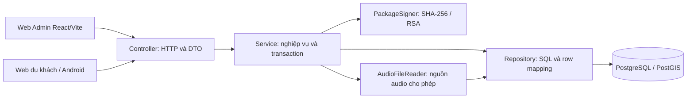
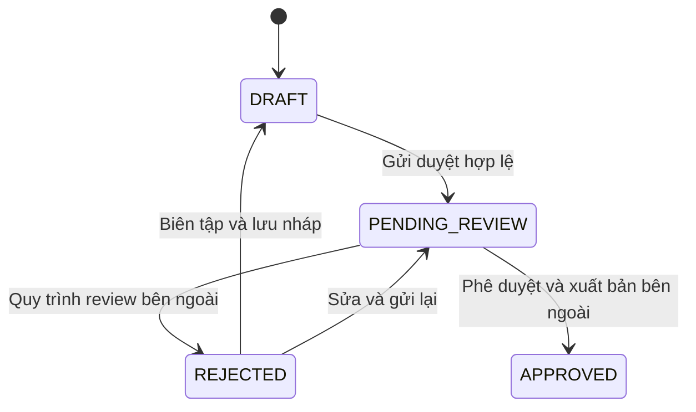

# Hướng dẫn mã nguồn và chạy demo

Cập nhật theo source ngày **25/10/2026**, sau các commit phân lớp JDBC và hoàn thiện Web Admin. Đây là hướng dẫn code/setup, không phải xác nhận đã triển khai production hoặc đã chạy mọi integration test. Yêu cầu chuẩn: [PRD EN](../en/PRD_Report.md), [PRD VI](PRD_Report_vi.md); hồ sơ thiết kế/review lịch sử: [HVP-21](https://trannhuthuy897.atlassian.net/browse/HVP-21). Bản hướng dẫn cũ ngày 19/10 mô tả editor/feedback mock không còn phản ánh luồng mặc định hiện tại.

## 1. Kiến trúc và nguyên tắc phân lớp



- Controller nhận tham số HTTP, dùng `@Valid` cho JSON lưu nội dung/chuyển trạng thái, gọi Service, trả record DTO hoặc binary audio/package. Không viết SQL hay quyết định trạng thái nghiệp vụ.
- Service kiểm tra nghiệp vụ và điều phối, đặt `@Transactional`. Không inject JdbcTemplate và không viết SQL. Truy vấn có tham số và ánh xạ ResultSet/JSONB đều ở Repository.
- Giữ Spring JDBC vì code/schema/PostGIS đã dùng JDBC và cần SQL rõ ràng. Repository là class cụ thể, không cần JPA/Hibernate hoặc Service Interface + Impl.
- Các object linh hoạt có kiểu cụ thể: tên là `Map<String,String>`, biến thể là `Map<String,Asset>`. Request/response Admin và Package không còn `Map<String,Object>`.
- Flyway quản lý schema. Không sửa migration đã áp dụng hay sửa tay database để triển khai tính năng.

Gốc Java trong các liên kết bên dưới là `backend/multi-audio-guide/src/main/java/com/application/`.

## 2. Lần theo các luồng chính

| Luồng | Controller | Service | Repository / thành phần |
|---|---|---|---|
| Danh mục, tìm kiếm, chi tiết địa điểm | [LocationController](../../backend/multi-audio-guide/src/main/java/com/application/controller/LocationController.java) | [LocationDiscoveryService](../../backend/multi-audio-guide/src/main/java/com/application/service/LocationDiscoveryService.java) | [LocationRepository](../../backend/multi-audio-guide/src/main/java/com/application/repository/LocationRepository.java), [CategoryRepository](../../backend/multi-audio-guide/src/main/java/com/application/repository/CategoryRepository.java), [DiscoveryMapper](../../backend/multi-audio-guide/src/main/java/com/application/mapper/DiscoveryMapper.java) |
| Lấy thuyết minh | [GuideController](../../backend/multi-audio-guide/src/main/java/com/application/controller/GuideController.java) | [PlaybackService](../../backend/multi-audio-guide/src/main/java/com/application/service/PlaybackService.java) | [GuideRepository](../../backend/multi-audio-guide/src/main/java/com/application/repository/GuideRepository.java) |
| Ghi lượt bắt đầu phát và thống kê | [DemoPlaybackController](../../backend/multi-audio-guide/src/main/java/com/application/controller/DemoPlaybackController.java) | PlaybackService | GuideRepository, [PlaybackRepository](../../backend/multi-audio-guide/src/main/java/com/application/repository/PlaybackRepository.java) |
| Cấu hình, danh sách, biên tập, upload/preview Admin | [AdminContentController](../../backend/multi-audio-guide/src/main/java/com/application/controller/AdminContentController.java) | [AdminContentService](../../backend/multi-audio-guide/src/main/java/com/application/service/AdminContentService.java) | [AdminContentRepository](../../backend/multi-audio-guide/src/main/java/com/application/repository/AdminContentRepository.java) |
| Gói offline và public key | [ContentPackageController](../../backend/multi-audio-guide/src/main/java/com/application/controller/ContentPackageController.java) | [ContentPackageService](../../backend/multi-audio-guide/src/main/java/com/application/service/ContentPackageService.java) | [ContentPackageRepository](../../backend/multi-audio-guide/src/main/java/com/application/repository/ContentPackageRepository.java), [PackageSigner](../../backend/multi-audio-guide/src/main/java/com/application/component/PackageSigner.java), [AudioFileReader](../../backend/multi-audio-guide/src/main/java/com/application/component/AudioFileReader.java) |
| Phản hồi: danh sách, lọc, chi tiết, trạng thái, dữ liệu xuất | [FeedbackController](../../backend/multi-audio-guide/src/main/java/com/application/controller/FeedbackController.java) | [FeedbackService](../../backend/multi-audio-guide/src/main/java/com/application/service/FeedbackService.java) | [FeedbackRepository](../../backend/multi-audio-guide/src/main/java/com/application/repository/FeedbackRepository.java) |

Danh sách Admin: trước đây `list()` lấy ID rồi gọi `detail()` từng ID: **1 + 2N + P SELECT**, N là số ID, P là số ID có hàng trong locations (có thêm truy vấn assets). Nếu cả N đều có locations thì 1 + 3N. Hiện `workspaces(null)` lấy metadata/draft/tên bằng một SELECT và assets bằng một SELECT batch: **2 SELECT khi có dữ liệu, 1 khi rỗng**, không tăng theo N. Đây là số câu query trong code; test đo trên JDBC thật ở AdminWorkflowIntegrationTest chưa chạy trong phiên này vì DB không sẵn sàng. Config/login là request khác, không được tính vào hai query danh sách.

## 3. Hợp đồng API

API nằm dưới `/api`. Mã thành công là 200. `Admin` trong cột Auth nghĩa HTTP Basic qua [DemoAdminFilter](../../backend/multi-audio-guide/src/main/java/com/application/config/DemoAdminFilter.java). Thiếu/sai credentials → 401; server chưa cấu hình mật khẩu → 503. Không có đăng ký/tạo tài khoản Admin trong phạm vi này.

| Method / đường dẫn | Request / response | Auth | Lỗi chính |
|---|---|---|---|
| GET `/api/categories` | Không body → [CategoryResponse](../../backend/multi-audio-guide/src/main/java/com/application/dto/CategoryResponse.java)[] | Public | 503 |
| GET `/api/locations` | `keyword`, `categoryId`, `page=0`, `size=20` → [LocationSearchResponse](../../backend/multi-audio-guide/src/main/java/com/application/dto/LocationSearchResponse.java) | Public | 400,404,503 |
| GET `/api/locations/{locationId}` | UUID → [LocationResponse](../../backend/multi-audio-guide/src/main/java/com/application/dto/LocationResponse.java) | Public | 400,404,503 |
| GET `/api/locations/{id}/guide` | `language=VI`, `scriptType=FULL` → [GuideContent](../../backend/multi-audio-guide/src/main/java/com/application/model/GuideContent.java) | Public | 400,404,503 |
| POST `/api/playbacks` | [PlaybackRequest](../../backend/multi-audio-guide/src/main/java/com/application/dto/PlaybackRequest.java): eventId, contentId, occurredAt?, offline? → [PlaybackReceipt](../../backend/multi-audio-guide/src/main/java/com/application/dto/PlaybackReceipt.java) | Public, profile demo | 400,404,409,503 |
| GET `/api/admin/analytics` | from/to ISO date, mặc định 30 ngày → [AnalyticsResponse](../../backend/multi-audio-guide/src/main/java/com/application/dto/AnalyticsResponse.java) | Admin, demo | 400,401,503 |
| GET `/api/admin/content/config` | Không body → AdminContentDto.Config | Admin, demo | 401,503 |
| GET `/api/admin/content/locations` | Không body → AdminContentDto.LocationDetail[] | Admin, demo | 401,503 |
| GET `/api/admin/content/locations/{id}` | UUID → AdminContentDto.LocationDetail | Admin, demo | 400,401,404,503 |
| PUT `/api/admin/content/locations/{id}` | AdminContentDto.SaveRequest → LocationDetail | Admin, demo | 400,401,409,503 |
| POST `/api/admin/content/audio` | Multipart: locationId, language, scriptType, file → AdminContentDto.UploadResponse | Admin, demo | 400,401,413,503 |
| GET `/api/admin/content/audio/{id}.{format}` | UUID/format → bytes với Content-Type audio | Admin, demo | 400,401,404,503 |
| GET `/api/content-audio/{id}.{format}` | UUID/format → audio chỉ khi được nội dung APPROVED tham chiếu | Public, demo | 400,404,503 |
| GET `/api/content-packages/key` | Không body → ContentPackageDto.PublicKey | Public, demo | — |
| GET `/api/content-packages` | Không body → ContentPackageDto.Manifest[] cho BASE/OPTIONAL | Public, demo | 404,503 |
| GET `/api/content-packages/{scope}/{version}` | BASE hoặc OPTIONAL, version → JSON package bytes; header X-Content-SHA256 | Public, demo | 400,404,503 |
| GET `/api/admin/feedback` | FeedbackDto.Query: from/to/category/status/page=1/size=10 → FeedbackDto.Page | Admin, demo | 400,401,503 |
| GET `/api/admin/feedback/{id}` | UUID → FeedbackDto.Item | Admin, demo | 400,401,404,503 |
| PATCH `/api/admin/feedback/{id}/status` | FeedbackDto.StatusRequest: status → Item có timestamp cập nhật | Admin, demo | 400,401,404,409,503 |
| GET `/api/admin/feedback/export` | Cùng bộ lọc/kỳ → FeedbackDto.Item[], toàn bộ kết quả không cắt trang | Admin, demo | 400,401,503 |

Định nghĩa record: [AdminContentDto](../../backend/multi-audio-guide/src/main/java/com/application/dto/AdminContentDto.java), [ContentPackageDto](../../backend/multi-audio-guide/src/main/java/com/application/dto/ContentPackageDto.java), [FeedbackDto](../../backend/multi-audio-guide/src/main/java/com/application/dto/FeedbackDto.java). Endpoint feedback/export trả JSON; trình duyệt tạo XLSX bằng ExcelJS. Không có endpoint approve/publish/reject nội dung hoặc nhận feedback mới từ du khách trong UC-06/UC-07 này.

[ApiExceptionHandler](../../backend/multi-audio-guide/src/main/java/com/application/controller/ApiExceptionHandler.java) chuyển lỗi nghiệp vụ, JSON/validation, sai kiểu tham số và lỗi truy cập DB thành ProblemDetail. Lỗi DB → 503, không trả SQL cho client. Multipart quá kích thước do Spring xử lý; không cam kết mọi lỗi container có cùng format JSON.

Public discovery và guide chỉ trả nội dung được công khai. Guide fallback Selected → EN → VI, giữ nguyên FULL/SHORT. Receipt dùng eventId để chống đếm trùng; cùng eventId cho content khác → 409. Analytics đếm lượt **bắt đầu phát**, không suy ra nghe hết, và dùng giờ Asia/Ho_Chi_Minh. Kỳ báo cáo tối đa 366 ngày.

## 4. Nháp, tên đa ngôn ngữ và xét duyệt

SaveRequest giữ các trường cũ `id`, `name`, `category`, `latitude`, `longitude`, `radius`, `status`, `assets`, `editVersion`; bổ sung `names` dạng `{ "vi": "Tên Việt", "en": "English name" }`. UUID trên wire vẫn là chuỗi. Category là tên danh mục cấu hình hiện hành; tọa độ/bán kính trên wire vẫn là chuỗi để nháp được trống. Assets có khóa `language:FULL|SHORT` và Asset có locationId/languageCode/scriptType/text/audioUrl/audioName. Gửi đầy đủ assets để giữ biến thể khác.

Tên trên danh sách: VI → EN → ngôn ngữ còn lại theo thứ tự mã → tên legacy. Client cũ không gửi names vẫn được hỗ trợ qua name; khi cả names và name được gửi, client mới gửi name bằng giá trị fallback hiện tại, còn sửa name độc lập được coi là chỉnh tên VI legacy. Tên theo ngôn ngữ dùng chung bộ chọn với kịch bản/audio, không phụ thuộc FULL/SHORT. Ngôn ngữ/danh mục lấy từ config DB.



- DRAFT cho phép thiếu thông tin; PENDING_REVIEW cần tên, danh mục hoạt động, lat/lng hợp lệ và bán kính nguyên dương. Frontend hiển thị lỗi cạnh trường và focus trường đầu; backend vẫn kiểm tra độc lập.
- Tên/kịch bản bản làm việc nằm trong JSONB `admin_content_drafts.payload`; Repository chịu trách nhiệm serialize/deserialize. Tên đã công khai có bảng location_translations; editor không ghi đè bảng published này.
- `editVersion=0` tạo bản làm việc nếu chưa có; phiên bản >0 cập nhật có điều kiện bằng version. Cập nhật thành công tăng version và ghi updatedBy/updatedAt. Không khớp → 409; frontend giữ form, không ghi đè dữ liệu mới.
- Nếu đã có APPROVED, bản nháp/gửi duyệt nằm riêng. Public guide/location/audio/package không bị thay bởi PUT Admin. Response có published để giải thích bản vẫn đang chạy.
- REJECTED và reviewerComment được đọc từ workspace; UI chỉ hiển thị và hướng dẫn sửa/gửi lại. PUT không cho tự đặt REJECTED/APPROVED và không nhận quyền sửa nhận xét. Reviewer bên ngoài phải tăng edit_version khi đổi kết quả review để tránh một tab cũ ghi đè; không có API reviewer trong dự án này. Nhận xét cũ được giữ sau khi resubmit cho tới khi quy trình bên ngoài thay đổi nó.
- Upload MP3/WAV/OGG, 12 byte–20 MB, kiểm tra header phía server và khả năng decode ở trình duyệt. Upload lỗi giữ text/field và cho chọn lại/retry. Audio nháp được nghe qua endpoint Admin rồi tạo blob URL, public URL vẫn 404 trước publication.

Migration mới: [V5 feedback/localized names](../../backend/multi-audio-guide/src/main/resources/db/migration/V5__feedback_and_localized_names.sql) tạo location_translations, bổ sung category/updated_at/language_code/index cho feedbacks đã có từ V1; không tạo trùng bảng feedback. [V5_1 workspace review/names](../../backend/multi-audio-guide/src/main/resources/db/demo/V5_1__workspace_review_and_names.sql) thêm REJECTED/reviewer_comment và backfill names cho nháp cũ. Không sửa migration V1–V4 đã có.

## 5. Phản hồi và xuất báo cáo

FeedbackRepository đọc `feedbacks` thật, không dùng localStorage. FeedbackDto.Item có id/locationId/location/category/content/rating/status/created/updated/createdAt; rating có thể null với dữ liệu ngoại vi chưa đánh giá. Page có items/page/size/total/totalPages/categories. Trang bắt đầu **1** (khác discovery bắt đầu 0), size 1–50. Bộ lọc category/status và kỳ ngày được áp dụng trong SQL, biên ngày theo giờ Việt Nam, thứ tự created_at giảm dần rồi UUID để ổn định.

Status chỉ tiến NEW → IN_REVIEW → RESOLVED. Service từ chối bỏ bước, lùi hoặc mở lại với 409; Repository UPDATE có điều kiện status cũ để chống hai tab cùng ghi. updated_at do database ghi. Danh sách/chi tiết không nhận quyền thay nội dung du khách đã gửi.

[LiveFeedback](../../web-admin/src/components/LiveFeedback.tsx) đồng bộ category/status/page/feedback với URL. Chi tiết lấy API riêng; loading/error/retry/empty có UI riêng, feedback dài được giới hạn ở bảng và hiển thị đầy đủ trong dialog. Cập nhật trạng thái thông báo bằng aria-live bên trong dialog.

[LiveAnalytics](../../web-admin/src/pages/LiveAnalytics.tsx) dùng [feedbackForExport](../../web-admin/src/lib/feedback.ts) gọi export với kỳ/category/status hiện tại, bỏ pagination. [exportReport](../../web-admin/src/lib/export.ts) tạo hai sheet Analytics và Feedback. ExcelJS dùng `await import("exceljs")` bên trong thao tác xuất; không vào initial bundle. Lỗi tải dữ liệu hoặc ghi XLSX giữ filter/state và có Thử lại. Bản mock chủ đích tại `/analytics?source=mock` vẫn giữ để kiểm tra UI; không fallback âm thầm khi API lỗi. Export mock cũng áp dụng đúng filters.

## 6. Gói nội dung offline và kiểm tra cập nhật

ContentPackageService đọc locations và guide APPROVED trong một transaction REPEATABLE_READ. BASE hiện chọn category UUID `10000000-0000-0000-0000-000000000101`; OPTIONAL là các category khác. Đây là cấu hình demo đang có, chưa phải catalog quản trị gói hoàn chỉnh. Hai scope phải có dữ liệu khi lấy toàn bộ manifest, nếu một scope trống request hiện có thể trả 404.

Repository batch phần survey geofence; JSON package có schemaVersion/status/scope/isBase/locations/guides/languages/assets và geofencing khi có khảo sát hợp lệ. Không tự cấp chứng nhận survey hoặc lấy tọa độ tham khảo làm survey.

AudioFileReader chỉ chấp nhận classpath demo WAV hoặc audio upload trong database theo mẫu đường dẫn cho phép. PackageSigner tính SHA-256 trên JSON UTF-8 chính xác, tạo version `scope-sha256`, ký SHA256withRSA; public key trả dạng SPKI Base64. Metadata asset có URL/size/checksum; audio không nhúng vào JSON. Sai version tải → 404, client phải lấy manifest mới. Tách record có thể làm version package thay đổi theo bytes; client cần kiểm tra cập nhật bình thường.

Key RSA hiện tạo khi backend khởi động, chưa có key store/key rotation trust production. Không đổi chữ ký thành xác thực danh tính tin cậy chỉ vì checksum đúng.

Điểm kiểm tra client: [Web OfflinePage](../../web-user/src/pages/OfflinePage.tsx), [Web packages](../../web-user/src/lib/packages.ts), [Android SharedTourRepository](../../android/app/src/main/java/vn/hvp/travelvoice/data/remote/SharedTourRepository.kt), [Android SharedTourScreen](../../android/app/src/main/java/vn/hvp/travelvoice/ui/screens/SharedTourScreen.kt). Các client có thao tác kiểm tra/tải gói; không có lịch polling package tự động chung do backend chạy. Polling **5 giây** trong [useLiveAnalytics](../../web-admin/src/lib/live-analytics.ts) là cập nhật số lượt nghe khi tab hiển thị, không phải polling nội dung offline. Phiên này không sửa/chạy lại Web Tourist hoặc Android.

## 7. Chạy demo

### Docker: cách dùng script có sẵn

Yêu cầu Docker Desktop/engine hoạt động. Từ root:

```powershell
.\scripts\start-live-demo.ps1
# Chỉ khi cần cùng Wi-Fi tin cậy:
# .\scripts\start-live-demo.ps1 -Lan
```

[Script](../../scripts/start-live-demo.ps1) tạo cấu hình cá nhân `.env.demo.local` nếu chưa có, profile demo, Compose project hvp-live-demo, backend **8081**, Admin **3001**. Không đưa file env hay mật khẩu thật lên Git/chat. [compose.yaml](../../compose.yaml) có default **8080/3000**; đó là cấu hình khác khi không dùng override của script. Không trộn hai bộ cổng trong một buổi demo.

Thứ tự: PostGIS healthy → backend chạy Flyway và healthy → nginx Web Admin. Mở `http://localhost:3001/locations`; đăng nhập theo DEMO_ADMIN_USERNAME/DEMO_ADMIN_PASSWORD trong file local. Username mặc định admin, mật khẩu không hard-code. Phiên giữ trong memory tab; reload cần đăng nhập lại. Endpoint Admin chỉ có khi profile demo.

### Backend local + Vite

Chuẩn bị PostgreSQL/PostGIS riêng và đặt biến môi trường local trước (không ghi giá trị thật vào tài liệu):

```powershell
$env:JAVA_HOME = 'C:\Program Files\Java\jdk-21.0.11' # hoặc JDK 21 của máy
$env:SPRING_PROFILES_ACTIVE = 'demo'
# Đặt SPRING_DATASOURCE_URL / USERNAME / PASSWORD và DEMO_ADMIN_USERNAME / PASSWORD trong môi trường cá nhân.
Set-Location .\backend\multi-audio-guide
.\mvnw.cmd spring-boot:run
```

Backend local mặc định 8080. Terminal khác, từ root:

```powershell
Set-Location .\web-admin
npm.cmd ci
$env:API_PROXY_TARGET = 'http://127.0.0.1:8080'
npm.cmd run dev -- --port 5174
```

[Vite config](../../web-admin/vite.config.ts) proxy /api và /demo-audio. Nếu dùng backend Docker script thì đổi target thành 8081. Khi chạy Web du khách riêng, [Vite config Tourist](../../web-user/vite.config.ts) dùng cổng 5175 và cũng cần cùng API_PROXY_TARGET. `vite preview` của Admin không phải cách thay thế reverse proxy API trong Docker.

### Kịch bản trình diễn và kết quả mong đợi

| Bước | Thao tác | Kết quả mong đợi |
|---|---|---|
| 1 | Mở locations, đăng nhập, tìm/lọc, mở địa điểm APPROVED | Danh sách từ API, trạng thái và coverage; form có tên/kịch bản/audio, thông báo bảo vệ bản published |
| 2 | Thêm địa điểm, chỉ điền tên VI/EN rồi Lưu nháp | DRAFT lưu DB; reload/đăng nhập lại đọc đúng names. Nội dung chưa công khai cho du khách |
| 3 | Gửi duyệt khi thiếu trường; sau đó điền danh mục/GPS/bán kính | Lần đầu lỗi inline và focus; lần sau PENDING_REVIEW. Không có nút tự duyệt/xuất bản |
| 4 | Sửa một audio ngôn ngữ × FULL/SHORT; thử tệp sai trước | Lỗi giữ form, retry được; biến thể khác và bản published không đổi |
| 5 | Hai tab đọc cùng editVersion; tab A lưu, tab B lưu tiếp | B nhận 409 và giữ nội dung nhập, không overwrite A |
| 6 | Mở bản do quy trình bên ngoài trả REJECTED | Hiện nhận xét chỉ đọc; sửa/gửi lại thành PENDING_REVIEW. Không tự tạo kết quả review để giả bằng chứng |
| 7 | Phát nội dung APPROVED trên Web/Android dùng cùng backend rồi xem analytics | Khi event lưu DB, dashboard tăng lượt bắt đầu phát; pause/resume không tự tạo event mới chỉ từ UI Admin |
| 8 | Chọn kỳ/category/status, mở phản hồi, chuyển lần lượt hai bước | Đọc DB thật; timestamp đổi; RESOLVED không có thao tác mở lại. Nếu nguồn ngoài chưa có feedback thì EmptyState là đúng |
| 9 | Xuất XLSX ở trang thật, kiểm tra hai sheet | Feedback đúng kỳ + filters, gồm mọi trang; không lấy fixture/mock hoặc chỉ trang hiện tại |
| 10 | Client kiểm tra/tải gói, sau đó thay đổi chỉ bản nháp | Package published không đổi bởi nháp. Publication ngoài mới thay đổi nội dung/version |

Để kiểm thử dữ liệu review/feedback mà không thêm API ngoài PRD, integration test tạo fixture trong transaction rồi rollback. Muốn trình diễn feedback thật cần chuẩn bị bản ghi từ hệ thống gửi feedback bên ngoài. Không thêm seed feedback giả vào migration production hay tự tuyên bố feedback đến từ du khách thật.

## 8. Kiểm chứng và cách chạy lại

| Lệnh/kiểm tra thực tế ngày 25/10 | Kết quả |
|---|---|
| Backend `mvnw.cmd clean verify -q` với JDK 21 | PASS: 41 test chạy thành công, 48 integration test skipped; 0 failure/error. Không coi skipped là pass DB |
| Web Admin `npm.cmd run lint` | PASS |
| Web Admin `npm.cmd run build` | PASS; ExcelJS chunk khoảng 929.55 kB minified (256.42 kB gzip), tải động; cảnh báo kích thước còn tồn tại |
| `npx.cmd playwright test --workers=1` | 16 PASS, 5 SKIP cần backend thật; 42.1 giây ở lượt cuối. Đây là UI test với HTTP fixtures, không phải PostgreSQL integration |
| Kiểm tra package service | Không còn JdbcTemplate/SQL; không còn Map<String,Object> trong service/controller Admin/Package |
| Skills | 9 manifest YAML hợp lệ, commit ghim và 132 file hash khớp lock; chưa restart agent discovery |

[Test Admin unit](../../backend/multi-audio-guide/src/test/java/com/application/service/AdminContentServiceTest.java) mock Repository, kiểm tra nháp/validation/conflict/published/names. [Test Package unit](../../backend/multi-audio-guide/src/test/java/com/application/service/ContentPackageServiceTest.java) kiểm tra JSON client fields, checksum/chữ ký và bytes ổn định. [Test Feedback unit](../../backend/multi-audio-guide/src/test/java/com/application/service/FeedbackServiceTest.java) kiểm tra thứ tự trạng thái, conflict, filter/kỳ xuất. [AdminWorkflowIntegrationTest](../../backend/multi-audio-guide/src/test/java/com/application/AdminWorkflowIntegrationTest.java) kiểm tra persistence tên/nhận xét, 2 query batch, feedback SQL/filter/export/status trên DB thật khi có env.

[Test UI mới](../../web-admin/tests/admin-workflow.spec.ts), [HTTP fixtures](../../web-admin/tests/admin-fixture.ts), [test hồi quy](../../web-admin/tests/demo.spec.ts), [test danh sách](../../web-admin/tests/location-list.spec.ts) giữ phân biệt rõ fake HTTP và runtime thật. Browser test đọc lại workbook bằng ExcelJS, kiểm tra tất cả 22 phản hồi Audio/NEW dù màn hình chỉ có 10; kiểm tra không tải ExcelJS trước thao tác xuất, retry, axe và layout 390px. Test prototype cũ đã đổi sang fixture HTTP cho editor hiện hành; không thêm đường mock ngầm vào code sản phẩm.

Khi PostGIS test riêng sẵn sàng, đặt TEST_DATABASE_URL/TEST_DATABASE_USERNAME/TEST_DATABASE_PASSWORD rồi chạy lại Maven clean verify. Chỉ trỏ tới DB **kiểm thử riêng**, không tới DB demo/production đang dùng. Không tự đặt cả ba biến rỗng rồi coi integration đã chạy. CI [workflow](../../.github/workflows/ci.yml) đã có PostGIS và TEST_DATABASE_*; chưa push hay xác nhận lần chạy CI mới trong phiên này.

Test UI nối DB thật: [content config](../../web-admin/playwright.content-live.config.ts), [content tests](../../web-admin/tests/content.live.spec.ts), [analytics tests](../../web-admin/tests/live-analytics.spec.ts). Content config dùng Admin cổng 3000; phải chạy đúng stack, đặt LIVE_CONTENT_API=1 và credentials môi trường. Suite này tạo nháp test có tiền tố Codex UI integration và ghi ID đã tạo vào output test để dọn đúng bản ghi. Không chạy nhầm lên production.

## 9. Giới hạn đã biết và việc cần làm trước demo

1. Docker Desktop lần khởi động trong phiên này lỗi `dockerInference` (không truy cập được socket/file), nên chưa áp dụng V5/V5_1 vào DB thật, chưa chạy integration/migration/đo query thật. Không reset Docker hay xóa volume để né lỗi. Cần sửa môi trường hoặc chạy CI/PostGIS test riêng trước khi coi demo được nghiệm thu đầy đủ.
2. Admin auth vẫn chỉ Basic Auth demo, updatedBy là tài khoản cấu hình chung; chưa có HTTPS/RBAC production, lịch sử reviewer đầy đủ hoặc dịch vụ publication. Key ký gói không bền qua restart. Không gọi hệ thống production-ready.
3. UC-07 đã có API quản lý phản hồi nhưng nguồn gửi feedback từ Tourist là dependency ngoài phạm vi. DB trống phải hiện EmptyState. Chưa có cơ chế tạo feedback thật trong Web Admin.
4. XLSX gom feedback toàn kỳ trong memory, không streaming; phù hợp demo, cần giới hạn/streaming khi dữ liệu rất lớn. Metrics và feedback xuất được lấy qua hai request riêng nên không phải snapshot transaction chung giữa cả hai tập dữ liệu.
5. Các test UI đã chạy bằng Chromium/HTTP fixture; chưa chứng minh screen reader thật, trình duyệt khác, chất lượng nghe thực tế, Android/Web Tourist runtime, deployment hay rollback migration. Checklist giao diện theo quy tắc Vercel và axe không thay thế các kiểm chứng đó.

Skills/setup của agent: [AGENT_SKILLS.md](AGENT_SKILLS.md). Các quyết định nghiệp vụ chưa rõ tiếp tục nằm ở Jira, không được suy từ fixture hoặc bài kiểm thử thành yêu cầu mới.

## 10. File thay đổi theo giai đoạn

Skills: commit ea4da6a, chỉ .claude và AGENT_SKILLS.md; danh sách payload/hash nằm trong lock. Các commit bên dưới chưa push.

### Giai đoạn 1 — phân lớp JDBC (ee6a613, 14 file)

```text
backend/multi-audio-guide/pom.xml
backend/multi-audio-guide/src/main/java/com/application/component/AudioFileReader.java
backend/multi-audio-guide/src/main/java/com/application/component/PackageSigner.java
backend/multi-audio-guide/src/main/java/com/application/controller/AdminContentController.java
backend/multi-audio-guide/src/main/java/com/application/controller/ApiExceptionHandler.java
backend/multi-audio-guide/src/main/java/com/application/controller/ContentPackageController.java
backend/multi-audio-guide/src/main/java/com/application/dto/AdminContentDto.java
backend/multi-audio-guide/src/main/java/com/application/dto/ContentPackageDto.java
backend/multi-audio-guide/src/main/java/com/application/repository/AdminContentRepository.java
backend/multi-audio-guide/src/main/java/com/application/repository/ContentPackageRepository.java
backend/multi-audio-guide/src/main/java/com/application/service/AdminContentService.java
backend/multi-audio-guide/src/main/java/com/application/service/ContentPackageService.java
backend/multi-audio-guide/src/test/java/com/application/TourPackageIntegrationTest.java
backend/multi-audio-guide/src/test/java/com/application/service/AdminContentServiceTest.java
```

### Giai đoạn 2 — nội dung đa ngôn ngữ và phản hồi (42d77ed, 31 file)

```text
backend/multi-audio-guide/src/main/java/com/application/controller/ContentPackageController.java
backend/multi-audio-guide/src/main/java/com/application/controller/FeedbackController.java
backend/multi-audio-guide/src/main/java/com/application/dto/AdminContentDto.java
backend/multi-audio-guide/src/main/java/com/application/dto/ContentPackageDto.java
backend/multi-audio-guide/src/main/java/com/application/dto/FeedbackDto.java
backend/multi-audio-guide/src/main/java/com/application/repository/AdminContentRepository.java
backend/multi-audio-guide/src/main/java/com/application/repository/FeedbackRepository.java
backend/multi-audio-guide/src/main/java/com/application/service/AdminContentService.java
backend/multi-audio-guide/src/main/java/com/application/service/ContentPackageService.java
backend/multi-audio-guide/src/main/java/com/application/service/FeedbackService.java
backend/multi-audio-guide/src/main/resources/db/demo/V5_1__workspace_review_and_names.sql
backend/multi-audio-guide/src/main/resources/db/migration/V5__feedback_and_localized_names.sql
backend/multi-audio-guide/src/test/java/com/application/AdminWorkflowIntegrationTest.java
backend/multi-audio-guide/src/test/java/com/application/service/AdminContentServiceTest.java
backend/multi-audio-guide/src/test/java/com/application/service/ContentPackageServiceTest.java
backend/multi-audio-guide/src/test/java/com/application/service/FeedbackServiceTest.java
web-admin/src/App.tsx
web-admin/src/components/LiveFeedback.tsx
web-admin/src/lib/export.ts
web-admin/src/lib/feedback.ts
web-admin/src/lib/status.ts
web-admin/src/mocks/data.ts
web-admin/src/pages/AnalyticsFeedback.tsx
web-admin/src/pages/LiveAnalytics.tsx
web-admin/src/pages/LocationForm.tsx
web-admin/src/pages/LocationList.tsx
web-admin/tests/admin-fixture.ts
web-admin/tests/admin-workflow.spec.ts
web-admin/tests/demo.spec.ts
web-admin/tests/live-analytics.spec.ts
web-admin/tests/location-list.spec.ts
```

### Giai đoạn 3 — tài liệu

```text
docs/vi/DEMO_CODE_GUIDE.md
docs/vi/AGENT_SKILLS.md
backend/ADMIN_CONTENT_API.md
backend/README.md
web-admin/README.md
```

Không thay đổi android/ hoặc web-user/ trong các mốc này.
