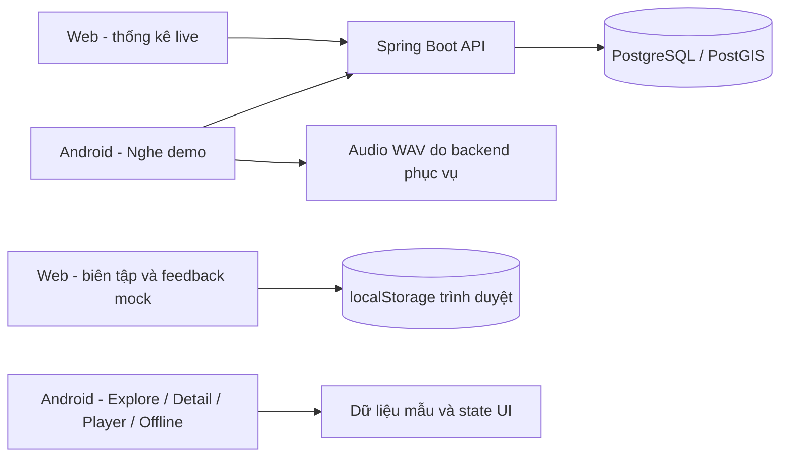
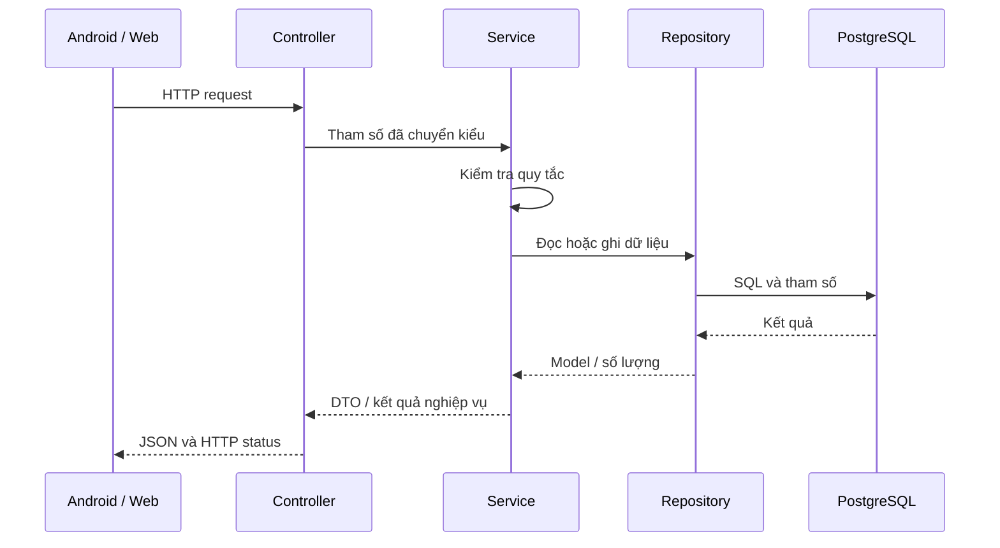
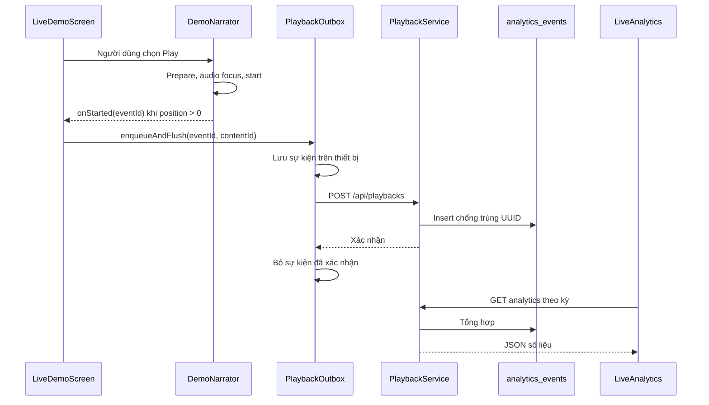
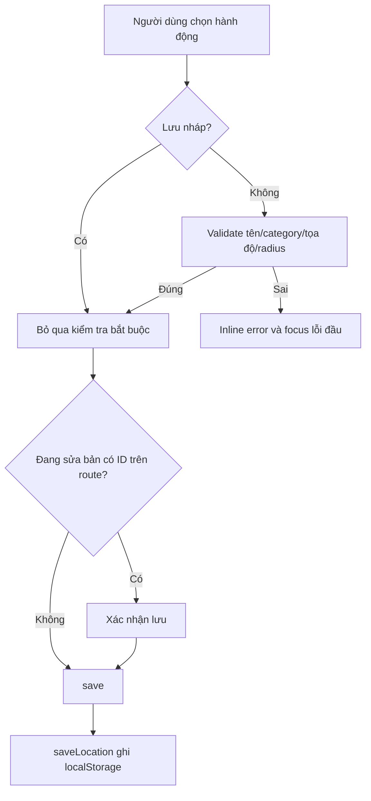

# Hướng dẫn đọc và tự review mã nguồn demo

Ngày giải thích: **19/10/2026**. Mốc source: **`9731cbe`**.

Tài liệu này giải thích **code hiện có**, giúp thành viên lần theo dữ liệu và tự kiểm tra trước khi sửa. Đây không phải xác nhận rằng tất cả chức năng đã hoàn thành hoặc là PRD mới.

**Cập nhật hướng sản phẩm ngày 19/10/2026:** PRD §2.4 đã chốt Web du khách và Android dùng chung UC-01–UC-05, nghiệp vụ và backend/nội dung. Web Admin vẫn riêng. Source được giải thích bên dưới chưa có Web du khách hoàn chỉnh; sơ đồ source hiện tại không thay thế kiến trúc đích mới trong PRD.

**Bắt đầu:** đọc mục 1–3 để hiểu hệ thống, sau đó chọn một luồng ở mục 4. Không cần đọc hết mọi file trong một buổi.

Nguồn yêu cầu: [PRD EN](../en/PRD_Report.md), [PRD VI](PRD_Report_vi.md). Kết luận review và quyết định thiết kế tiếp tục quản lý tại [HVP-21 — Web](https://trannhuthuy897.atlassian.net/browse/HVP-21), [HVP-22 — Android](https://trannhuthuy897.atlassian.net/browse/HVP-22) và các Epic. Khi source thay đổi, đối chiếu lại tài liệu bằng tên hàm; không mặc định mô tả này luôn cập nhật.

## 1. Bản demo hiện có những gì?

Có ba ứng dụng trong cùng repository:

| Phần | Chạy ở đâu? | Trách nhiệm |
| --- | --- | --- |
| `android/` | Điện thoại hoặc emulator | Giao diện du khách, bản đồ, nghe demo |
| `web-admin/` | Trình duyệt | Giao diện biên tập và thống kê |
| `backend/multi-audio-guide/` | Máy chạy Java/Docker | API, kiểm tra dữ liệu, truy vấn PostgreSQL |

Android không chứa Spring Boot hoặc PostgreSQL. Web và Android gửi HTTP request tới backend; backend mới truy cập database.



**Hai khối mock không tự đồng bộ với database.** Sửa địa điểm trên Web hiện không thay nội dung tab Nghe demo hoặc Khám phá của Android.

### 1.1 Phân biệt bốn mức hoàn thiện

| Mức | Ví dụ trong dự án | Điều nó chứng minh |
| --- | --- | --- |
| Giao diện | Có nút TTS, thanh tiến độ | Có thể biểu diễn thao tác |
| Mô phỏng logic | Timer tăng vị trí nghe | State UI thay đổi theo tình huống |
| Tích hợp | MediaPlayer tải WAV, API ghi event | Có mã làm việc với dịch vụ thật |
| Kiểm chứng runtime | Thiết bị phát, dashboard tăng đúng | Luồng đã chạy đúng trong điều kiện kiểm tra |

Không suy từ việc có UI, có bảng DB hoặc build thành công rằng cả luồng đã tích hợp và được kiểm chứng.

### 1.2 Ba bộ dữ liệu cần nhận diện

| Nguồn | Địa điểm mẫu | Ngôn ngữ mẫu |
| --- | --- | --- |
| Web `src/mocks/data.ts` | Sáu địa điểm TP.HCM | `vi`, `en`, `fr` |
| Android `DemoData.kt` | Sáu địa điểm Hà Nội | `VI`, `EN`, `JA` |
| Backend demo seed | Ba địa điểm Demo | Ba guide `VI/SHORT` có WAV |

Web dùng ID như `loc-1`; Android mock dùng `ngoc-son`; backend dùng UUID. Không ghép chúng thành một địa điểm chỉ dựa trên tên hiển thị.

## 2. Từ điển để đọc code

| Từ | Hiểu trong dự án này |
| --- | --- |
| Mock / fixture | Dữ liệu chuẩn bị sẵn để trình diễn hoặc test |
| State | Giá trị quyết định UI hiện đang hiển thị gì |
| Derived data | Kết quả tính từ state/dữ liệu khác, ví dụ danh sách sau lọc |
| Side effect | Việc ngoài tính UI: gọi HTTP, timer, đăng ký listener, ghi storage |
| Route | Đường dẫn mở màn hình |
| Query parameter | Trạng thái sau dấu `?`, ví dụ `status=NEW&page=2` |
| DTO | Dữ liệu được nhận/trả qua API |
| Repository | Nơi thực hiện truy vấn dữ liệu |
| Revision | Một phiên bản nội dung có ID riêng |
| Idempotency | Gửi lại cùng sự kiện vẫn chỉ tạo một bản ghi |
| Outbox | Danh sách sự kiện lưu trên thiết bị để gửi lại khi lỗi |
| Audio focus | Quyền sử dụng âm thanh do hệ điều hành điều phối |
| TTS | Chuyển văn bản thành tiếng nói; khác với phát một WAV có sẵn |

## 3. Bản đồ thư mục và điểm bắt đầu

```text
web-admin/src/
  main.tsx                 Gắn React vào trang HTML
  App.tsx                  Layout và routes
  pages/                   Các màn nghiệp vụ
  components/ui/           Control dùng chung
  components/locations/    Hàng địa điểm và chỉ báo ngôn ngữ
  mocks/data.ts            Model + fixture + lưu localStorage
  lib/                     Format, export, hook loading, live analytics

android/app/src/main/java/vn/hvp/travelvoice/
  MainActivity.kt          Điểm vào Android
  ui/navigation/DemoApp.kt Điều hướng và các tab
  ui/screens/              Các màn Compose
  ui/mock/DemoData.kt      Dữ liệu mẫu Android
  data/remote/             HTTP client và outbox lượt nghe
  platform/audio/          MediaPlayer thật
  platform/maps/           MapLibre và lifecycle bản đồ
  domain/model/            Kiểu dữ liệu tọa độ/bản đồ

backend/multi-audio-guide/src/main/
  java/com/application/
    controller/            HTTP endpoints và xử lý lỗi
    service/               Kiểm tra và xử lý nghiệp vụ
    repository/            SQL bằng Spring JDBC
    dto/                   Hợp đồng request/response
    mapper/                Chuyển model sang DTO
    model/                 Kiểu dữ liệu đọc từ DB
    config/                Basic Auth demo
  resources/
    db/migration/          Tạo và thay đổi schema
    db/demo/               Dữ liệu mẫu khi bật profile demo
    static/demo-audio/     WAV tạo sẵn
```

Backend hiện dùng **Spring JDBC và SQL**, không phải JPA/Hibernate. Thư mục `model` không đồng nghĩa với các JPA Entity có `@Entity`.

## 4. Chọn thứ tự đọc theo luồng

Các thời lượng dưới đây là gợi ý chia buổi, không phải thời gian bắt buộc.

| Buổi | Nội dung | Mục tiêu | Ước lượng |
| --- | --- | --- | --- |
| 1 | Mục 1–3 và 5 | Nắm ranh giới thật/mock và API | 20–30 phút |
| 2 | Mục 6–8 | Theo một lượt phát từ Android tới dashboard | 30–45 phút |
| 3 | Mục 9–11 | Theo một lần sửa/lưu địa điểm Web | 30–45 phút |
| 4 | Mục 12–14 | Hiểu feedback, export và control dùng chung | 25–40 phút |
| 5 | Mục 15–19 | Android mock, hạ tầng và cách kiểm chứng | 30–45 phút |

Sau mỗi buổi, viết lại luồng bằng lời của mình và đánh dấu mục 20. Nếu chưa giải thích được một phần, đọc lại đúng hàm đó trước khi yêu cầu AI sửa.

## 5. Backend: request đi qua những lớp nào?



### 5.1 API hiện có

Đọc [LocationController.java](../../backend/multi-audio-guide/src/main/java/com/application/controller/LocationController.java) và [DemoPlaybackController.java](../../backend/multi-audio-guide/src/main/java/com/application/controller/DemoPlaybackController.java).

| API | Đọc/ghi | Hàm xử lý | Giới hạn cần nhớ |
| --- | --- | --- | --- |
| `GET /api/locations` | Đọc | `LocationDiscoveryService.search` | Keyword/category/page/size; chưa tìm GPS nearby |
| `GET /api/locations/{id}` | Đọc | `LocationDiscoveryService.detail` | Địa điểm APPROVED, category active |
| `GET /api/categories` | Đọc | `LocationDiscoveryService.categories` | Catalog active, có số địa điểm công khai |
| `GET /api/locations/{id}/guide` | Đọc | `PlaybackService.guide` | Controller chỉ bật trong profile `demo` |
| `POST /api/playbacks` | Ghi | `PlaybackService.record` | Controller demo; ghi sự kiện lượt bắt đầu phát |
| `GET /api/admin/analytics` | Đọc | `PlaybackService.analytics` | Controller demo; Basic Auth |

Không có API trong bảng này để Web tạo địa điểm, upload audio hoặc cập nhật feedback. Những nút tương ứng trên Web hiện gọi mock/localStorage.

`@Profile("demo")` là điều kiện để Spring đăng ký controller/filter tương ứng; nó không chỉ là nhãn giao diện. Thiếu profile này, các endpoint demo không được cung cấp bởi controller đó.

### 5.2 Tìm địa điểm

Đọc theo thứ tự:

1. [LocationDiscoveryService.java](../../backend/multi-audio-guide/src/main/java/com/application/service/LocationDiscoveryService.java): `search`, `detail`.
2. [LocationRepository.java](../../backend/multi-audio-guide/src/main/java/com/application/repository/LocationRepository.java): `VISIBLE_LOCATIONS`, `search`, `filters`, `parameters`.
3. [CategoryRepository.java](../../backend/multi-audio-guide/src/main/java/com/application/repository/CategoryRepository.java).
4. [DiscoveryMapper.java](../../backend/multi-audio-guide/src/main/java/com/application/mapper/DiscoveryMapper.java).

`search` bỏ khoảng trắng đầu/cuối keyword, giới hạn keyword 255 ký tự, page từ 0 và size từ 1 đến 50. Category chỉ định nhưng không khả dụng trả lỗi; không có kết quả tìm kiếm là kết quả hợp lệ kèm gợi ý, không phải lỗi server.

Repository dùng `ILIKE` để tìm không phân biệt hoa/thường trên tên đơn ngữ. Khi có keyword, ưu tiên tên khớp hoàn toàn, sau đó tiền tố, rồi chứa keyword; có thứ tự phụ để phân trang ổn định. `%`, `_`, `!` được escape để ký tự người dùng nhập không tự biến thành wildcard.

SQL dùng tham số đặt tên. Mapper chuyển model sang response; mapper không quyết định một địa điểm có được công khai hay không. Điều kiện công khai nằm trong query/service.

**Tự kiểm tra:** vì sao tìm được 0 địa điểm nên trả danh sách rỗng, còn ID chi tiết không tồn tại lại trả 404? Vì sao có cột tọa độ và index PostGIS vẫn chưa chứng minh đã có tìm kiếm nearby?

### 5.3 Xử lý lỗi HTTP

[ApiExceptionHandler.java](../../backend/multi-audio-guide/src/main/java/com/application/controller/ApiExceptionHandler.java) biến một số exception thành `ProblemDetail`:

| Trường hợp | Hành vi |
| --- | --- |
| Service chủ động ném `ResponseStatusException` | Giữ status và thông điệp nghiệp vụ |
| Tham số không chuyển được sang kiểu cần thiết | Trả 400 và tên tham số lỗi |
| Lỗi truy cập database | Log lỗi phía server; trả 503 với thông báo chung |

Phạm vi trên là những handler hiện có; không suy rằng mọi exception đều được xử lý bởi ba method này.

## 6. Backend: nội dung, lượt phát và thống kê

### 6.1 Lấy guide APPROVED

Đọc [PlaybackService.java](../../backend/multi-audio-guide/src/main/java/com/application/service/PlaybackService.java) hàm `guide`, sau đó [GuideRepository.java](../../backend/multi-audio-guide/src/main/java/com/application/repository/GuideRepository.java).

Service chuẩn hóa mã ngôn ngữ sang chữ hoa và kiểm tra loại FULL/SHORT. Repository lọc script và location APPROVED, category/language active, scriptText không rỗng. `LEFT JOIN audio_assets` cho phép có văn bản dù chưa có audio.

Trong `find`, thứ tự ngôn ngữ là **đang chọn → EN → VI**, còn `scriptType` được giữ nguyên. Ví dụ yêu cầu `JA/SHORT` có thể trả `VI/SHORT`; query không chuyển sang FULL. Trong cùng ngôn ngữ ưu tiên revision mới hơn.

Tên/comment “published revision” không thay thế bằng chứng publication: query hiện chưa kiểm tra membership trong package được xuất bản. Cần phân biệt điều kiện SQL thật với ý định trong comment.

**Tự kiểm tra:** nếu không có EN/SHORT nhưng có EN/FULL và VI/SHORT, query lấy bản nào? Vì sao client phải dùng languageCode trong response thay vì luôn dùng ngôn ngữ đã yêu cầu?

### 6.2 Ghi nhận một lượt phát

Request hiện có hai định danh:

```json
{
  "eventId": "UUID-cua-mot-lan-bat-dau-phat",
  "contentId": "UUID-cua-revision-noi-dung"
}
```

Đây là minh họa tên trường, các giá trị trên không phải UUID hợp lệ để gửi nguyên vào API.

| Định danh | Ý nghĩa |
| --- | --- |
| `locationId` | Địa điểm |
| `contentId` | Revision nội dung cụ thể của địa điểm/ngôn ngữ/loại |
| `eventId` | Một lần bắt đầu phát; dùng lại khi gửi lại sự kiện đó |

Đọc `PlaybackService.record` và [PlaybackRepository.java](../../backend/multi-audio-guide/src/main/java/com/application/repository/PlaybackRepository.java) hàm `insert`:

1. Thiếu eventId/contentId thì từ chối.
2. Event đã tồn tại với cùng contentId: trả `created=false`, không tăng lượt.
3. Event chưa có: kiểm tra content công khai, suy ra location/language từ content.
4. Insert dùng `ON CONFLICT (id) DO NOTHING` để DB ngăn trùng cả khi hai request chạy gần nhau.
5. Dùng eventId cũ cho content khác: trả conflict; không im lặng gắn lại sự kiện.

`@Transactional` gom thao tác DB của method thành một transaction. Kiểm tra trước insert giúp diễn giải nghiệp vụ, còn ràng buộc DB xử lý trường hợp tranh chấp mà kiểm tra trước không đủ ngăn.

**Định nghĩa lượt ở demo:** một phiên bắt đầu phát, không phải người nghe duy nhất hoặc lượt nghe hết. Pause/Resume giữ phiên; nghe lại sau kết thúc tạo phiên mới.

Query insert hiện gán `is_offline=FALSE`; thời điểm `occurred_at` mặc định ở DB là lúc nhận. Outbox chưa gửi thời điểm nghe thực tế hoặc connectivity. Đây là giới hạn quan trọng khi giải thích báo cáo và gửi lại qua ngày.

**Tự kiểm tra:** server đã lưu nhưng response bị mất thì gửi lại UUID nào? Tại sao không tin location/language tùy ý do client khai báo?

### 6.3 Tính thống kê

`PlaybackService.analytics` mặc định ngày kết thúc hôm nay theo `Asia/Ho_Chi_Minh`, ngày bắt đầu lùi 29 ngày: tổng cộng 30 ngày khi tính cả hai đầu.

Khoảng thời gian SQL là:

```text
đầu ngày from <= occurred_at < đầu ngày sau to
```

Cách này bao gồm toàn bộ ngày cuối, không cần đoán mốc `23:59:59.999...`. Kỳ đảo ngược hoặc dài quá 366 ngày bị từ chối.

Repository chỉ tính event `PLAYBACK_STARTED`; tổng hợp theo online/offline, địa điểm và ngôn ngữ. `REPEATABLE_READ` giúp các query tổng và phân bố trong cùng method đọc một snapshot nhất quán khi có lượt mới ghi đồng thời.

**Tự kiểm tra:** tổng online + offline phải bằng trường nào? Tại sao thời điểm server tạo response khác với thời điểm xảy ra event?

## 7. Android thật: từ màn hình tới MediaPlayer

### 7.1 Điểm vào và điều hướng

Mở [MainActivity.kt](../../android/app/src/main/java/vn/hvp/travelvoice/MainActivity.kt) rồi [DemoApp.kt](../../android/app/src/main/java/vn/hvp/travelvoice/ui/navigation/DemoApp.kt).

`DemoApp` mặc định bắt đầu ở route `live`. Ba tab gốc là live/explore/offline. Explore mở `detail/{id}`; Detail gọi callback để mở `player/{id}/{language}/{mode}`. Player ở route này là **player mô phỏng**, khác MediaPlayer trong live.

`appLanguage` là state nhỏ dùng giữa Explore/Detail. Nó không phải cấu hình tài khoản lưu trên server, và không điều khiển request VI/SHORT đang hardcode trong live.

### 7.2 LiveDemoScreen

Mở [LiveDemoScreen.kt](../../android/app/src/main/java/vn/hvp/travelvoice/ui/screens/LiveDemoScreen.kt).

| Biến/hàm | Vai trò |
| --- | --- |
| `address` | URL đang gõ, có thể chưa hợp lệ |
| `base` | URL đã xác nhận để gọi API; lưu trong SharedPreferences |
| `revision` | Tăng để chủ động kích hoạt tải lại catalog |
| `locations`, `selected` | Catalog và ID được chọn |
| `guide` | Nội dung đã tải của lựa chọn hiện tại |
| `catalogError`, `guideError` | Phân biệt lỗi danh sách và lỗi nội dung |
| `synchronize` | Gửi mới/gửi lại sự kiện qua outbox và cập nhật thông báo |
| `rememberNarrator` | Tạo/giữ/giải phóng DemoNarrator ứng với guide |

`LaunchedEffect(base, revision)` tải catalog. `LaunchedEffect(base, selected)` tải guide khi đổi server/địa điểm. Các key cho biết **đổi dữ liệu nào mới kích hoạt effect**; nút refresh catalog không tự đồng nghĩa guide được tải lại khi ID vẫn giữ nguyên.

`rememberNarrator` dùng `DisposableEffect` để gọi `close()` khi narrator bị thay hoặc rời composition. Một effect khác định kỳ 300 ms gọi `updatePosition`. Callback dùng `rememberUpdatedState` để narrator nhận logic callback hiện tại thay vì giữ closure cũ.

Các block catch ném lại `CancellationException` để không biến hủy coroutine bình thường thành lỗi nghiệp vụ. Không mặc định mọi request OkHttp đang chạy đều được hủy ngay chỉ vì LaunchedEffect bị hủy; phải đọc cơ chế HTTP cancellation nếu sửa sâu phần này.

**Tự kiểm tra:** vì sao phải tách address và base? Nếu đổi bài trong khi đang phát, đâu là chỗ giải phóng player cũ?

### 7.3 DemoApi

[DemoApi.kt](../../android/app/src/main/java/vn/hvp/travelvoice/data/remote/DemoApi.kt) là HTTP client thật, dùng OkHttp trên `Dispatchers.IO`.

| Hàm | Việc thực hiện |
| --- | --- |
| `normalizeBaseUrl` | Kiểm tra scheme/host, không chấp nhận credentials/query/fragment trong URL |
| `locations` | Gọi `/api/locations?size=50`, đọc items thành ServerLocation |
| `guide` | Gọi guide với `language=VI&scriptType=SHORT` |
| `playback` | POST eventId/contentId |
| `json` | Thực thi request, đọc JSON hoặc thông điệp lỗi |

Khi resolve audioUrl tương đối, client kiểm tra host/port thuộc server demo. ServerLocation hiện chỉ giữ id/name, không đưa toàn bộ tọa độ/category của response vào màn live.

Client chỉ lấy trang đầu catalog. Không đồng nhất `size=50` với việc đã duyệt được mọi địa điểm khi DB có nhiều trang.

### 7.4 DemoNarrator

[DemoNarrator.kt](../../android/app/src/main/java/vn/hvp/travelvoice/platform/audio/DemoNarrator.kt) quản lý MediaPlayer, không phải engine TTS.

| Hàm | Ý nghĩa cần hiểu |
| --- | --- |
| `play` | Tạo player/chuẩn bị audio mới; nếu đang pause thì tiếp tục player hiện có |
| `start` | Kiểm tra lifecycle, xin audio focus và gọi player.start |
| `pause` | Pause, lưu vị trí và trả audio focus |
| `updatePosition` | Đọc currentPosition; phát callback một lần khi vị trí đã lớn hơn 0 |
| `fail` | Release player, trả focus, hiện lỗi |
| `close` | Gỡ observer/receiver, release và dọn callback |

`counted` ngăn callback lượt nghe chạy lại trong cùng phiên. Chỉ bấm Play hoặc prepare thành công chưa đủ để đếm: code chờ quan sát vị trí phát tiến lên. Completion đánh dấu kết thúc; lần play mới reset cờ và tạo event mới khi phát bắt đầu.

Lifecycle ON_STOP, mất audio focus và ngắt tai nghe có nhánh pause. Không có Seek/tốc độ/TTS thật trong class này. Những chức năng đó xuất hiện ở player mock không làm class này tự hỗ trợ chúng.

**Tự kiểm tra:** nếu mỗi lần tick 300 ms đều gửi event thì sai thế nào? Vì sao cần cả pause và close?

## 8. Luồng hoàn chỉnh: Android → DB → dashboard



### 8.1 PlaybackOutbox giải quyết vấn đề gì?

[PlaybackOutbox.kt](../../android/app/src/main/java/vn/hvp/travelvoice/data/remote/PlaybackOutbox.kt) dùng SharedPreferences tên `playback-outbox`, key `events`, lưu JSON gồm base/eventId/contentId.

`enqueueAndFlush` lưu trước khi gửi. `flushLocked` chỉ gửi các event của base URL hiện tại và lưu xác nhận sau từng event. Nếu request tiếp theo lỗi, các event chưa gửi vẫn còn. `Mutex` tránh hai coroutine cùng đọc/sửa danh sách rồi ghi đè nhau trong cùng process.

Nếu server đã ghi nhưng client chưa lưu được xác nhận, event có thể gửi lại. UUID và DB idempotency giúp lần gửi lại không tạo thêm lượt.

Đây chưa phải một dịch vụ đồng bộ nền độc lập: source đang gọi flush khi tải màn và khi người dùng/callback yêu cầu; không có WorkManager trong luồng này.

**Tự kiểm tra:** vì sao event lưu cả base URL? Vì sao chỉ xóa event sau xác nhận? Nếu một event đầu hàng đợi liên tục bị server từ chối thì các event phía sau sẽ ra sao?

### 8.2 Web nhận số liệu như thế nào?

Mở [LiveAnalytics.tsx](../../web-admin/src/pages/LiveAnalytics.tsx) và [live-analytics.ts](../../web-admin/src/lib/live-analytics.ts).

`LiveAnalytics` giữ from/to trên URL, authorization trong bộ nhớ React, trạng thái export và revision làm mới. Đăng xuất xóa authorization khỏi state; đây không phải gọi endpoint logout để thu hồi session server.

Hook `useLiveAnalytics`:

1. Chỉ fetch khi có authorization và trang đang hiển thị.
2. Gửi GET kèm Authorization, from/to và `cache: no-store`.
3. Dùng cờ fetching để tránh hai lần polling chồng nhau trong effect.
4. Poll mỗi 5 giây, thử refresh khi đổi visibility; ngừng retry tự động sau 401 trong effect đó.
5. Khi unmount/đổi key, abort request và dọn timer/listener.

Key gồm authorization/from/to/revision để không hiển thị kết quả của kỳ trước như thể thuộc kỳ mới. Cần đọc cả error branch: hiện hook ghi result lỗi mà không kèm data cũ trong result đó; câu “giữ dữ liệu khi export lỗi” không đồng nghĩa mọi lỗi polling đều giữ bảng cũ trên màn.

Màn có bốn metric và bảng phân bố. Nút export lấy số liệu đã nhận rồi tạo XLSX ở trình duyệt; danh sách feedback truyền vào đang rỗng vì live chưa tích hợp feedback.

**Tự kiểm tra:** gọi polling nhiều lần có tăng lượt nghe không? Vì sao tải dashboard chỉ nên đọc dữ liệu? Reload trình duyệt có còn đăng nhập thống kê không?

## 9. Web: routes, URL và mô phỏng loading

Mở [main.tsx](../../web-admin/src/main.tsx), [App.tsx](../../web-admin/src/App.tsx), [demo.ts](../../web-admin/src/lib/demo.ts).

| Route | Màn | Nguồn |
| --- | --- | --- |
| `/` | Chuyển về `/locations` | Router |
| `/locations` | LocationList | Mock/localStorage |
| `/locations/new` | LocationForm trống | Mock/localStorage |
| `/locations/:id/edit` | LocationForm bản có sẵn | Mock/localStorage |
| `/analytics` | LiveAnalytics | API thật |
| `/analytics?source=mock` | MockAnalyticsFeedback | Mock/localStorage |

Layout chứa sidebar, breadcrumb, skip link và Outlet cho màn con. Bộ chọn scenario nằm ở footer trong các màn mock; scenario là công cụ trình diễn lỗi/rỗng/dữ liệu dài, không phải tham số nghiệp vụ production.

`useSearchParams` đọc/ghi state trên URL. Nhờ đó filter/page/detail có thể truy vết qua đường dẫn thay vì chỉ tồn tại trong một biến UI.

`useDemoLoad` dùng timer 350 ms rồi báo ready/error theo scenario. Loading này không chờ HTTP. `pageNumber` ép số trang vào khoảng hợp lệ; giao diện mock dùng trang bắt đầu từ **1**, khác API backend bắt đầu từ **0**.

**Tự kiểm tra:** mở `/analytics` có vào màn feedback mock không? Đổi query language trong form có cần coi là rời trang đang sửa không?

## 10. Web: dữ liệu mẫu và danh sách địa điểm

### 10.1 mocks/data.ts

Mở [data.ts](../../web-admin/src/mocks/data.ts). File này gộp ba trách nhiệm: khai báo kiểu, tạo fixture và đọc/ghi localStorage.

| Kiểu/hàm | Ý nghĩa |
| --- | --- |
| `Location` | Thông tin địa điểm + bản làm việc + published mẫu |
| `Asset` | Text/audio của một location/ngôn ngữ/scriptType |
| `Feedback` | Phản hồi và trạng thái xử lý mẫu |
| `getLocations`, `getFeedback` | Đọc localStorage, dùng fixture khi thiếu hoặc JSON lỗi |
| `saveLocation` | Tìm theo ID để cập nhật/thêm mới, ghi updatedAt và serialize |
| `advanceFeedback` | Chuyển đúng một bước trạng thái, ghi timestamp |
| `playbackEvents` | Sinh số liệu mẫu, không đọc analytics_events |
| `longLocations` | Tạo dữ liệu dài/nhiều hàng để thử bố cục |

Hai key là `hvp-demo-locations-v1` và `hvp-demo-feedback-v1`. Dữ liệu chỉ thuộc origin/profile trình duyệt đang dùng; khác cổng, trình duyệt hoặc máy không tự chia sẻ dữ liệu.

Một asset có key như `en:SHORT` trong `location.assets`. locationId nằm trong asset, còn ngôn ngữ và loại nằm cả trong key lẫn field. Khi sửa cần giữ các giá trị này nhất quán.

`saveLocation` loại audioUrl ở working assets khi serialize. Object URL từ file người dùng chọn không phải đường dẫn audio được upload bền vững lên server. Metadata có thể còn sau reload nhưng cần chọn lại tệp để nghe thử.

`published` là snapshot mẫu có name/assets/version; nó chưa mô hình hóa snapshot đầy đủ tên dịch/tọa độ/category/radius. Không lấy shape này làm hợp đồng cuối cho bảo vệ nội dung công khai.

### 10.2 LocationList và các hàng

Đọc [LocationList.tsx](../../web-admin/src/pages/LocationList.tsx), [LocationRow.tsx](../../web-admin/src/components/locations/LocationRow.tsx), [LanguageCoverage.tsx](../../web-admin/src/components/locations/LanguageCoverage.tsx).

```text
chọn source theo scenario
→ lọc q/status
→ tính page hợp lệ
→ lấy 10 dòng của page
→ render LocationRow
```

Các nút thống kê trạng thái đổi bộ lọc và reset page. Link tại tên/hành động mở form theo ID. Hàng bảng dùng liên kết, không biến cả thẻ tr thành một nút bằng onClick.

`LanguageCoverage.coverage` xem hai asset FULL/SHORT để phân biệt chưa có, thiếu text, audio lỗi, thiếu audio và đủ. Chỉ báo này giúp người biên tập xem tình trạng; nó không phải validator bắt buộc phải có audio khi gửi duyệt. Tooltip có nhãn truy cập và hỗ trợ Escape.

**Tự kiểm tra:** tổng trên thẻ trạng thái lấy từ source hay rows sau lọc? Vì sao chỉ báo thiếu audio không nên tự khóa Submit?

## 11. Web: LocationForm — phần nên đọc kỹ nhất

Mở [LocationForm.tsx](../../web-admin/src/pages/LocationForm.tsx). Đọc phần state/hàm trước, sau đó mới đọc JSX.

### 11.1 Các nhóm state

| Nhóm | Biến tiêu biểu | Vai trò |
| --- | --- | --- |
| Dữ liệu | `form`, asset hiện chọn | Giá trị đang biên tập |
| Chưa lưu | `dirty` | Quyết định cảnh báo khi rời form |
| Lỗi | `errors`, `uploadError` | Lỗi field và lỗi audio riêng |
| Request mô phỏng | `busy`, `uploadBusy` | Khóa thao tác liên quan khi xử lý |
| Xác nhận | `saveStatus`, router blocker | Xác nhận lưu bản sửa hoặc bỏ thay đổi |
| Tệp retry | `pendingFile` | Giữ file và key ban đầu để retry đúng asset |

`useParams` cung cấp ID từ route. Khởi tạo form bằng dữ liệu hiện có hoặc `blankLocation`. URL giữ language/type; key được ghép thành `language:type`.

### 11.2 Các hàm cần theo dõi

| Hàm | Việc thực hiện |
| --- | --- |
| `blankLocation` | Tạo ID và bản DRAFT trống |
| `change` | Sửa field địa điểm, đánh dấu dirty, xóa lỗi của field |
| `updateAsset` | Thay một asset, giữ các key khác |
| `query` | Đổi query language/type/scenario |
| `validate` | Kiểm tra thông tin địa điểm và focus lỗi đầu |
| `upload` | Kiểm tra extension/browser decode, tạo URL preview, mô phỏng lỗi/retry |
| `requestSave` | Chọn có validate và có mở dialog xác nhận hay không |
| `save` | Delay mô phỏng, gọi saveLocation, cập nhật message/dirty |

`setForm(old => ...)` dùng dữ liệu mới nhất để merge. Ở nhánh upload, code chỉ merge metadata audio vào asset hiện tại, tránh ghi đè text người dùng vừa sửa trong lúc upload/retry.

### 11.3 Lưu nháp và gửi duyệt



Validate kiểm tra tên/category có giá trị, latitude −90..90, longitude −180..180, radius là số dương. Tọa độ chấp nhận dấu phẩy thập phân bằng cách chuyển sang dấu chấm khi kiểm tra.

Đây là **bán kính geofence của địa điểm**, khác bán kính tìm kiếm nearby UC-01. Không áp giới hạn 100–500 m của nearby vào field này nếu PRD chưa quy định như vậy.

Sau lưu địa điểm mới, code hiện chưa chuyển URL từ `/locations/new` sang edit ID vừa lưu. Reload route new khởi tạo form mới dù bản trước vẫn ở storage. Khi review, phải kiểm tra cả thông báo lưu, dữ liệu đã lưu và màn mở lại.

### 11.4 Upload ở đây thực sự làm gì?

Code nhận MP3/WAV/OGG theo tên file, tạo `new Audio()` để thử đọc metadata, rồi tạo object URL cho preview. Không có HTTP upload hoặc lưu file vào object storage. Scenario upload-error tạo lỗi mô phỏng; retry vẫn giữ file và target key ban đầu.

Browser đọc được metadata là một kiểm tra hữu ích, chưa phải xác nhận đầy đủ MIME/bitrate/duration/size ở server. Object URL được revoke khi dọn component để giải phóng tài nguyên.

### 11.5 Cảnh báo rời trang

`beforeunload` xử lý đóng/reload tab. `useBlocker` chặn điều hướng sang pathname khác khi dirty; đổi query ngôn ngữ/loại vẫn ở cùng form nên không bị coi là bỏ form. Dialog cho chọn ở lại hoặc tiếp tục rời trang.

**Tự kiểm tra:** sửa EN/SHORT phải giữ VI/FULL ở đoạn merge nào? Vì sao DRAFT được lưu thiếu tọa độ nhưng PENDING_REVIEW không được? Sau reload, file preview và metadata còn giống nhau không?

## 12. Web: AnalyticsFeedback mock

Mở [AnalyticsFeedback.tsx](../../web-admin/src/pages/AnalyticsFeedback.tsx). Component đầu chỉ chọn nguồn: `source=mock` render MockAnalyticsFeedback, còn lại render LiveAnalytics.

### 12.1 Ba tập phản hồi khác nhau

```text
feedback                     Toàn bộ nguồn mock/storage
  → periodFeedback           Lọc theo kỳ báo cáo
    → rows                   Lọc thêm category/status
      → rows.slice(...)      Chỉ trang đang xem
```

Phải xác định đúng tập trước khi sửa chức năng. Export theo kỳ và bộ lọc cần toàn bộ `rows`, không chỉ slice một trang. Source hiện truyền `periodFeedback` vào export nên bỏ qua category/status; xem kết luận review trong Jira, không coi đây là hành vi mong muốn.

`detail` được tìm trong `periodFeedback` bằng ID trên URL. Vì vậy chi tiết vẫn có thể đang mở dù sau đổi trạng thái bản ghi không còn khớp filter danh sách; hãy đọc cả điều kiện tìm detail trước khi đánh giá việc đó.

### 12.2 Metrics và chuyển trạng thái

Events của mock lấy từ `playbackEvents()`, lọc theo kỳ rồi cộng count, nhóm location/language và online/offline. Chúng không được lấy từ PostgreSQL hoặc từ thao tác Play trên Android.

Hàm `update` gọi `advanceFeedback`, cập nhật danh sách và announcement. Model chỉ cho chuyển NEW → IN_REVIEW → RESOLVED; RESOLVED không có thao tác mở lại. Timestamp lưu trong localStorage.

Kỳ/filter/page/feedback ID ở URL; 10 phản hồi một trang. Loading và lỗi do scenario; lỗi export giữ lựa chọn hiện tại để retry.

**Tự kiểm tra:** vì sao feedback filter không làm biến tổng lượt nghe thay đổi? Nếu export chỉ dùng 10 dòng đang hiển thị thì vi phạm yêu cầu nào?

## 13. Export và format dùng chung

### 13.1 exportReport

[export.ts](../../web-admin/src/lib/export.ts) nhận from/to, metrics, feedback và nhãn nguồn. Nó không tự truy vấn backend hoặc quyết định filter.

Hàm lazy-load ExcelJS, tạo workbook gồm Analytics/Feedback, ghi dữ liệu, sinh buffer → Blob → object URL, rồi kích hoạt tải qua link. Sau đó revoke URL. Đây là **tệp XLSX thật**, nhưng tính đúng của nội dung phụ thuộc dữ liệu caller truyền vào.

Mock và live cùng dùng hàm này. Live truyền feedback rỗng; không được hiểu sheet Feedback rỗng là bằng chứng database không có phản hồi nào nếu luồng đó chưa tích hợp.

**Tự kiểm tra:** lỗi lọc nằm trong thư viện ExcelJS hay caller? Cần đọc workbook sau tải để kiểm tra điều gì ngoài việc file tồn tại?

### 13.2 format.ts

[format.ts](../../web-admin/src/lib/format.ts) gom Intl vi-VN cho số, tọa độ, phần trăm, ngày/giờ. `today` dùng Asia/Ho_Chi_Minh; `daysAgo` tạo ngày mẫu/kỳ mặc định. Không tự viết lại format ở từng component khi sửa UI.

Phân biệt ngày `YYYY-MM-DD` dùng làm điều kiện báo cáo với timestamp ISO có giờ. Ghi dữ liệu ở dạng máy đọc được, format khi hiển thị.

## 14. Web: component dùng chung và CSS

| File | Giải thích trách nhiệm |
| --- | --- |
| [Button.tsx](../../web-admin/src/components/ui/Button.tsx) | Mặc định type=button; busy hiện spinner và disabled; submit phải truyền type=submit |
| [Field.tsx](../../web-admin/src/components/ui/Field.tsx) | Bọc label/help/error; caller vẫn phải đặt id, aria-invalid/describedby đúng trên control |
| [ConfirmDialog.tsx](../../web-admin/src/components/ui/ConfirmDialog.tsx) | Native dialog, ID nhãn riêng, Escape gọi cancel, khôi phục focus |
| [AudioPlayer.tsx](../../web-admin/src/components/ui/AudioPlayer.tsx) | Audio native controls, báo decode lỗi và transcript; không TTS |
| [DataTable.tsx](../../web-admin/src/components/ui/DataTable.tsx) | Caption, header và vùng cuộn bảng; không tự filter/page |
| [StatusBadge.tsx](../../web-admin/src/components/ui/StatusBadge.tsx) | Nhãn và style trạng thái, không thay trạng thái dữ liệu |
| [States.tsx](../../web-admin/src/components/ui/States.tsx) | Loading/Error/Pagination; Pagination gọi callback, không tự fetch |
| [EmptyState.tsx](../../web-admin/src/components/ui/EmptyState.tsx) | Thông báo vùng không có dữ liệu |
| [status.ts](../../web-admin/src/lib/status.ts) | Ánh xạ mã trạng thái thành nhãn |
| [index.css](../../web-admin/src/index.css) | Layout, focus, responsive, bảng/modal/tooltip, reduced-motion |

Native `<button>` đã có hành vi bàn phím; không cần tự thêm keydown cho mọi button. Cần kiểm tra custom interactive element và nhãn truy cập. Không suy từ component Field có label rằng control con chắc chắn đã liên kết đúng.

**Tự kiểm tra:** vì sao nút Chọn audio trong form không được mặc định submit? Component nào chịu trách nhiệm lọc dữ liệu và component nào chỉ hiển thị?

## 15. Android mock: Explore → Detail → Player

### 15.1 DemoData và Explore

[DemoData.kt](../../android/app/src/main/java/vn/hvp/travelvoice/ui/mock/DemoData.kt) chứa text, khoảng cách và tọa độ minh họa. [ExploreScreen.kt](../../android/app/src/main/java/vn/hvp/travelvoice/ui/screens/ExploreScreen.kt) lọc tên/đường/category rồi sắp theo distanceMeters.

Khi keyword/category/map tạo chế độ manual, kết quả không bị giới hạn bởi radius như nearby. Source cắt tối đa 5 nearby hoặc 20 manual; khoảng cách không tính từ thiết bị. Slider hiện 50–500 m, còn PRD là 100–500 m.

Scenario GPS denied không gọi OS permission: nó đổi UI, khóa slider và giữ cách tìm thủ công. Nút Mở cài đặt hiện thông báo mô phỏng.

UC-05 nằm trong phần scenario của Explore: chọn banner/permission/cooldown/ID lỗi. Banner trỏ tới nearest fixture; click mới gọi onLocation. Cooldown là một lựa chọn scenario, chưa là phép so thời gian thông báo theo location trong storage.

### 15.2 Detail

[DetailScreen.kt](../../android/app/src/main/java/vn/hvp/travelvoice/ui/screens/DetailScreen.kt) tìm location trong DemoData, giữ selectedLanguage/mode/scenario. Mặc định FULL. `contentLanguage` được chọn theo scenario thiếu bản dịch; `guideDemoText` tạo đoạn text mẫu theo ngôn ngữ/loại.

Nút Nghe truyền **contentLanguage đang hiển thị** cùng ID/mode sang player. Loading/no-content khóa nút. Hộp Gửi mẫu chỉ đổi state cục bộ, không ghi bảng feedbacks; đây là hành vi cần đối chiếu lại phạm vi UC-02 ở Jira.

### 15.3 Player mô phỏng

[PlayerScreen.kt](../../android/app/src/main/java/vn/hvp/travelvoice/ui/screens/PlayerScreen.kt) nhận ID/language/mode. Duration giả là 90 giây cho SHORT hoặc 300 giây cho FULL. Coroutine mỗi giây tăng position theo speed; slider và các nút thay đổi state này.

Nhãn audio/TTS chỉ đổi theo scenario. Chọn Cuộc gọi đến/Ngắt tai nghe làm playing=false; không nhận event âm thanh OS. Nó không gọi DemoNarrator, không phát WAV, không gọi TextToSpeech và không gửi lượt nghe.

**Tự kiểm tra:** một nút có chữ Phát tiếp nhưng không tạo âm thanh nằm ở màn nào? Dấu hiệu source nào phân biệt timer giả với MediaPlayer thật?

## 16. Android: bản đồ và nội dung offline

### 16.1 MapPreview / MapSession

Đọc [MapPoint.kt](../../android/app/src/main/java/vn/hvp/travelvoice/domain/model/MapPoint.kt), [MapPreview.kt](../../android/app/src/main/java/vn/hvp/travelvoice/ui/components/MapPreview.kt), [MapSession.kt](../../android/app/src/main/java/vn/hvp/travelvoice/platform/maps/MapSession.kt).

MapPoint là dữ liệu id/name/lat/lng dùng để vẽ marker; kiểm tra tọa độ không tự xác minh độ đúng của điểm du lịch. MapPreview nối Compose với native map, trạng thái mạng và lựa chọn marker. MapSession quản lý MapView, style, marker, camera, zoom/fit và lifecycle cleanup. Style raster OSM ở [osm.json](../../android/app/src/main/assets/maps/osm.json).

Bản đồ có mạng thật và marker fixture. Không có quyền GPS cũng có thể xem/pan/zoom/chọn thủ công. Mất mạng hoặc tải lỗi có đường về danh sách; không có chức năng tải tile offline.

Host test có thể inject renderer bản đồ để kiểm tra ID/navigation; renderer thay thế không chứng minh tile native tải được. Phải đọc test đang dùng renderer nào.

### 16.2 OfflineScreen

[OfflineScreen.kt](../../android/app/src/main/java/vn/hvp/travelvoice/ui/screens/OfflineScreen.kt) là state machine mô phỏng:

```text
Chưa kiểm tra → Có bản cập nhật → xác nhận
→ Đang tải → Đang kiểm tra → Sẵn sàng ngoại tuyến
```

`installedVersion`, `optionalInstalled`, `phase`, `progress` là UI state. Effect dùng delay tăng tiến độ, không tải file. Phiên bản chỉ đổi ở nhánh kiểm tra thành công; thiếu dung lượng/gói lỗi giữ phiên bản cũ. Xóa optional cần xác nhận; Base không có nút xóa.

Nhánh Mất mạng hiện giữ tiến độ và cho tiếp tục; PRD E2 yêu cầu bỏ dữ liệu tải dở, nên không sao chép hành vi này thành installer thật. Đổi phiên bản ở đây không thay nguồn DemoData hoặc audio đang nghe.

`rememberSaveable` giúp khôi phục state nhỏ trong các cơ chế khôi phục UI thích hợp, không thay thế file/database và installed-package metadata bền vững.

**Tự kiểm tra:** bước nào thực sự ghi tệp xuống thiết bị? Nếu không có bước đó, chữ “đã cài 1.1” đang mô tả điều gì?

## 17. Database: bảng có sẵn khác với chức năng đã hoàn thành

Đọc [V1__demo.sql](../../backend/multi-audio-guide/src/main/resources/db/migration/V1__demo.sql), [V2__location_discovery.sql](../../backend/multi-audio-guide/src/main/resources/db/migration/V2__location_discovery.sql), [V3__playback_content_reference.sql](../../backend/multi-audio-guide/src/main/resources/db/migration/V3__playback_content_reference.sql).

| Nhóm | Bảng | Cần hiểu |
| --- | --- | --- |
| Catalog | categories, languages, locations | Tên, tọa độ PostGIS, radius; V2 thêm status/location completeness |
| Nội dung | guide_content_revisions | Location + language + FULL/SHORT + revision_no, text/status |
| Audio | audio_assets | File URL/storage key thuộc một content revision; không lưu WAV binary trong cột này |
| Package | content_packages, content_package_items | Schema có liên kết package/content/audio; chưa có installer/API package hoàn chỉnh |
| Phản hồi | feedbacks | Bảng có sẵn nhưng Web mock chưa dùng; chưa đủ trường theo mô hình PRD đề xuất |
| Thống kê | analytics_events | Sự kiện theo location/language/connectivity/time; V3 thêm content_id |

Tọa độ PostGIS lưu Point với kinh độ là X, vĩ độ là Y; repository trả latitude bằng ST_Y và longitude bằng ST_X. Index tọa độ không tự tạo hàm tìm nearby.

Foreign key `(audio_id, content_id)` của package item ngăn trỏ audio thuộc revision khác. Schema có ràng buộc hữu ích nhưng chưa chứng minh whole-package publication hoặc atomic install đã hoạt động.

### 17.1 Migration và seed

| File | Vai trò |
| --- | --- |
| V1 | Schema nền, không seed lượt nghe |
| V2 | Bổ sung status và điều kiện địa điểm APPROVED |
| [V2_1 demo seed](../../backend/multi-audio-guide/src/main/resources/db/demo/V2_1__seed_discovery_demo.sql) | Catalog/địa điểm minh họa |
| V3 | Tham chiếu revision từ event |
| [V3_1 demo seed](../../backend/multi-audio-guide/src/main/resources/db/demo/V3_1__seed_short_guides.sql) | Ba script VI/SHORT và metadata WAV |

Flyway áp migration theo thứ tự/version và lưu lịch sử. Profile demo nạp thêm thư mục db/demo. Khi migration đã chạy trên môi trường dùng chung, thay schema bằng migration mới; không sửa lịch sử chỉ để làm source trông gọn hơn.

WAV nằm trong static/demo-audio, được chuẩn bị bằng [generate-demo-audio.ps1](../../backend/generate-demo-audio.ps1). TTS tạo tệp trước trên máy/server khác với OS TTS fallback chạy khi du khách Play. Android hiện chưa có fallback TTS thật.

**Tự kiểm tra:** seed nội dung APPROVED mẫu có phải bằng chứng đã có người duyệt trong sản phẩm không? Vì sao có bảng feedbacks nhưng giao diện feedback vẫn không đồng bộ DB?

## 18. Xác thực, cấu hình và cách chạy

### 18.1 Basic Auth hiện có

[DemoAdminFilter.java](../../backend/multi-audio-guide/src/main/java/com/application/config/DemoAdminFilter.java) chỉ bật ở profile demo, kiểm tra URL `/api/admin/`. Credentials lấy từ cấu hình/environment. Thiếu cấu hình password trả 503; credentials sai/thiếu trả 401; hợp lệ cho request đi tiếp. Response được đánh dấu no-store.

Web tạo Basic header bằng `basicCredentials`, giữ authorization trong bộ nhớ tab. Base64 là cách mã hóa biểu diễn, không phải mã hóa bảo mật. HTTP local/Wi-Fi trong runbook là cấu hình demo; NFR production yêu cầu HTTPS.

Hiện chưa có AdminAccount trong DB, login/logout session API, role SYSTEM_ADMIN/CONTENT_EDITOR, khóa/mở tài khoản hoặc reset password. Profile UI “Quản trị viên” không tạo danh tính backend cho UC-06.

**Yêu cầu mới đã trao đổi:** chỉ thêm tài khoản quản trị Web, du khách không cần đăng nhập. UC-08/09 vẫn là đề xuất lưu trong Jira, chưa tích hợp vào source/PRD. UC-03 đã được bổ sung chi tiết TTS trong hai bản PRD ngày 19/10/2026; mã Android vẫn chưa triển khai TTS fallback thật. Đừng coi cập nhật yêu cầu là bằng chứng chức năng đã chạy.

### 18.2 Docker, proxy và cổng

| File | Vai trò |
| --- | --- |
| [compose.yaml](../../compose.yaml) | Backend + Web Nginx + PostgreSQL/PostGIS, healthcheck và volume |
| [start-live-demo.ps1](../../scripts/start-live-demo.ps1) | Tạo env riêng nếu chưa có, chạy project Compose hvp-live-demo |
| [vite.config.ts](../../web-admin/vite.config.ts) | Dev server proxy `/api` tới backend 8081 |
| [nginx.conf](../../web-admin/nginx.conf) | Bản Docker proxy `/api` tới service backend; route SPA về index.html |
| [application-demo.properties](../../backend/multi-audio-guide/src/main/resources/application-demo.properties) | Bật seed demo và ánh xạ credentials environment |

Luồng live dùng backend 8081/Web 3001 theo script; Compose mặc định là 8080/3000 nếu không override. Android emulator dùng host alias `10.0.2.2`; điện thoại thật dùng IP máy chạy backend cùng mạng. `localhost` trên điện thoại không phải máy tính.

Nginx giải quyết route Web/API khi đóng gói; Vite proxy giải quyết lúc dev. Android gọi trực tiếp backend, không đi qua React.

PostgreSQL lưu dữ liệu vào named volume, không chỉ trong vòng đời container. Hướng dẫn chạy: [LIVE_DEMO_SETUP.md](LIVE_DEMO_SETUP.md). Không dùng thao tác xóa volume để thử sửa lỗi nếu còn cần giữ dữ liệu lượt nghe.

## 19. Kiểm thử: đọc đúng bằng chứng

### 19.1 Các nhóm test

| Nhóm | File | Kiểm tra gì / giới hạn |
| --- | --- | --- |
| Web mock | [demo.spec.ts](../../web-admin/tests/demo.spec.ts) | Form, draft, upload retry, guard, feedback transition, export, trạng thái, axe |
| Web list | [location-list.spec.ts](../../web-admin/tests/location-list.spec.ts) | Filter/URL, tooltip, link, responsive |
| Web live | [live-analytics.spec.ts](../../web-admin/tests/live-analytics.spec.ts) | Backend thật, event idempotency, dashboard/XLSX; bài đầu tạo event thật |
| Backend controller | [LocationControllerTest.java](../../backend/multi-audio-guide/src/test/java/com/application/controller/LocationControllerTest.java) | HTTP/service với repository mock; không chứng minh SQL/PostGIS |
| Backend DB | [LocationDiscoveryIntegrationTest.java](../../backend/multi-audio-guide/src/test/java/com/application/LocationDiscoveryIntegrationTest.java), [PlaybackIntegrationTest.java](../../backend/multi-audio-guide/src/test/java/com/application/PlaybackIntegrationTest.java) | Database test riêng; cần TEST_DATABASE_URL/USERNAME/PASSWORD |
| Android host | [DemoUiTest.kt](../../android/app/src/test/java/vn/hvp/travelvoice/DemoUiTest.kt), [MapCoordinateTest.kt](../../android/app/src/test/java/vn/hvp/travelvoice/MapCoordinateTest.kt), [DemoApiUrlTest.kt](../../android/app/src/test/java/vn/hvp/travelvoice/DemoApiUrlTest.kt) | Robolectric/UI flow và helper; không nghe được âm thanh native |
| Android device | [LivePlaybackTest.kt](../../android/app/src/androidTest/java/vn/hvp/travelvoice/LivePlaybackTest.kt), [MapFlowTest.kt](../../android/app/src/androidTest/java/vn/hvp/travelvoice/MapFlowTest.kt), [DemoFlowTest.kt](../../android/app/src/androidTest/java/vn/hvp/travelvoice/DemoFlowTest.kt) | Cần thiết bị/emulator; kiểm tra điều kiện từng bài trước chạy |

Đọc [playwright.config.ts](../../web-admin/playwright.config.ts) để biết dev server/viewport/output. Đọc [CI](../../.github/workflows/ci.yml): backend có PostGIS test và Maven verify; Web có lint/build. Workflow hiện không chạy Web Playwright hoặc Android, nên CI xanh không chứng minh các nhóm đó đã chạy.

### 19.2 Kết quả có trước khi viết tài liệu

Trong lượt review trước đó cùng ngày 19/10/2026: Web lint/build qua, 12 test Web mock/list qua; backend controller 16 test qua; Android host 8 test qua. Các kết quả này được lưu trong Jira. **Lượt viết tài liệu này không chạy lại test hoặc kiểm tra native trên thiết bị.**

Kiểm tra bổ sung trước đó vẫn phát hiện export bỏ filter dù test xanh; bài export chỉ kiểm tra kỳ mà chưa bật category/status. Bài lưu draft đọc storage sau reload nhưng chưa xác nhận form reload mở lại đúng ID.

### 19.3 Khi review một thay đổi

1. Đọc yêu cầu và xác định đầu vào/đầu ra/quy tắc phải giữ.
2. Lần caller → hàm xử lý → nơi lưu dữ liệu, không chỉ đọc file AI sửa.
3. Đọc test: nó tạo điều kiện nào, assert điều gì, đang mock phần nào?
4. Chạy luồng chính và ít nhất một trường hợp biên có liên quan.
5. Ghi phạm vi chứng minh: source/build/test/browser/DB/device; phần chưa chạy phải để chưa kiểm chứng.

## 20. Checklist cá nhân: đã hiểu đến đâu?

Chỉ đánh dấu khi tự giải thích được bằng lời của mình; không đánh dấu vì AI nói đã hoàn thành.

### A. Tổng thể

- [ ] Tôi chỉ ra được màn nào dùng DB, localStorage hoặc UI state.
- [ ] Tôi phân biệt locationId, contentId và eventId.
- [ ] Tôi giải thích được vì sao sửa Web chưa thay nội dung Android.
- [ ] Tôi phân biệt TTS tạo WAV sẵn với OS TTS fallback.

### B. Backend

- [ ] Tôi lần được request qua controller/service/repository và đọc được SQL chính.
- [ ] Tôi giải thích được APPROVED filter và Selected → EN → VI giữ scriptType.
- [ ] Tôi mô tả được retry cùng UUID và conflict khi dùng UUID cho content khác.
- [ ] Tôi hiểu kỳ 30 ngày, timezone và khoảng SQL bao gồm ngày cuối.

### C. Android thật

- [ ] Tôi giải thích được effect nào tải catalog, effect nào tải guide.
- [ ] Tôi chỉ ra điều kiện tạo một lượt nghe trong DemoNarrator.
- [ ] Tôi giải thích được outbox lưu trước, xác nhận sau và không tạo lượt trùng.
- [ ] Tôi chỉ ra nơi cleanup player/map và phần chưa tích hợp TTS/GPS/offline thật.

### D. Web

- [ ] Tôi phân biệt state form, state URL và dữ liệu localStorage.
- [ ] Tôi giải thích được validate khi Submit nhưng không bắt đủ khi Save Draft.
- [ ] Tôi lần được việc thay một audio mà giữ asset/ngôn ngữ khác.
- [ ] Tôi phân biệt periodFeedback, rows và trang hiện tại khi export.
- [ ] Tôi chỉ ra hook polling và cơ chế dọn request/timer của live analytics.

### E. Kiểm soát thay đổi

- [ ] Tôi đọc hết diff trước khi commit và không gom thay đổi ngoài phạm vi.
- [ ] Tôi biết test nào chứng minh yêu cầu, test nào chưa bao phủ.
- [ ] Tôi giải thích được phần mình phụ trách mà không cần đọc lời giải của AI.
- [ ] Tôi ghi rõ mock/thật và giới hạn kiểm chứng trong PR.

## 21. Bài tập đầu tiên để học kiểm soát code AI

**Chỉ đọc, chưa sửa:** mở AnalyticsFeedback.tsx và vẽ lại `feedback → periodFeedback → rows → slice trang`.

Trả lời: “Nếu đang lọc Audio + NEW và có hơn một trang, hàm export phải nhận tập nào? Tại sao hai tập còn lại không đúng?”

Sau khi trả lời được, viết một tiêu chí nghiệm thu kiểm tra nội dung workbook. Khi đó mới giao AI thay đổi nhỏ và tự review diff. Các lỗi và ưu tiên còn lại tham khảo hồ sơ Jira; tài liệu này không thay thế danh sách review đang được duy trì ở đó.
