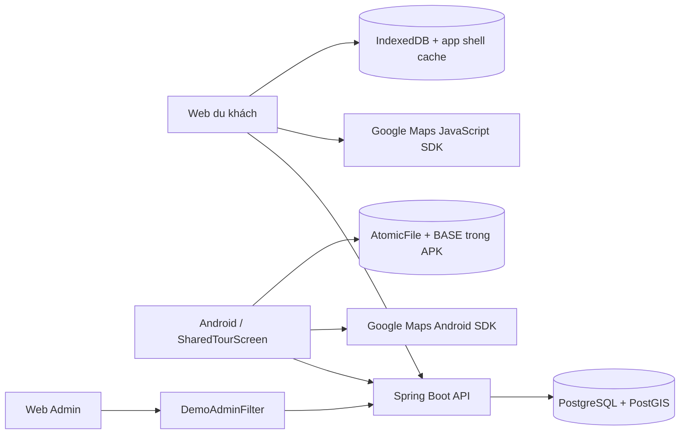
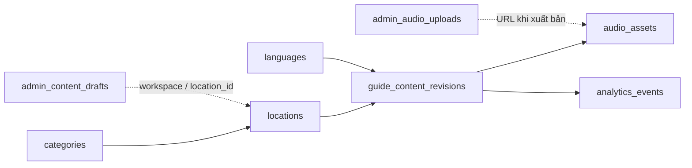
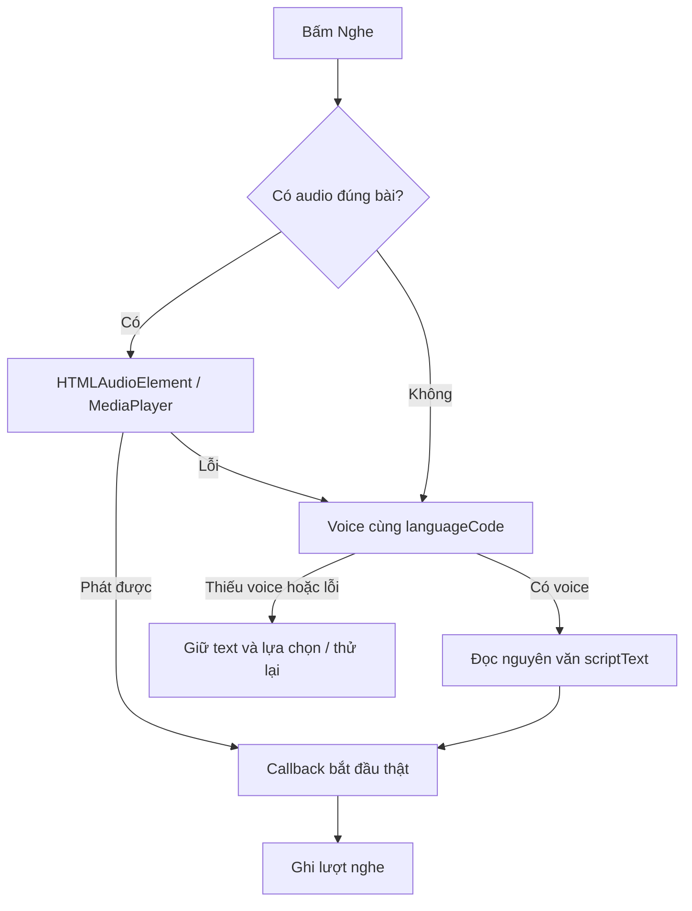
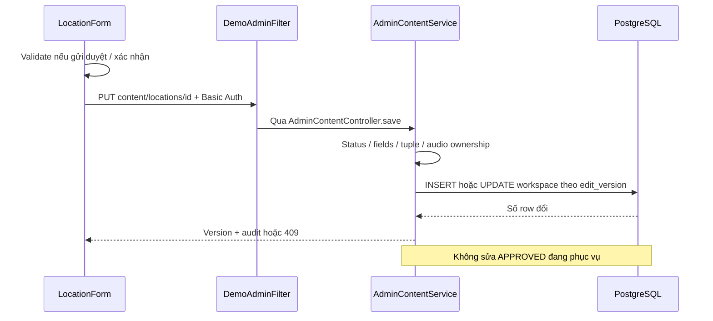

# Hướng dẫn đọc code TravelVoice từ đầu tới cuối

Cập nhật **21/10/2026**, đối chiếu source **`5dd713d`**, branch `codex/web-user-guide-text`. Tài liệu thay mô tả source ngày 19/10 đã cũ; giải thích code hiện có, không xác nhận toàn bộ PRD đã hoàn thành. Yêu cầu: [PRD EN](../en/PRD_Report.md), [PRD VI](PRD_Report_vi.md). Bằng chứng chạy từng mốc: [SESSION_REPORT.md](web-demo-prompts/SESSION_REPORT.md).

**Cách dùng:** mở Markdown Preview (`Ctrl+Shift+V` trong VS Code), bấm tên file rồi tìm tên hàm trong bảng. Link tương đối để đọc trong repository/GitHub. Mỗi mục là một luồng từ thao tác đến API/database; không cần đọc hết file theo thứ tự thư mục.

## Mục lục

| Nhóm             | Luồng cần đọc                                                                                                                |
| ----------------- | -------------------------------------------------------------------------------------------------------------------------------- |
| Nền tảng        | [1. Toàn cảnh](#overview) · [2. Điểm vào/routes](#entry) · [3. Database/fixture](#database)                                  |
| Du khách         | [4. Tìm/chọn điểm](#discovery) · [5. Text/ngôn ngữ](#guide) · [6. Audio/TTS](#playback)                                     |
| Bản đồ/offline | [7. Google Maps](#maps) · [8. Tải gói/offline](#offline)                                                                        |
| Quản trị        | [9. Đăng nhập](#auth) · [10. Form/text/audio](#editor) · [11. Thống kê/Excel](#analytics)                                    |
| Tra cứu          | [12. Feedback/legacy](#legacy) · [13. Cấu hình/APK](#setup) · [14. Test](#tests) · [15. Sửa lỗi từ đâu?](#troubleshooting) |

<a id="overview"></a>

## 1. Toàn cảnh: ai gọi ai?



**Admin và Android không gọi trực tiếp cho nhau.** Admin lưu qua backend; Web/Android đọc nội dung công khai từ cùng backend/database. APK không chứa PostgreSQL. Map nền do Google cung cấp, marker lấy ID/tọa độ từ ứng dụng.

| Khái niệm                  | Ý nghĩa                                                                           |
| ---------------------------- | ----------------------------------------------------------------------------------- |
| locationId                   | UUID địa điểm dùng chung giữa các client                                     |
| Biến thể                   | locationId + languageCode + scriptType; VI/EN/FR/JA/ZH/RU × FULL/SHORT             |
| contentId                    | UUID một revision, khác ID địa điểm                                           |
| Requested/effective language | Ngôn ngữ người dùng chọn / ngôn ngữ API trả sau fallback                   |
| editVersion                  | Phiên bản workspace Admin chống ghi đè; khác revision_no của bài công khai |
| Idempotency/outbox           | Gửi lại event không đếm trùng / hàng đợi sự kiện trên thiết bị        |

Quy tắc chung: bài công khai APPROVED hợp lệ; **Selected → EN → VI**, giữ FULL/SHORT; audio đúng bài trước, TTS nguyên văn theo effective language sau. Nháp/chờ duyệt không tự thay APPROVED.

| Phần                          | Hiện trạng theo source/báo cáo 21/10                                          |
| ------------------------------ | --------------------------------------------------------------------------------- |
| Catalog/text/Admin form/upload | API và PostgreSQL thật ở các màn chính                                      |
| Audio/TTS                      | Adapter media thật; chưa xác nhận đủ sáu voice thật trên mọi thiết bị |
| Google Android / Web           | Android MapFlowTest emulator đạt; Web gần nhất còn gm_authFailure            |
| Offline                        | Gói ký/checksum, lưu thật; trust/key vẫn là cơ chế demo                   |
| Feedback/GPS                   | Feedback prototype; GPS/geofence tự động chưa tích hợp luồng chính        |

Runtime trên lấy từ báo cáo có ngày. Lượt viết hướng dẫn chỉ đọc source/kiểm tra tài liệu, không chạy lại toàn bộ hệ thống.

<a id="entry"></a>

## 2. Điểm vào và điều hướng

### Web du khách

[index.html](../../web-user/index.html) → [main.tsx][w-main]. Routes nằm trong main.tsx, **không có web-user/src/App.tsx**.

| Route                      | File/component                                                   | Trạng thái                                               |
| -------------------------- | ---------------------------------------------------------------- | ---------------------------------------------------------- |
| `/`                      | [LocationEntry.tsx][w-entry] → [LocationCatalog.tsx][w-catalog] | keyword/categoryId/page/view/language/scriptType trong URL |
| `/locations/:locationId` | [GuidePage.tsx][w-guide]                                         | language/scriptType, reload/back giữ lựa chọn           |
| `/offline`               | [OfflinePage.tsx][w-offline]                                     | Kiểm tra, xác nhận tải, hủy, xóa OPTIONAL            |
| Khác                      | Nhánh * của main.tsx                                           | Không tìm thấy trang                                    |

`LocationEntry.openLocation` là phần **dán link**: lấy UUID/query từ URL hợp lệ rồi điều hướng nội bộ. Không tải HTML của URL được dán, không tự quét camera QR; QR chứa URL có thể mở bằng trình duyệt bên ngoài.

### Android

[MainActivity.kt](../../android/app/src/main/java/vn/hvp/travelvoice/MainActivity.kt) → [DemoApp.kt][a-nav] → [SharedTourScreen.kt][a-shared]. Mặc định startDestination="tour".

| Khối                                     | Vai trò                                                                               |
| ----------------------------------------- | -------------------------------------------------------------------------------------- |
| Route tour                                | Danh sách/chọn điểm, bài, bản đồ và nghe                                      |
| Route offline khi shared=true             | SharedTourScreen offlinePage=true → SharedOfflineContent                              |
| SharedNarration                           | Gắn SharedNarrator với Compose/lifecycle và callback ghi lượt                     |
| Kết nối máy chủ / Làm mới nội dung | Base URL trong SharedPreferences demo-server; revision kích hoạt lại LaunchedEffect |

Route explore/detail/player/live cũ giữ cho tương thích/test; xem mục 12.

### Admin và backend

[Admin main.tsx](../../web-admin/src/main.tsx) → [App.tsx][adm-app] tạo router/layout/AdminProvider. `/locations` → LocationList; `/locations/new` và `/locations/:id/edit` → LocationForm. `/analytics` → AnalyticsFeedback chọn LiveAnalytics mặc định, chỉ source=mock vào prototype.

[MultiAudioGuideApplication.java](../../backend/multi-audio-guide/src/main/java/com/application/MultiAudioGuideApplication.java) khởi động Spring. Controller nhận HTTP → service xử lý → repository/JdbcTemplate chạy SQL. **Dùng Spring JDBC, không phải JPA/Hibernate.** AdminContentService và ContentPackageService trực tiếp dùng JdbcTemplate, không có repository riêng.

<a id="database"></a>

## 3. Database và fixture

| Đọc theo thứ tự                        | Nội dung                                                            |
| ------------------------------------------ | -------------------------------------------------------------------- |
| [V1__demo.sql][db1]                        | Schema/PostGIS, catalog, revision/audio, package, feedback/analytics |
| [V2__location_discovery.sql][db2]          | locations.status và ràng buộc APPROVED                            |
| [V2_1__seed_discovery_demo.sql][db21]      | Fixture catalog ban đầu                                            |
| [V3__playback_content_reference.sql][db3]  | analytics_events.content_id                                          |
| [V3_1__seed_short_guides.sql][db31]        | VI/SHORT và WAV cũ                                                 |
| [V3_2__seed_multilingual_guides.sql][db32] | VI/EN × FULL/SHORT cho điểm demo đầu                            |
| [V3_3__seed_district_tour.sql][db33]       | Bảy điểm mới, sáu tiếng, 84 bài                               |
| [V3_4__admin_content_workspace.sql][db34]  | Workspace và bytes audio Admin                                      |

[application.properties][be-properties] đọc db/migration; [application-demo.properties][be-demo-properties] bổ sung db/demo. Không sửa migration đã áp dụng; thay đổi tiếp theo cần migration mới.



Nét đứt là liên hệ nghiệp vụ, không khẳng định FK vật lý trong workspace.

- guide_content_revisions: status/revision_no/script_type/script_text; audio_assets có audio tùy chọn theo revision.
- admin_content_drafts: JSONB payload/edit_version/updated_by/at; admin_audio_uploads: bytes và tuple địa điểm/ngôn ngữ/type.
- analytics_events: UUID chống trùng, content_id, thời điểm server ghi nhận.
- Có bảng content_packages/content_package_items/feedbacks không nghĩa là dịch vụ đã đầy đủ: package demo dựng trực tiếp từ dữ liệu công khai; feedback live chưa có API.

Nguồn: [multilingual_tour_content.md](../en/multilingual_tour_content.md) → [generate-tour-fixture.mjs](../../backend/multi-audio-guide/scripts/generate-tour-fixture.mjs) → V3_3. `--check` đối chiếu nguyên văn, không duyệt độ chính xác.

UUID prefix địa điểm `20000000-0000-0000-0000-000000000`, suffix: **101** Dinh Độc Lập; **102** Nhà hát Thành phố; **103** Nhà thờ Đức Bà; **104** Đại học Sài Gòn cơ sở 2; **105** Bảo tàng Chứng tích Chiến tranh; **106** Bến Nhà Rồng; **107** Bitexco. Category tuyến: `10000000-0000-0000-0000-000000000101`.

Thực có **7 × 6 × 2 = 84 bài**, gồm điểm lân cận ngoài Quận 1. Text/bản dịch/tọa độ cần rà soát; APPROVED trong fixture không thay thẩm định thực tế.

<a id="discovery"></a>

## 4. Tìm/chọn địa điểm — UC-01

**Flow:** từ khóa/bộ điểm → client → GET /api/locations → validate → SQL địa điểm công khai → JSON → mở bài theo UUID.

| Bước        | File                                                                               | Hàm/khối cần xem                                                                        |
| ------------- | ---------------------------------------------------------------------------------- | ------------------------------------------------------------------------------------------ |
| Web thao tác | [LocationCatalog.tsx][w-catalog]                                                   | LocationCatalog/change/submit, query URL, page 0-based                                     |
| Web tải      | Cùng file                                                                         | Results/useEffect: fetch/abort/timeout/rỗng/lỗi; thử gói xác minh khi tải thất bại |
| Android       | [SharedTourScreen][a-shared] → [SharedTourRepository][a-repo] → [DemoApi][a-api] | LaunchedEffect → locations, boolean chỉ nguồn offline                                   |
| HTTP backend  | [LocationController.java][be-loc-controller]                                       | search/detail/categories                                                                   |
| Nghiệp vụ   | [LocationDiscoveryService.java][be-discovery]                                      | keyword/category/page/size                                                                 |
| SQL           | [LocationRepository.java][be-loc-repo], [CategoryRepository.java][be-cat-repo]     | APPROVED/active, ILIKE, escape wildcard, sort/page                                         |
| Response      | [DiscoveryMapper.java][be-mapper]                                                  | Chuyển model thành DTO, không quyết định công khai                                  |

Web size=12; backend mặc định 20 nếu không truyền. Tìm tên ILIKE, chưa có tìm bỏ dấu/AI semantic search. Android tải catalog rồi lọc tên/category trong UI, khác cơ chế phân trang Web. Có tọa độ/index PostGIS chưa chứng minh đã có GPS nearby.

<a id="guide"></a>

## 5. Đọc text, đổi tiếng/FULL–SHORT — UC-02

```http
GET /api/locations/20000000-0000-0000-0000-000000000101/guide?language=FR&scriptType=SHORT
```

| Bước         | File                                                                                   | Cần xem                                                                              |
| -------------- | -------------------------------------------------------------------------------------- | ------------------------------------------------------------------------------------- |
| Web lựa chọn | [GuidePage.tsx][w-guide]                                                               | UUID/query, mặc định VI/FULL; GuideReader key theo selection/attempt               |
| Web HTTP       | [useGuide.ts][w-use-guide]                                                             | fetch, timeout 15s, AbortController + active chống response cũ                      |
| JSON           | [guide.ts][w-model]                                                                    | Selection/Guide/parseGuide: đúng location/type/fallback language, text không rỗng |
| Backend        | [GuideController.java][be-guide-controller] → [PlaybackService.java][be-play-service] | guide: chuẩn hóa/validate và gọi repository                                       |
| SQL            | [GuideRepository.java][be-guide-repo]                                                  | PUBLIC_GUIDE/find/ORDER BY language và revision                                      |
| Android        | [SharedTourScreen][a-shared] → [SharedTourRepository][a-repo] → [DemoApi][a-api]     | selected/language/mode → guide, ServerGuide, nguồn online/offline                   |

SQL: cùng location/type → guide/location APPROVED → category/language active → text có ký tự không trắng → Selected, EN, VI → revision_no mới nhất trong tiếng được chọn. Không có → 404; audioUrl được null.

Thiếu FR/SHORT nhưng có EN/SHORT → EN/SHORT. Chỉ có FR/FULL, không có SHORT ở các fallback → 404. URL giữ tiếng **yêu cầu**, languageCode là tiếng **hiệu lực**; UI thông báo fallback. Text nguyên văn, không dangerouslySetInnerHTML. [GUIDE_API.md](../../backend/GUIDE_API.md).

| Nhánh              | Web                                                  | Android                                          |
| ------------------- | ---------------------------------------------------- | ------------------------------------------------ |
| 404                 | unavailable, không lấy bài offline che 404        | GuideApiException 4xx ném tiếp, không offline |
| Network/5xx         | Thử gói đã xác minh, không có thì lỗi/retry | Thử gói cài/BASE, ghi rõ nguồn              |
| 200 sai dữ liệu   | parseGuide từ chối, không che bằng offline       | Xem validation trong DemoApi.guide               |
| HTTP lỗi khác 404 | useGuide hiện thử offline với response không OK  | Repository chỉ fallback network/5xx             |

Không giả định mọi nhánh lỗi hai client giống tuyệt đối. GuideController không có profile demo; playback/admin/package có điều kiện demo.

<a id="playback"></a>

## 6. Audio/TTS — UC-03



| Nhánh         | File                                            | Hàm/điểm chính                                                                   |
| -------------- | ----------------------------------------------- | ------------------------------------------------------------------------------------ |
| Web UI         | [GuidePlayer.tsx][w-player]                     | GuidePlayback, useSyncExternalStore, controls/onStarted/cleanup                      |
| Web engine     | [playback.ts][w-playback]                       | play/startTts/speak/pause/stop/seek/setRate/networkLost, speechChunks/generation     |
| Android UI     | [SharedTourScreen.kt][a-shared] SharedNarration | remember theo bài, DisposableEffect gọi close, callback event                      |
| Android engine | [SharedNarrator.kt][a-narrator]                 | play/MediaPlayer; useTts/chooseVoice/speak/TextToSpeech; pause/seek/speed/tick/close |

Chọn TTS theo effective language; không có voice đúng tiếng thì lỗi, không dùng tiếng khác. Android ưu tiên voice không cần mạng nếu có. Chưa có backend cloud TTS trong luồng này. Web pause khi tab ẩn; Android quản lý AudioFocus/lifecycle, giải phóng player/engine/listener.

**Seek audio dùng giây; seek TTS theo đoạn/câu**, chưa có time alignment giây như file thu sẵn. Tải text không tự cài voice/đảm bảo voice mạng chạy offline. Chỉ callback bắt đầu thật mới ghi lượt ở mục 11.

<a id="maps"></a>

## 7. Google Maps và vùng Quận 1

| Nhánh  | Đọc theo thứ tự                                                                      | Cần tìm                                                                      |
| ------- | ---------------------------------------------------------------------------------------- | ------------------------------------------------------------------------------ |
| Web     | [LocationCatalog][w-catalog] → [TourMap.tsx][w-map] → [googleMaps.ts][w-map-sdk]       | lazy khi view=map, isDistrictOneStop/loadGoogleMaps/districtOne/gm_authFailure |
| Android | [SharedTourScreen][a-shared] → [MapPreview.kt][a-map-preview] → [MapSession.kt][a-map] | MapPoint/UUID, getMapAsync, setPoints/fitToPoints, MapView lifecycle           |

Web AdvancedMarkerElement có link UUID/language/scriptType. Android marker.tag giữ UUID, callback đổi selected. Nút tên điểm là lựa chọn thay thế; bấm marker không tự phát audio.

Center demo 10.777/106.701, bounds 10.757–10.800 / 106.685–106.714, zoom 14–19; chỉ ghim 101/102/103/107. Điểm lân cận vẫn trong catalog. Web strictBounds, Android giới hạn camera target/zoom. **Khung chữ nhật không phải polygon hành chính**; không khẳng định mọi pixel nền thuộc Quận 1.

gm_authFailure phải hiện chưa được cấp quyền, không báo Ready. Gần nhất Android map thật đạt emulator, Web còn fail auth. [maps.spec.ts](../../web-user/tests/maps.spec.ts) giả SDK; [maps.live.spec.ts](../../web-user/tests/maps.live.spec.ts) kiểm tra Google thật. Map tiles không nằm trong gói offline; key xem mục 13.

<a id="offline"></a>

## 8. Tải gói và offline — UC-04

### Backend chuẩn bị gói

[ContentPackageController.java][be-package-controller] → [ContentPackageService.java][be-package-service]: build/asset/publicKey. [CONTENT_PACKAGE_API.md](../../backend/CONTENT_PACKAGE_API.md) là hợp đồng chung.

| API                                         | Nội dung                                                        |
| ------------------------------------------- | ---------------------------------------------------------------- |
| GET /api/content-packages                   | Hai manifest BASE/OPTIONAL                                       |
| GET /api/content-packages/key               | SPKI public key/keyId, không trả private key                   |
| GET /api/content-packages/{scope}/{version} | Raw UTF-8 JSON đúng version; version không hiện hành → 404 |

build đọc snapshot REPEATABLE_READ, chọn revision APPROVED mới nhất mỗi tuple, checksum từng audio, SHA-256 raw JSON rồi ký RSA. BASE là category tuyến mới; OPTIONAL các điểm còn lại. Version gắn checksum. Không dựng từ workspace chưa duyệt.

### Client tải/xác minh/cài

```text
Kiểm tra manifest → người dùng xác nhận → kiểm tra dung lượng
→ tải key/raw JSON → size/checksum/chữ ký → từng audio/checksum
→ commit nguyên tử theo scope → báo sẵn sàng.
Hủy/lỗi trước commit: giữ bản trước. Chỉ OPTIONAL được xóa.
```

| Nhánh            | File/hàm                                                                                                     | Nơi lưu                                         |
| ----------------- | ------------------------------------------------------------------------------------------------------------- | ------------------------------------------------- |
| Web UI            | [OfflinePage.tsx][w-offline]: check/install/remove, AbortController, confirm                                  | UI chờ commit                                    |
| Web dữ liệu     | [packages.ts][w-packages]: verifyPackage/downloadPackage/installedPackages/offlineGuide/deleteOptionalPackage | IndexedDB travelvoice-content-v1, store packages  |
| Android UI        | [SharedTourScreen][a-shared]: SharedOfflineContent                                                            | Confirm/cancel/progress/bảo vệ BASE             |
| Android dữ liệu | [SharedTourRepository][a-repo]: verify/readRecords/available/download/guide/deleteOptional                    | filesDir/shared-content-v1, AtomicFile mỗi scope |
| BASE trong APK    | [assets/content/base.json](../../android/app/src/main/assets/content/base.json)                                | Envelope đã ký; không phải DemoData giả     |

Xác minh raw bytes **trước parse**, không serialize JSON lại để kiểm chữ ký. Khi đọc offline tiếp tục kiểm tra gói/audio; giữ location/type và fallback Selected → EN → VI.

### App shell khác dữ liệu bài

[main.tsx][w-main] chỉ đăng ký SW ở production; [public/sw.js][w-sw] cache HTML/build assets. API/audio không được SW cache tùy ý; packages.ts quản lý nội dung đã xác minh. Reopen offline cần **app shell cache + gói đã cài**; dev server không chứng minh được. ignoreVary=true cho build asset bất biến cùng origin xử lý Vite Vary: Origin.

Key ký demo tạo lại khi backend restart; public key cùng origin, chưa có publisher trust độc lập/pinning/lịch sử mọi version. Gói không chứa Google tiles hoặc tự cài voice TTS.

<a id="auth"></a>

## 9. Đăng nhập quản trị

**Flow:** form → Authorization trong bộ nhớ tab → GET config → filter xác minh → mở danh sách/form.

| Thứ tự | File                              | Cần xem                                                               |
| -------- | --------------------------------- | ---------------------------------------------------------------------- |
| 1        | [AdminAccess.tsx][adm-access]     | username/password, onAuthenticate, lỗi/focus                          |
| 2        | [AdminProvider.tsx][adm-provider] | AdminProvider/AdminContentGate, config/timeout, chống response cũ    |
| 3        | [admin-content.ts][adm-client]    | AdminSession/adminRequest, Authorization/no-store/status               |
| 4        | [DemoAdminFilter.java][be-filter] | /api/admin/*; thiếu/sai auth → 401, chưa có password server → 503 |

Session dùng chung form/thống kê, reload cần login lại. Không lưu password localStorage/APK. Đây là tài khoản demo cấu hình, chưa phải user/role/JWT production; updatedBy là username chung, chưa phân biệt biên tập viên.

<a id="editor"></a>

## 10. Admin biên tập địa điểm/text/audio — UC-06

### Danh sách → form

[LocationList.tsx][adm-list] GET danh sách thật rồi lọc/phân trang ở client. [LocationRow.tsx](../../web-admin/src/components/locations/LocationRow.tsx) và [LanguageCoverage.tsx](../../web-admin/src/components/locations/LanguageCoverage.tsx) hiển thị text/audio, published và link chỉnh sửa.

[LocationForm.tsx][adm-form] lấy config từ session, GET detail khi có UUID. form.assets dùng khóa như fr:SHORT; mỗi asset giữ locationId/languageCode/scriptType/text/audio. Đổi ngôn ngữ/type không bỏ các biến thể khác.



| Bước          | File/hàm                                                         | Hành vi                                                                                       |
| --------------- | ----------------------------------------------------------------- | ---------------------------------------------------------------------------------------------- |
| Chuẩn bị/lưu | [LocationForm][adm-form]: blankLocation/validate/requestSave/save | UUID mới; draft cho thiếu trường, pending cần name/category/coords/radius nguyên dương |
| Giữ state      | Cùng form: useBlocker/beforeunload, redirect effect              | Lỗi giữ form; lưu đầu chuyển UUID/edit, không mất text khi upload lỗi                 |
| API             | [AdminContentController.java][be-admin-controller]                | config/list/detail/save/upload/preview/public audio                                            |
| SQL/nghiệp vụ | [AdminContentService.java][be-admin-service]                      | published/detail/save: validate và ghi JSONB workspace                                        |
| Storage         | [V3_4][db34]                                                      | admin_content_drafts, edit_version, updated_by/at                                              |

editVersion=0: chưa có workspace, insert đầu version 1. Lưu tiếp gửi version đã đọc; tab khác sửa rồi → 409, không ghi đè. published cho biết APPROVED vẫn đang chạy khi form DRAFT/PENDING_REVIEW.

### Upload/thay một audio

LocationForm.upload → POST multipart → AdminContentService.upload → admin_audio_uploads → merge đúng asset → PUT lưu form.

- Browser kiểm extension/decode preview; backend kiểm header/tuple, tối đa 20 MB cho MP3/WAV/OGG.
- Chỉ merge audio vào biến thể được chọn; giữ text sửa trong lúc upload. Lỗi có retry/chọn tệp khác.
- Upload lưu bytes trước, **chưa đồng nghĩa bản nháp đã lưu hoặc audio công khai**.
- Preview /api/admin/content/audio/{id}.{format} cần auth rồi tạo Blob URL. Public /api/content-audio/{id}.{format} 404 nếu chưa được bản APPROVED tham chiếu.

[ADMIN_CONTENT_API.md](../../backend/ADMIN_CONTENT_API.md): **chưa có API/nút approve/publish**. Cần bên duyệt/xuất bản tạo APPROVED, client tải lại bài/gói. Test external publisher bằng SQL trong DB test không phải chức năng xuất bản đã triển khai.

<a id="analytics"></a>

## 11. Lượt nghe → dashboard → Excel — UC-03/UC-07

### Chỉ ghi khi bắt đầu thật

| Bước     | Web                                                                    | Android                                                                    |
| ---------- | ---------------------------------------------------------------------- | -------------------------------------------------------------------------- |
| Bắt đầu | [playback.ts][w-playback] didStart từ media/TTS callback              | [SharedNarrator][a-narrator] begin/tick/UtteranceProgressListener          |
| Event      | [GuidePlayer][w-player] tạo eventId/contentId                         | [SharedTourScreen][a-shared] SharedNarration nhận eventId                 |
| Gửi       | POST /api/playbacks; lỗi báo cảnh báo, chưa có outbox bền vững | [PlaybackOutbox.kt][a-outbox] enqueueAndFlush → [DemoApi][a-api] playback |

Outbox Android ghi SharedPreferences trước gửi, Mutex chống ghi/gửi đè, gắn event với base URL; chỉ xóa sau server xác nhận. Không phải background worker luôn chạy độc lập ứng dụng.

[DemoPlaybackController.java][be-play-controller] record → [PlaybackService.java][be-play-service] record → [PlaybackRepository.java][be-play-repo]. Cùng eventId/contentId retry không tăng lượt; cùng ID cho content khác → 409. Server tra contentId công khai, suy ra location/language, insert PLAYBACK_STARTED. Mở bài/đổi tiếng không ghi lượt; pause/resume cùng phiên không thêm event.

### Dashboard và export

[AnalyticsFeedback.tsx][adm-analytics-router] → [LiveAnalytics.tsx][adm-live] → [live-analytics.ts][adm-live-hook] useLiveAnalytics → GET /api/admin/analytics → PlaybackService.analytics → PlaybackRepository.count/byLocation/byLanguage.

| Khối          | Hành vi                                                                                                                                                               |
| -------------- | ---------------------------------------------------------------------------------------------------------------------------------------------------------------------- |
| from/to        | URL, mặc định 30 ngày, tối đa 366 ngày                                                                                                                          |
| Refresh        | 5 giây khi tab hiển thị, tránh chồng request, cleanup/abort                                                                                                       |
| Ngày/snapshot | Asia/Ho_Chi_Minh; to inclusive qua đầu ngày kế; REPEATABLE_READ giữ tổng nhất quán                                                                             |
| XLSX           | LiveAnalytics.download → [export.ts](../../web-admin/src/lib/export.ts) exportReport; tạo ở client từ data API, không có endpoint Excel                           |
| Format/UI      | [format.ts](../../web-admin/src/lib/format.ts), [components/ui](../../web-admin/src/components/ui/): Intl vi-VN, Field/Button/ConfirmDialog/AudioPlayer/DataTable/States |

**Giới hạn số liệu:** PlaybackRepository hiện insert is_offline=FALSE; request không truyền cờ offline/thời điểm phát trên thiết bị, occurred_at là lúc server ghi nhận. Có tỷ lệ online/offline không chứng minh đã đo đủ lượt offline. Outbox gửi muộn vẫn qua hợp đồng này.

<a id="legacy"></a>

## 12. Feedback và code legacy

| File/nhánh                                                                                                                                                                                              | Hiện trạng                                                                                                                                               |
| -------------------------------------------------------------------------------------------------------------------------------------------------------------------------------------------------------- | ---------------------------------------------------------------------------------------------------------------------------------------------------------- |
| [AnalyticsFeedback][adm-analytics-router] MockAnalyticsFeedback                                                                                                                                          | source=mock: lọc/xem feedback, NEW → IN_REVIEW → RESOLVED/export; dùng [mocks/data.ts](../../web-admin/src/mocks/data.ts), chưa có feedback API thật |
| [ExploreScreen.kt](../../android/app/src/main/java/vn/hvp/travelvoice/ui/screens/ExploreScreen.kt), [DetailScreen.kt](../../android/app/src/main/java/vn/hvp/travelvoice/ui/screens/DetailScreen.kt)       | Prototype từ [DemoData.kt](../../android/app/src/main/java/vn/hvp/travelvoice/ui/mock/DemoData.kt), tình huống GPS/fallback mẫu                         |
| [PlayerScreen.kt](../../android/app/src/main/java/vn/hvp/travelvoice/ui/screens/PlayerScreen.kt), [OfflineScreen.kt](../../android/app/src/main/java/vn/hvp/travelvoice/ui/screens/OfflineScreen.kt)       | Player/package mô phỏng cũ, khác SharedNarrator/SharedOfflineContent                                                                                   |
| [LiveDemoScreen.kt](../../android/app/src/main/java/vn/hvp/travelvoice/ui/screens/LiveDemoScreen.kt), [DemoNarrator.kt](../../android/app/src/main/java/vn/hvp/travelvoice/platform/audio/DemoNarrator.kt) | Demo backend/audio VI cũ có IO thật, không phải luồng sáu tiếng chính                                                                             |
| [DemoApp.kt][a-nav] shared/startDestination                                                                                                                                                              | Phân biệt tour mặc định và route legacy test chọn riêng                                                                                            |

Admin import **type** từ mocks/data.ts không nghĩa là form lấy fixture: TypeScript xóa type khi build. Lần tới fetch/adminRequest/getFeedback/localStorage/repository để biết nguồn dữ liệu.

<a id="setup"></a>

## 13. Cấu hình, build và APK

| Vấn đề   | File                                                                                                                                   | Cần nhớ                                                                                  |
| ----------- | -------------------------------------------------------------------------------------------------------------------------------------- | ------------------------------------------------------------------------------------------ |
| Backend/DB  | [compose.yaml](../../compose.yaml), [backend README](../../backend/README.md)                                                            | Hiện dùng 8080/3000, bind mặc định 127.0.0.1                                          |
| Profile     | [application-demo.properties][be-demo-properties]                                                                                      | Auth/editor/package/playback cần demo; GuideController không bị profile này giới hạn |
| Web Tourist | [vite.config.ts](../../web-user/vite.config.ts), [README](../../web-user/README.md)                                                      | Dev 5175/preview 4175; proxy API/audio → 8080, API_PROXY_TARGET đổi upstream            |
| Admin       | [vite.config.ts](../../web-admin/vite.config.ts), [nginx.conf](../../web-admin/nginx.conf), [README](../../web-admin/README.md)           | Dev --port 5174, Docker 3000, proxy/upload                                                 |
| Android     | [app/build.gradle.kts](../../android/app/build.gradle.kts), [README](../../android/README.md)                                            | vn.hvp.travelvoice.demo, versionCode 2, emulator 10.0.2.2:8080                             |
| Quyền/HTTP | [AndroidManifest.xml](../../android/app/src/main/AndroidManifest.xml), [debug manifest](../../android/app/src/debug/AndroidManifest.xml) | Quyền mạng/Google metadata, debug cho HTTP local                                         |
| Key Web     | [.env.example](../../web-user/.env.example)                                                                                             | VITE_GOOGLE_MAPS_API_KEY/mapId, giá trị thật .env.local ignored                         |
| Key Android | [secrets.properties.example](../../android/secrets.properties.example)                                                                  | MAPS_API_KEY hoặc ANDROID_MAPS_API_KEY, package/SHA-1 đúng keystore                     |

Admin local hiện ở .env.admin.local root, ignored. Không chép secret vào tài liệu hoặc commit; APK không chứa mật khẩu Admin/DB. Key Maps được build vào client để SDK dùng, cần restriction riêng cho Web và Android.

```powershell
# Trong web-user/
npm.cmd run dev
npm.cmd run lint
npm.cmd run build
# Trong web-admin/
npm.cmd run dev -- --port 5174
# Trong backend/multi-audio-guide/, chỉ đối chiếu, không sửa DB
node scripts/generate-tour-fixture.mjs --check
```

Build APK debug trong android/ theo README:

```powershell
$env:JAVA_HOME='C:\Program Files\Java\jdk-21.0.11'
$env:ANDROID_HOME="$PWD\.sdk"
$env:JAVA_TOOL_OPTIONS="-Djdk.net.unixdomain.tmpdir=$PWD\.java-tmp"
.\gradlew.bat --gradle-user-home .gradle-user-home --no-daemon --no-configuration-cache :app:assembleDebug
```

Output android/app/build/outputs/apk/debug/app-debug.apk là file phát sinh ignored. USB: adb reverse tcp:8080 tcp:8080 rồi nhập http://127.0.0.1:8080/ trong Kết nối máy chủ. Wi-Fi cần bind/firewall/IP LAN; 10.0.2.2 chỉ dành cho emulator.

**Stack cũ:** [start-live-demo.ps1](../../scripts/start-live-demo.ps1) / [LIVE_DEMO_SETUP.md](LIVE_DEMO_SETUP.md) dùng project hvp-live-demo, **8081/3001 và volume riêng**, không phải DB hiện tại 8080/3000. Runbook cũ có mô tả màn lỗi thời; không giả định hai stack/DB tự đồng bộ.

<a id="tests"></a>

## 14. Test: đọc nhánh và giới hạn bằng chứng

### Backend

| Test                                                                                                                                                                                                                                                   | Đọc để hiểu                                                                                         |
| ------------------------------------------------------------------------------------------------------------------------------------------------------------------------------------------------------------------------------------------------------ | -------------------------------------------------------------------------------------------------------- |
| [LocationControllerTest](../../backend/multi-audio-guide/src/test/java/com/application/controller/LocationControllerTest.java), [GuideControllerTest](../../backend/multi-audio-guide/src/test/java/com/application/controller/GuideControllerTest.java) | HTTP binding/default/status, không tự chứng minh SQL                                                  |
| [LocationDiscoveryIntegrationTest](../../backend/multi-audio-guide/src/test/java/com/application/LocationDiscoveryIntegrationTest.java)                                                                                                                 | PostGIS/Flyway, APPROVED/catalog/category/keyword/page                                                   |
| [GuideIntegrationTest](../../backend/multi-audio-guide/src/test/java/com/application/GuideIntegrationTest.java)                                                                                                                                         | Selected → EN → VI, giữ type/latest/nonblank/no-approved                                              |
| [PlaybackIntegrationTest](../../backend/multi-audio-guide/src/test/java/com/application/PlaybackIntegrationTest.java)                                                                                                                                   | Event/idempotency/conflict/thống kê kỳ                                                                |
| [TourPackageIntegrationTest](../../backend/multi-audio-guide/src/test/java/com/application/TourPackageIntegrationTest.java)                                                                                                                             | Package/chữ ký/audio/7 điểm và 84 bài                                                              |
| [AdminContentIntegrationTest](../../backend/multi-audio-guide/src/test/java/com/application/AdminContentIntegrationTest.java)                                                                                                                           | Auth/draft/pending/409/published/upload/private/public audio, external publication mô phỏng trong test |

Integration test cần TEST_DATABASE_URL/USERNAME/PASSWORD trỏ PostGIS riêng, không DB demo. Kiểm tra cả **skip**, không chỉ số PASS.

### Client

| Test                                                                                                                                                                                     | Nguồn thật/giả                                                                                               |
| ---------------------------------------------------------------------------------------------------------------------------------------------------------------------------------------- | --------------------------------------------------------------------------------------------------------------- |
| [guide.spec.ts](../../web-user/tests/guide.spec.ts), [playback.spec.ts](../../web-user/tests/playback.spec.ts)                                                                             | Giả API/media/TTS, kiểm tra UI/stale/controls, không chứng minh DB/voice                                    |
| [guide.live.spec.ts](../../web-user/tests/guide.live.spec.ts), [tour.live.spec.ts](../../web-user/tests/tour.live.spec.ts)                                                                 | LIVE_GUIDE_API=1, backend/DB thật; text/fallback/12 biến thể/WAV/event                                       |
| [offline.live.spec.ts](../../web-user/tests/offline.live.spec.ts), [offline config](../../web-user/playwright.offline.config.ts)                                                           | Gói thật + production SW; có ca cố ý sửa bytes kiểm tra từ chối                                        |
| [maps.spec.ts](../../web-user/tests/maps.spec.ts), [maps config](../../web-user/playwright.maps.config.ts)                                                                                 | SDK giả/dummy key, camera/ID/error                                                                             |
| [maps.live.spec.ts](../../web-user/tests/maps.live.spec.ts), [Google live config](../../web-user/playwright.google-live.config.ts)                                                         | LIVE_GOOGLE_MAPS=1, SDK/key/tiles thật                                                                         |
| [content.live.spec.ts](../../web-admin/tests/content.live.spec.ts), [content config](../../web-admin/playwright.content-live.config.ts)                                                    | LIVE_CONTENT_API=1, Admin 3000/auth/DB thật; row test cần dọn đúng UUID                                    |
| [SharedContentTest.kt](../../android/app/src/test/java/vn/hvp/travelvoice/SharedContentTest.kt), [DemoApiUrlTest.kt](../../android/app/src/test/java/vn/hvp/travelvoice/DemoApiUrlTest.kt) | Unit/host, chữ ký/URL, không thay native runtime                                                             |
| [SharedTourFlowTest.kt](../../android/app/src/androidTest/java/vn/hvp/travelvoice/SharedTourFlowTest.kt)                                                                                  | Instrumentation nguồn server/sáu tiếng/FR-SHORT/BASE bảo vệ                                                |
| [MapFlowTest.kt](../../android/app/src/androidTest/java/vn/hvp/travelvoice/MapFlowTest.kt)                                                                                                | Google SDK thật, ready/camera/đúng bài, không autoplay                                                     |
| [LivePlaybackTest.kt](../../android/app/src/androidTest/java/vn/hvp/travelvoice/LivePlaybackTest.kt)                                                                                      | Audio/analytics demo cũ; xem endpoint/credentials trước chạy, không suy ra sáu voice SharedNarrator đạt |

Theo SESSION_REPORT 21/10: backend 87 PASS/0 skip, Admin live 3 PASS; Web guide/tour 4 PASS, offline 2 PASS, map adapter 4 PASS; Android 11 unit, SharedTourFlowTest/MapFlowTest mỗi 1 PASS. **Web Google live còn FAIL auth.** Không chạy lại các suite trong lượt viết docs; không coi local là CI/CD.

<a id="troubleshooting"></a>

## 15. Tra cứu nhanh khi sửa lỗi

| Hiện tượng                     | Mở trước → tiếp theo                                                                                              |
| --------------------------------- | ---------------------------------------------------------------------------------------------------------------------- |
| Text cũ đè sau đổi tiếng    | [GuidePage][w-guide]/[useGuide][w-use-guide] → parseGuide → GuideRepository                                          |
| Chọn FR, hiện EN                | [GuideRepository][be-guide-repo] → ORDER BY language/status/text/cùng type                                           |
| Admin lưu, Android chưa đổi   | [AdminContentService.save][be-admin-service] → workspace khác published, cần bên xuất bản rồi refresh/gói mới |
| Reload Admin phải login          | [AdminProvider][adm-provider] → auth trong bộ nhớ tab                                                               |
| Lưu báo 409                     | [LocationForm][adm-form] → editVersion, giữ form/đọc bản mới                                                     |
| Preview audio có, du khách 404  | [AdminContentService.audio][be-admin-service] → cần APPROVED tham chiếu                                             |
| Có text, không nói             | [GuidePlayback][w-playback]/[SharedNarrator][a-narrator] → URL/voice/timeout/lifecycle/focus                          |
| Lượt nghe trùng/không tăng   | [GuidePlayer][w-player]/[PlaybackOutbox][a-outbox] → start/eventId → PlaybackService.record                          |
| Có gói, Web offline trắng      | [sw.js][w-sw] → app shell production/cache → IndexedDB                                                               |
| Android có bài khi backend tắt | [SharedTourRepository][a-repo] → gói/BASE xác minh, không mặc định gọi là mock                                |
| Web gm_authFailure                | [googleMaps.ts][w-map-sdk]/[TourMap][w-map] → đúng key Web/API/billing/restriction, tách key Android               |
| APK vẫn là màn giả            | [DemoApp][a-nav] → đúng version 2/startDestination tour/base URL                                                    |
| Data khác giữa máy             | [compose.yaml](../../compose.yaml) → port/project/volume, nhất là stack 8081/3001                                    |

### Một vòng đọc để bắt đầu

Chọn **Dinh Độc Lập / FR / SHORT**, lần theo:

```text
LocationCatalog hoặc SharedTourScreen
→ GET guide → GuideController → PlaybackService.guide → GuideRepository.find
→ scriptText/languageCode/contentId trả về client
→ GuidePlayer hoặc SharedNarration → audio/TTS bắt đầu thật
→ eventId + contentId → PlaybackService.record → analytics_events
→ LiveAnalytics → PlaybackService.analytics → số liệu / exportReport.
```

Sau đó đọc Admin sửa FR/SHORT → workspace → pending và giải thích vì sao bài du khách chưa đổi. Với mỗi chức năng, chỉ được **file nhận thao tác, hàm gọi API, SQL chạm bảng nào và test kiểm tra nhánh đó** là bạn đã nắm luồng.

<!-- Link tính từ docs/vi/. -->

[w-main]: ../../web-user/src/main.tsx
[w-entry]: ../../web-user/src/pages/LocationEntry.tsx
[w-catalog]: ../../web-user/src/components/LocationCatalog.tsx
[w-guide]: ../../web-user/src/pages/GuidePage.tsx
[w-use-guide]: ../../web-user/src/lib/useGuide.ts
[w-model]: ../../web-user/src/lib/guide.ts
[w-player]: ../../web-user/src/components/GuidePlayer.tsx
[w-playback]: ../../web-user/src/lib/playback.ts
[w-map]: ../../web-user/src/components/TourMap.tsx
[w-map-sdk]: ../../web-user/src/lib/googleMaps.ts
[w-offline]: ../../web-user/src/pages/OfflinePage.tsx
[w-packages]: ../../web-user/src/lib/packages.ts
[w-sw]: ../../web-user/public/sw.js
[a-nav]: ../../android/app/src/main/java/vn/hvp/travelvoice/ui/navigation/DemoApp.kt
[a-shared]: ../../android/app/src/main/java/vn/hvp/travelvoice/ui/screens/SharedTourScreen.kt
[a-repo]: ../../android/app/src/main/java/vn/hvp/travelvoice/data/remote/SharedTourRepository.kt
[a-api]: ../../android/app/src/main/java/vn/hvp/travelvoice/data/remote/DemoApi.kt
[a-outbox]: ../../android/app/src/main/java/vn/hvp/travelvoice/data/remote/PlaybackOutbox.kt
[a-narrator]: ../../android/app/src/main/java/vn/hvp/travelvoice/platform/audio/SharedNarrator.kt
[a-map-preview]: ../../android/app/src/main/java/vn/hvp/travelvoice/ui/components/MapPreview.kt
[a-map]: ../../android/app/src/main/java/vn/hvp/travelvoice/platform/maps/MapSession.kt
[adm-app]: ../../web-admin/src/App.tsx
[adm-access]: ../../web-admin/src/components/AdminAccess.tsx
[adm-provider]: ../../web-admin/src/components/AdminProvider.tsx
[adm-client]: ../../web-admin/src/lib/admin-content.ts
[adm-list]: ../../web-admin/src/pages/LocationList.tsx
[adm-form]: ../../web-admin/src/pages/LocationForm.tsx
[adm-analytics-router]: ../../web-admin/src/pages/AnalyticsFeedback.tsx
[adm-live]: ../../web-admin/src/pages/LiveAnalytics.tsx
[adm-live-hook]: ../../web-admin/src/lib/live-analytics.ts
[be-loc-controller]: ../../backend/multi-audio-guide/src/main/java/com/application/controller/LocationController.java
[be-discovery]: ../../backend/multi-audio-guide/src/main/java/com/application/service/LocationDiscoveryService.java
[be-loc-repo]: ../../backend/multi-audio-guide/src/main/java/com/application/repository/LocationRepository.java
[be-cat-repo]: ../../backend/multi-audio-guide/src/main/java/com/application/repository/CategoryRepository.java
[be-mapper]: ../../backend/multi-audio-guide/src/main/java/com/application/mapper/DiscoveryMapper.java
[be-guide-controller]: ../../backend/multi-audio-guide/src/main/java/com/application/controller/GuideController.java
[be-play-service]: ../../backend/multi-audio-guide/src/main/java/com/application/service/PlaybackService.java
[be-guide-repo]: ../../backend/multi-audio-guide/src/main/java/com/application/repository/GuideRepository.java
[be-package-controller]: ../../backend/multi-audio-guide/src/main/java/com/application/controller/ContentPackageController.java
[be-package-service]: ../../backend/multi-audio-guide/src/main/java/com/application/service/ContentPackageService.java
[be-filter]: ../../backend/multi-audio-guide/src/main/java/com/application/config/DemoAdminFilter.java
[be-admin-controller]: ../../backend/multi-audio-guide/src/main/java/com/application/controller/AdminContentController.java
[be-admin-service]: ../../backend/multi-audio-guide/src/main/java/com/application/service/AdminContentService.java
[be-play-controller]: ../../backend/multi-audio-guide/src/main/java/com/application/controller/DemoPlaybackController.java
[be-play-repo]: ../../backend/multi-audio-guide/src/main/java/com/application/repository/PlaybackRepository.java
[be-properties]: ../../backend/multi-audio-guide/src/main/resources/application.properties
[be-demo-properties]: ../../backend/multi-audio-guide/src/main/resources/application-demo.properties
[db1]: ../../backend/multi-audio-guide/src/main/resources/db/migration/V1__demo.sql
[db2]: ../../backend/multi-audio-guide/src/main/resources/db/migration/V2__location_discovery.sql
[db21]: ../../backend/multi-audio-guide/src/main/resources/db/demo/V2_1__seed_discovery_demo.sql
[db3]: ../../backend/multi-audio-guide/src/main/resources/db/migration/V3__playback_content_reference.sql
[db31]: ../../backend/multi-audio-guide/src/main/resources/db/demo/V3_1__seed_short_guides.sql
[db32]: ../../backend/multi-audio-guide/src/main/resources/db/demo/V3_2__seed_multilingual_guides.sql
[db33]: ../../backend/multi-audio-guide/src/main/resources/db/demo/V3_3__seed_district_tour.sql
[db34]: ../../backend/multi-audio-guide/src/main/resources/db/demo/V3_4__admin_content_workspace.sql
